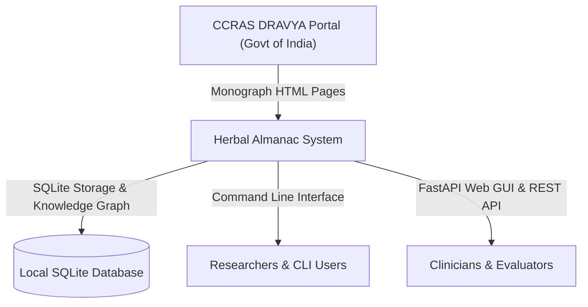

# Herbal Almanac

Herbal Almanac is a Python research library, command-line interface, and local web application for exploring Ayurvedic herbs, clinical indications, pharmacological properties (*Dravyaguna*), and herb-treatment relationships. The primary data adapter ingests monographs from the CCRAS DRAVYA portal.

> **Research disclaimer:** This software is for educational, historical, and software evaluation purposes only. It is **not medical advice**. Scraped therapeutic associations, botanical classifications, and machine translations may be unverified and must not be used to diagnose, treat, cure, or prevent any illness.

---

## Architecture & Data Flow

### Level 0: System Context Diagram


### Level 1: System Data Flow Diagram

```mermaid
flowchart LR
    SRC["CCRAS DRAVYA Website"] --> SCRAPE["1. Scraper (scrapper.py)"]
    SCRAPE --> CLEAN["2. Cleaning & Validation (cleaning.py)"]
    CLEAN -->|Optional --translate| TRANS["3. Translation (translation.py)"]
    CLEAN --> SQLITE["4. SQLite Persistence (database_operator.py)"]
    TRANS --> SQLITE
    SQLITE --> STAGE_B["5. Operational Provenance (sources, source_claims, taxa)"]
    STAGE_B --> STAGE_C["6. Semantic Backfill (backfill_engine.py & concept_catalog.py)"]
    STAGE_C --> VIEW["7. View-Model Layer (herb_view.py & illness_glossary.py)"]
    STAGE_C --> CLI["8. Typer CLI (cli.py)"]
    VIEW --> WEB["9. Web GUI & REST API (web_app.py)"]
    CLI --> USERS["CLI Researchers"]
    WEB --> BROWSERS["Web Users & Evaluators"]
```


---

## Database Entity-Relationship Diagram

Built from the actual SQLite application schema (`database_operator.py`) and Stage C DDL (`migrations/*.sql`):

```mermaid
erDiagram
    herbs ||--o{ treatment : "links"
    illness ||--o{ treatment : "references"
    herbs ||--o{ herb_attributes : "has"
    herbs ||--o{ herb_doshas : "has"

    sources ||--o{ source_records : "provides"
    source_records ||--o{ source_claims : "contains"
    source_claims ||--o{ source_claims : "supersedes"

    herbs ||--|| legacy_herb_map : "maps"
    herbs ||--o{ herb_names : "named"
    source_claims ||--o{ herb_names : "verifies"

    taxa ||--o{ taxon_relationships : "subject"
    taxa ||--o{ taxon_relationships : "object"
    source_claims ||--o{ taxon_relationships : "verifies"
    herbs ||--o{ herb_taxa : "classified"
    taxa ||--o{ herb_taxa : "applies_to"
    source_claims ||--o{ herb_taxa : "verifies"

    dravyaguna_concepts ||--o{ dravyaguna_concepts : "parent"
    dravyaguna_concepts ||--o{ concept_labels : "labeled_by"
    concept_labels ||--o{ concept_label_sources : "cited_by"

    source_claims ||--o{ concept_claim_mappings : "mapped_from"
    dravyaguna_concepts ||--o{ concept_claim_mappings : "maps_to"

    herbs ||--o{ herb_dravyaguna_properties : "has"
    concept_claim_mappings ||--o{ herb_dravyaguna_properties : "grounds"
    dravyaguna_concepts ||--o{ herb_dravyaguna_properties : "part_concept"

    source_claims ||--o{ dosha_claim_assertions : "asserts"
    dravyaguna_concepts ||--o{ dosha_claim_assertions : "dosha"
    dravyaguna_concepts ||--o{ dosha_claim_assertions : "effect"

    herbs ||--o{ herb_dosha_effects : "has"
    dosha_claim_assertions ||--o{ herb_dosha_effects : "grounded_in"

    herbs ||--o{ herb_plant_parts : "uses"
    concept_claim_mappings ||--o{ herb_plant_parts : "part_mapping"

    herbs ||--o{ herb_preparations : "formulated_as"
    concept_claim_mappings ||--o{ herb_preparations : "prep_mapping"

    herbs ||--o{ herb_indications : "treats"
    concept_claim_mappings ||--o{ herb_indications : "ind_mapping"

    herbs {
        int id PK
        string english_name
        string original_name
        string botanical_name
        string family
        string source
        int source_record_id
        string source_url
        string retrieved_at
    }
    illness {
        int id PK
        string english_name
        string canonical_key
        int machine_generated
        string verification_status
    }
    treatment {
        int herb_id PK
        int illness_id PK
        string source
    }
    herb_attributes {
        int herb_id PK
        string field_name PK
        string value PK
        string source_text
        string source_language
        int machine_generated
        string verification_status
    }
    herb_doshas {
        int herb_id PK
        string dosha PK
        string effect
        string source_expression PK
        string source PK
    }
    sources {
        int source_id PK
        string source_key
        string publisher
    }
    source_records {
        int source_record_id PK
        int source_id FK
        string external_record_key
    }
    source_claims {
        int source_claim_id PK
        int source_record_id FK
        string claim_type
        string source_field
        string source_expression
        string language_code
        string verification_status
        int supersedes_claim_id FK
    }
    legacy_herb_map {
        int legacy_herb_id PK
        int herb_id FK
        string created_at
    }
    herb_names {
        int herb_name_id PK
        int herb_id FK
        string name_text
        string language_code
        string name_type
        int source_claim_id FK
    }
    taxa {
        int taxon_id PK
        string canonical_name
        string rank
    }
    taxon_relationships {
        int relationship_id PK
        int subject_taxon_id FK
        int object_taxon_id FK
        string relationship_type
        int source_claim_id FK
    }
    herb_taxa {
        int herb_taxon_id PK
        int herb_id FK
        int taxon_id FK
        int source_claim_id FK
    }
    dravyaguna_concepts {
        int concept_id PK
        string concept_code
        string concept_domain
        string canonical_sanskrit_deva
        string canonical_sanskrit_iast
        int parent_concept_id FK
    }
    concept_labels {
        int concept_label_id PK
        int concept_id FK
        string language_code
        string label_text
        int is_preferred
    }
    concept_label_sources {
        int label_source_id PK
        int concept_label_id FK
        string treatise_citation
    }
    concept_claim_mappings {
        int mapping_id PK
        int source_claim_id FK
        int concept_id FK
        string mapping_type
        float mapping_confidence
    }
    herb_dravyaguna_properties {
        int herb_property_id PK
        int herb_id FK
        int mapping_id FK
        int part_concept_id FK
    }
    dosha_claim_assertions {
        int dosha_assertion_id PK
        int source_claim_id FK
        int dosha_concept_id FK
        int effect_concept_id FK
    }
    herb_dosha_effects {
        int herb_dosha_effect_id PK
        int herb_id FK
        int dosha_assertion_id FK
    }
    herb_plant_parts {
        int herb_part_id PK
        int herb_id FK
        int mapping_id FK
    }
    herb_preparations {
        int herb_preparation_id PK
        int herb_id FK
        int prep_mapping_id FK
        int part_mapping_id FK
    }
    herb_indications {
        int herb_indication_id PK
        int herb_id FK
        int mapping_id FK
    }
```



---

## Installation

Python 3.10 or later is required. Install from the repository root:

- **Core CLI and Library (Default):**
  ```bash
  python -m pip install -e .
  ```
  *Provides the `herbal-almanac` CLI, SQLite database operator, scraper, DDL migrations, and demo generator (`scripts/make_demo_db.py`). No web dependencies required.*

- **Web Interface Extra (`[web]`):**
  ```bash
  python -m pip install -e ".[web]"
  ```
  *Required for running the local FastAPI web server (`uvicorn herbal_almanac.web_app:app`) and browsing the web GUI.*

- **Translation Extra (`[translate]`):**
  ```bash
  python -m pip install -e ".[translate]"
  ```
  *Optional. Required only when running scraper with the `--translate` flag.*

- **Development Extra (`[dev]`):**
  ```bash
  python -m pip install -e ".[dev]"
  ```
  *For running tests (`pytest`), packaging checks (`build`), and smoke testing.*

> **Windows Note:** If Windows Application Control or Smart App Control restricts `.exe` launcher stubs, prefix commands with `python -m`:
> - `python -m pip install ...`
> - `python -m herbal_almanac ...`
> - `python -m uvicorn herbal_almanac.web_app:app --reload`

---

## Demo in 5 minutes

Evaluate the full Herbal Almanac system—including the Typer CLI, FastAPI Web GUI, Stage B provenance tracking, and Stage C semantic Dravyaguna features—in under 5 minutes.

### 1. Install with Web Dependencies

```bash
python -m pip install -e ".[web]"
```

### 2. Build the Demo Database

Choose either the instant offline demo database (recommended for quick evaluation without network calls) or a live scrape:

**Option A: Instant Offline Demo Database (Recommended)**
```bash
python scripts/make_demo_db.py
```
*Builds `data/demo.db` offline from `sample.html`, creates 2 manual illnesses and treatment links, applies Stage C Migration 3, seeds the 136-concept catalog, and runs semantic backfill.*

**Option B: Live Scrape (Requires Internet Access to CCRAS DRAVYA)**
```bash
herbal-almanac setup --database data/demo.db
herbal-almanac scrape dravya --max-plants 25 --database data/demo.db
herbal-almanac upgrade-stage-c --database data/demo.db --yes
```

### 3. Launch the Web Interface

Point the application to the demo database and start the server:

- **Linux / macOS:**
  ```bash
  HERBAL_ALMANAC_DATABASE=data/demo.db uvicorn herbal_almanac.web_app:app --reload
  ```
- **Windows (PowerShell):**
  ```powershell
  $env:HERBAL_ALMANAC_DATABASE="data/demo.db"; uvicorn herbal_almanac.web_app:app --reload
  ```
- **Windows (Command Prompt):**
  ```cmd
  set HERBAL_ALMANAC_DATABASE=data/demo.db && uvicorn herbal_almanac.web_app:app --reload
  ```

### 4. Pages to Open in Your Browser

Open `http://127.0.0.1:8000` and explore:

1. **User Guide & Ayurveda Primer (`/guide`):** Introductory guide and conceptual reference explaining what the site is, 3 numbered navigation flows with dynamic examples, a 19-term glossary of classical Ayurvedic concepts (Rasa, Guna, Virya, Vipaka, Prabhava, Doshas) and architectural mechanisms (Claims, Concepts, Provenance, Virya Reconciliation), data sources, and research safety boundaries.
2. **Dashboard (`/`):** Summary cards displaying counts of herbs, illnesses, treatment relationships, and attributes alongside recent herbs, top frequent conditions, and search inputs. Includes a prominent "New here? Read the guide" callout.
3. **Herb Catalog (`/herbs`):** Searchable, paginated directory of herbs with text filtering and pagination. Supports search in English, Latin botanical names, transliteration, and native Indic scripts (e.g. "तुलसी").
4. **Semantic Herb Detail (`/herbs/1`):** Complete Stage C presentation showcasing:
   - **Unified 6-Column Matrix:** Rasa (taste), Guna (qualities), Virya (potency), Vipaka (post-digestive effect), Prabhava (specific action), and Karma (actions) in a single deduped row with claim badges (`×N`) and collapsible source details.
   - **3-Row Dosha Table:** Deterministic Vata, Pitta, and Kapha states with explicit "Not recorded" fallback.
   - **Structured Characteristics:** Vernacular names across regional languages, officinal plant parts (Prayojyāṅga), preparations, dosage statements, and classical etymology.
   - **Virya Consensus Indicator:** Consensus status and direct link to the Virya reconciliation dashboard.
5. **Illness Explorer (`/illnesses`):** Therapeutic index of conditions with:
   - **15-Language Selector:** Switch between 15 Indian languages (English, हिन्दी, संस्कृतम्, বাংলা, தமிழ், తెలుగు, etc.) with native script buttons and URL persistence (`?language=hi`).
   - **Multilingual Search:** Query conditions by English common name ("fever", "cough", "piles"), classical transliteration ("jvara", "kasa", "arsha"), or vernacular scripts ("बुखार", "खांसी", "बवासीर").
   - **Heading Hierarchy:** Readable English primary heading, localized native script subtitle, and original scraped transliteration in code tags.
6. **Illness Detail (`/illnesses/1`):** Detailed condition profile listing all associated herbs with distinct badges for scraped vs. manually curated links.
7. **Virya Reconciliation Dashboard (`/stage-c/reconciliation/1`):** Detailed 4-tier audit report classifying concordance across sources, candidate divergence, and intra-claim ambiguity.
8. **REST JSON Endpoints:**
   - Herb Semantic Profile: `GET /api/stage-c/herbs/1/profile`
   - Illness Search: `GET /api/illnesses?q=`
   - Condition Herbs: `GET /api/illnesses/1/herbs`

### 5. CLI Commands to Show

Demonstrate the command-line interface against the demo database:

```bash
# 1. Inspect Stage C schema capability, migration ledger, and table counts
herbal-almanac stage-c-status --database data/demo.db

# 2. Search and list herbs
herbal-almanac herbs --database data/demo.db

# 3. List illnesses (shows both scraped and manually curated illnesses)
herbal-almanac illnesses --database data/demo.db

# 4. View treatment links for Herb 1 (distinguishes scraped from manual treatments)
herbal-almanac treatments 1 --database data/demo.db

# 5. Inspect extracted section attributes
herbal-almanac attributes 1 --database data/demo.db

# 6. Export the full database to a single JSON archive
herbal-almanac records all --format json --output demo_records.json --database data/demo.db
```

---

## Documentation Index

Comprehensive project documentation is organized in `documentations/`:

- **[Project Plan & SDLC Roadmap](documentations/plan.md):** Architectural principles, milestone history, future roadmap, and pre-push verification checklist.

### Package Modules (`src/herbal_almanac/`)
- **[backfill_engine.md](documentations/backfill_engine.md):** Semantic ingestion engine migrating Stage B claims to Stage C concepts.
- **[claim_lifecycle.md](documentations/claim_lifecycle.md):** State transitions for claims (supersede, restore, reject, review).
- **[cleaning.md](documentations/cleaning.md):** Unicode NFC normalization, ASCII transliteration, and Dosha expression parsing.
- **[cli.md](documentations/cli.md):** Typer command line interface commands and console entry points.
- **[concept_catalog.md](documentations/concept_catalog.md):** Canonical Dravyaguna concept catalog across 11 domains and 640+ multilingual labels.
- **[database_operator.md](documentations/database_operator.md):** SQLite CRUD operator, migrations, concurrency management, and schema reference.
- **[herb_view.md](documentations/herb_view.md):** Pure view-model functions for property deduplication and attribute grouping.
- **[illness_glossary.md](documentations/illness_glossary.md):** Multilingual illness translation across 15 Indian languages and catalog precedence.
- **[repository_api.md](documentations/repository_api.md):** Read-only presentation service for Dravyaguna profiles and Virya reconciliation.
- **[schema_capability_gate.md](documentations/schema_capability_gate.md):** Migration ledger inspection and Version 2/3 capability gating.
- **[scrapper.md](documentations/scrapper.md):** CCRAS DRAVYA discovery, HTTP fetching, and HTML monograph parsing.
- **[translation.md](documentations/translation.md):** Optional English machine translation adapter and protocol.
- **[web_app.md](documentations/web_app.md):** FastAPI read-only presentation layer, Jinja2 routing, and REST endpoints.

### Scripts (`scripts/`)
- **[illness_coverage.md](documentations/illness_coverage.md):** Audit script reporting database glossary resolution and catalog conflicts.
- **[make_demo_db.md](documentations/make_demo_db.md):** Offline demo database generator from local test fixtures.
