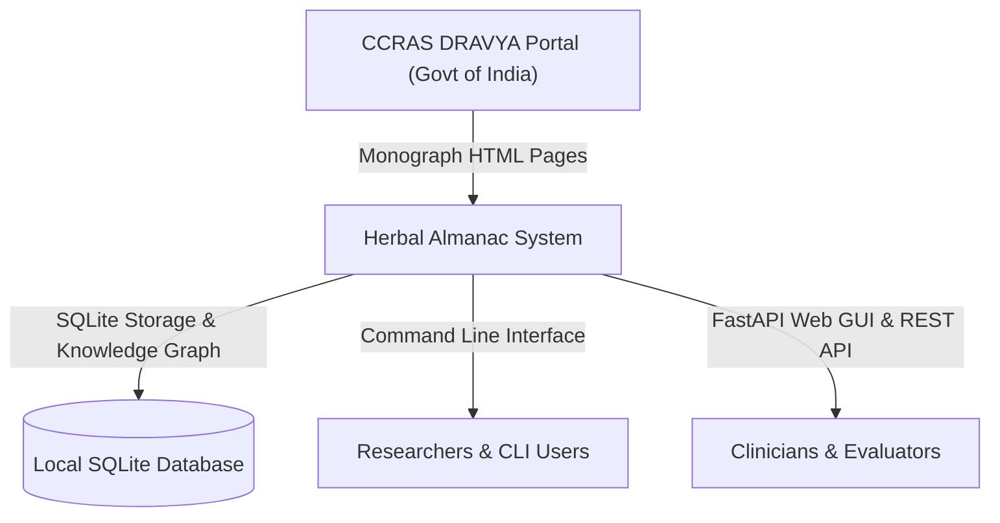

# Herbal Almanac

Herbal Almanac is a Python research library, command-line interface, and local web application for exploring Ayurvedic herbs, clinical indications, pharmacological properties (*Dravyaguna*), and herb-treatment relationships. The primary data adapter ingests monographs from the CCRAS DRAVYA portal.

> **Research disclaimer:** This software is for educational, historical, and software evaluation purposes only. It is **not medical advice**. Scraped therapeutic associations, botanical classifications, and machine translations may be unverified and must not be used to diagnose, treat, cure, or prevent any illness.

---

## 1. Project Objectives

The primary objectives are:

1. Collect Ayurvedic medicinal plant information from structured online sources (CCRAS DRAVYA portal).
2. Extract botanical identity, vernacular names, and Dravyaguna properties.
3. Preserve original source terminology and source expressions verbatim.
4. Normalize Unicode text (NFC) and generate ASCII transliterations for search indexing.
5. Convert scraped records into structured SQLite entities.
6. Maintain source-level provenance, claim status history, and audit lineage.
7. Map traditional terminology to a controlled Dravyaguna concept vocabulary (136 canonical concepts, 649 labels).
8. Provide searchable information through a Python API, Typer CLI, and FastAPI local web interface.
9. Keep extracted evidence distinguishable from interpretations and machine-generated information.

### Core Architectural Principle

**Normalization must never destroy the original source information.**

For example, when a source monograph records the Dosha expression:

`KaphaVātahara`

The application normalizes and derives:
- **Kapha** -> `decrease`
- **Vata** -> `decrease`
- **Pitta** -> `unspecified`

However, the raw source expression `KaphaVātahara`, the retrieval timestamp, the monograph URL, and the source claim ID remain permanently preserved in the database for auditability and verification.

---

## 2. Architectural Stages

| Stage | Responsibility | Implementation | Status |
|---|---|---|---|
| **Initial Core** | Scraping, cleaning, validation, SQLite storage | `scrapper.py`, `cleaning.py`, `database_operator.py` | Complete |
| **Stage B** | Operational provenance and botanical taxonomy | Migrations 1 & 2 (`sources`, `source_claims`, `taxa`) | Complete |
| **Stage C** | Normalized Dravyaguna knowledge model | Migration 3, `concept_catalog.py`, `backfill_engine.py`, `herb_view.py` | Complete |
| **Stage E** | Web parity, multilingual herb search, exports & accessibility | Web forms, `herb_glossary.py`, CSV/JSON exports, WCAG 2.1 AA | Complete |
| **Stage D** | Multi-source evidence integration | Statutory pharmacopoeias, independent replication scoring | Design Proposal |

### Initial Core
Establishes the fundamental ingestion pipeline:
- CCRAS DRAVYA directory pagination and plant discovery.
- HTTP retrieval with rate limiting, timeouts, and exponential backoff retries.
- Dynamic BeautifulSoup HTML table parsing.
- Unicode NFC normalization and ASCII transliteration.
- Classical Dosha expression normalization.
- SQLite insertion with relational links between herbs and illnesses.
- Typer CLI commands for searching and inspecting records.

### Stage B – Operational Provenance
Introduces complete source traceability and taxonomic lineage:
- Storing the publisher (`sources`), retrieved monograph (`source_records`), and individual claims (`source_claims`).
- Preserving verbatim source expressions and verification statuses.
- Botanical taxonomy relationships (`taxa`, `taxon_relationships`, `herb_taxa`).
- Backward-compatible schema versioning (Schema Version 2: `[1, 2]`).

### Stage C – Semantic Dravyaguna Architecture
Adds a controlled vocabulary, semantic claim mapping, and view-model layer:
- `concept_catalog.py`: 136 canonical concepts and 649 multilingual labels.
- `schema_capability_gate.py`: Strict schema version verification (`[1, 2]` vs `[1, 2, 3]`).
- `claim_lifecycle.py`: Auditable claim review and interpretation transitions.
- `backfill_engine.py`: Transactional semantic backfill mapping claims to concepts.
- `repository_api.py`: Multi-concept search, localized profiles, and Virya reconciliation.
- `herb_view.py`: View-model deduplication and presentation grouping.
- `illness_glossary.py`: 15-language vernacular condition glossary.
- `web_app.py`: FastAPI web interface with responsive dashboard and guides.

### Stage D – Multi-source Evidence Integration (Design Only)
A future architectural proposal for cross-source epistemic integration:
- Ingestion adapters for statutory pharmacopoeias (e.g. Ayurvedic Pharmacopoeia of India — API).
- Scientific literature and clinical trial repository integration.
- Epistemic deduplication distinguishing citations from independent experimental replications.
- Multi-authority concordance scoring and probabilistic evidence weighting.

---

## 3. Architecture & Data Flow

### Level 0: System Context Diagram


### Level 1: System Data Flow Diagram

```mermaid
flowchart LR
    SRC["CCRAS DRAVYA Website"] --> SCRAPE["1. Scraper (scrapper.py)"]
    SCRAPE --> CLEAN["2. Cleaning & Validation (cleaning.py)"]
    CLEAN -->|Optional --translate| TRANS["3. Translation (translation.py)"]
    CLEAN --> SQLITE["4. SQLite Persistence (database_operator.py)"]
    TRANS --> SQLITE
    SQLITE --> STAGE_B["5. Operational Provenance (sources, source_claims, taxa)"]
    STAGE_B --> STAGE_C["6. Semantic Backfill (backfill_engine.py & concept_catalog.py)"]
    STAGE_C --> VIEW["7. View-Model Layer (herb_view.py & illness_glossary.py)"]
    STAGE_C --> CLI["8. Typer CLI (cli.py)"]
    VIEW --> WEB["9. Web GUI & REST API (web_app.py)"]
    CLI --> USERS["CLI Researchers"]
    WEB --> BROWSERS["Web Users & Evaluators"]
```


---

## 4. Database Entity-Relationship Diagram

Built from the actual SQLite application schema (`database_operator.py`) and Stage C DDL (`src/herbal_almanac/migrations/stage_c_ddl_and_triggers.sql`):

```mermaid
erDiagram
    herbs ||--o{ treatment : "links"
    illness ||--o{ treatment : "references"
    herbs ||--o{ herb_attributes : "has"
    herbs ||--o{ herb_doshas : "has"

    sources ||--o{ source_records : "provides"
    sources ||--o{ source_reconciliation_events : "tracks"
    source_records ||--o{ source_claims : "contains"
    herbs ||--o{ source_claims : "asserts"

    herbs ||--o{ legacy_herb_map : "maps"
    herbs ||--o{ herb_names : "identified_by"
    herbs ||--o{ herb_taxa : "classified_in"
    taxa ||--o{ herb_taxa : "applies_to"
    taxa ||--o{ taxon_relationships : "parent"

    dravyaguna_concepts ||--o{ concept_labels : "labeled_with"
    concept_labels ||--o{ concept_label_sources : "cited_by"
    dravyaguna_concepts ||--o{ concept_claim_mappings : "classifies"
    source_claims ||--o{ concept_claim_mappings : "mapped_from"
    source_claims ||--o{ dosha_claim_assertions : "asserts"

    herbs ||--o{ herb_dravyaguna_properties : "exhibits"
    dravyaguna_concepts ||--o{ herb_dravyaguna_properties : "categorized_as"
    concept_claim_mappings ||--o{ herb_dravyaguna_properties : "derived_from"

    herbs ||--o{ herb_dosha_effects : "has"
    dosha_claim_assertions ||--o{ herb_dosha_effects : "derived_from"

    herbs ||--o{ herb_plant_parts : "uses"
    dravyaguna_concepts ||--o{ herb_plant_parts : "part_concept"
    concept_claim_mappings ||--o{ herb_plant_parts : "derived_from"

    herbs ||--o{ herb_preparations : "prepared_as"
    dravyaguna_concepts ||--o{ herb_preparations : "prep_concept"
    concept_claim_mappings ||--o{ herb_preparations : "derived_from"

    herbs ||--o{ herb_indications : "indicated_for"
    dravyaguna_concepts ||--o{ herb_indications : "indication_concept"
    concept_claim_mappings ||--o{ herb_indications : "derived_from"

    herbs {
        int id PK
        text name
        text botanical_name
        text family
    }
    illness {
        int id PK
        text name
        text english_name
    }
    treatment {
        int herb_id PK "FK"
        int illness_id PK "FK"
    }
    herb_attributes {
        int id PK
        int herb_id FK
        text field_name
        text value
        text attribute_kind
    }
    herb_doshas {
        int id PK
        int herb_id FK
        text dosha
        text effect
    }
    sources {
        int source_id PK
        text source_code
        text source_name
    }
    source_records {
        int record_id PK
        int source_id FK
        text source_url
        text retrieved_at
    }
    source_claims {
        int claim_id PK
        int record_id FK
        int herb_id FK
        text claim_type
        text raw_text
        text review_status
    }
    source_reconciliation_events {
        int event_id PK
        int source_id FK
        text event_type
        text snapshot_timestamp
        text extraction_status
    }
    taxa {
        int taxon_id PK
        text canonical_name
        text taxon_rank
    }
    dravyaguna_concepts {
        text concept_code PK
        text concept_domain
        text status
    }
    concept_labels {
        int label_id PK
        text concept_code FK
        text label_text
        text language_code
    }
    concept_claim_mappings {
        int mapping_id PK
        int claim_id FK
        text concept_code FK
        text mapping_status
    }
    dosha_claim_assertions {
        int assertion_id PK
        int claim_id FK
        text dosha_code
        text effect_direction
    }
    herb_dravyaguna_properties {
        int property_id PK
        int herb_id FK
        text concept_code FK
        int mapping_id FK
    }
    herb_dosha_effects {
        int effect_id PK
        int herb_id FK
        text dosha_code
        text effect_direction
        int assertion_id FK
    }
    herb_plant_parts {
        int part_id PK
        int herb_id FK
        text part_concept_code FK
        int mapping_id FK
    }
    herb_preparations {
        int prep_id PK
        int herb_id FK
        text prep_concept_code FK
        int prep_mapping_id FK
    }
    herb_indications {
        int indication_id PK
        int herb_id FK
        text indication_concept_code FK
        int mapping_id FK
    }
```



---

## 5. Project Structure

Regenerated from `git ls-files`:

```text
NITT-PSP-Project/
├── .github/
│   └── workflows/
│       └── tests.yml                     # Multi-OS & multi-Python CI workflow
├── data/                                 # Gitignored runtime databases (*.db)
├── data.txt                              # Reference monograph list
├── documentations/                       # Comprehensive, verified documentation
│   ├── backfill_engine.md                # Semantic backfill & Stage B snapshot invariance
│   ├── claim_lifecycle.md                # Claim transitions, overrides & omission audits
│   ├── cleaning.md                       # Text sanitization, HTML stripping & PlantRecord
│   ├── cli.md                            # Typer CLI subcommands & python -m entry points
│   ├── concept_catalog.md                # 136 concepts & 649 multilingual seed labels
│   ├── database_operator.md              # SQLite DAL, migrations & schema reference
│   ├── herb_glossary.md                  # 15-language botanical glossary, resolver & search
│   ├── herb_view.md                      # View-model layer, deduplication & grouping
│   ├── illness_coverage.md               # Script measuring glossary coverage across illnesses
│   ├── illness_glossary.md               # 15-language condition glossary & lookup hierarchy
│   ├── make_demo_db.md                   # Deterministic offline demo database generator
│   ├── plan.md                           # Project SDLC, milestones, roadmap & checklist
│   ├── repository_api.md                 # Semantic queries, profiles & Virya reconciliation
│   ├── schema_capability_gate.md         # Schema version verification ([1, 2] vs [1, 2, 3])
│   ├── scrapper.md                       # BeautifulSoup CCRAS scraper & rate-limited client
│   ├── translation.md                    # Machine translation adapter with local fallbacks
│   └── web_app.md                        # FastAPI web GUI, Jinja2 templates & REST API
├── scripts/
│   ├── herb_name_coverage.py             # Measures herb name glossary resolution coverage
│   ├── illness_coverage.py               # Evaluates glossary resolution coverage
│   └── make_demo_db.py                   # Generates offline demo database from sample.html
├── src/
│   └── herbal_almanac/
│       ├── __init__.py                   # Package root
│       ├── __main__.py                   # python -m herbal_almanac entry point
│       ├── backfill_engine.py            # Stage C backfill engine
│       ├── claim_lifecycle.py            # Claim review & audit lifecycle
│       ├── cleaning.py                   # PlantRecord & text sanitizers
│       ├── cli.py                        # Typer CLI application
│       ├── concept_catalog.py            # Canonical Dravyaguna seeds
│       ├── database_operator.py          # SQLite database operator & DDL
│       ├── herb_glossary.py              # Multilingual herb glossary & CCRAS ID resolver
│       ├── herb_view.py                  # Presentation view models
│       ├── illness_glossary.py           # Vernacular condition lookup
│       ├── repository_api.py             # Semantic repository API
│       ├── schema_capability_gate.py     # Schema version capability gate
│       ├── scrapper.py                   # CCRAS monograph scraper
│       ├── translation.py                # Translation pipeline
│       ├── web_app.py                    # FastAPI application
│       ├── data/
│       │   ├── __init__.py
│       │   ├── herb_names.csv            # 347-row 15-language botanical name glossary
│       │   └── illness_glossary.csv      # 227-row 15-language condition glossary
│       ├── migrations/
│       │   ├── __init__.py
│       │   ├── migration_0003_semantic_dravyaguna.py
│       │   ├── stage_c_ddl_and_triggers.sql
│       │   └── virya_reconciliation.sql
│       ├── static/
│       │   ├── placeholder-herb.svg      # Packaged offline plant placeholder image
│       │   └── styles.css                # Offline application stylesheet (WCAG 2.1 AA)
│       └── templates/
│           ├── attributes.html           # Source attributes explorer
│           ├── base.html                 # Jinja2 layout shell, skip link & a11y panel
│           ├── dashboard.html            # Dashboard metric summary
│           ├── guide.html                # User guide & concept explanation
│           ├── herb_detail.html          # Fallback Schema v2 herb view
│           ├── herb_detail_semantic.html # Stage C Dravyaguna profile view
│           ├── herb_form.html            # Web form to add herb
│           ├── herbs.html                # Herb catalog & vernacular search
│           ├── illness_detail.html       # Multilingual condition view
│           ├── illness_form.html         # Web form to add illness
│           ├── illnesses.html            # Illness explorer directory
│           ├── records.html              # Records hub & exports
│           ├── stage_c_status.html       # Stage C status & migration GUI
│           ├── treatment_form.html       # Web form to link treatment
│           ├── treatments.html           # Treatments explorer
│           └── virya_reconciliation.html# Cross-source Virya reconciliation view
├── tests/
│   ├── conftest.py                       # Hermetic fixtures & temporary databases
│   ├── smoke_installed_package.py        # Wheel installation smoke test
│   ├── test_database_connections.py      # SQLite connection & timeout tests
│   ├── test_database_initialization.py   # Baseline DDL & migration tests
│   ├── test_demo_db.py                   # Offline demo generator tests
│   ├── test_herb_view.py                 # View-model deduplication tests
│   ├── test_illness_glossary.py          # Multilingual lookup & alias tests
│   ├── test_packaging_and_guards.py      # Skip-guard & packaging integrity tests
│   ├── test_provenance_integration.py    # Stage B provenance tests
│   ├── test_scrapper.py                  # Scraper regression tests (57 tests)
│   ├── test_stage_c_api.py               # Repository API profile & query tests
│   ├── test_stage_c_backfill.py          # Semantic backfill & invariance tests
│   ├── test_stage_c_catalog.py           # Concept catalog dataset tests
│   ├── test_stage_c_cli.py               # Typer CLI upgrade & status tests
│   ├── test_stage_c_comprehensive.py     # End-to-end integration tests
│   ├── test_stage_c_gating.py            # Capability gate & ledger tests
│   ├── test_stage_c_lifecycle.py         # Claim transition & override tests
│   ├── test_stage_c_migration.py         # Schema v3 DDL & trigger tests
│   ├── test_stage_c_web.py               # Semantic web route tests
│   ├── test_web_app.py                   # Core web route & template tests
│   └── test_web_parity_and_features.py   # Web parity, exports, multilingual & a11y tests
├── LICENSE                               # MIT License
├── pyproject.toml                        # PEP 517/621 build configuration
├── requirements.txt                      # Pinned production dependencies
└── sample.html                           # Offline sample CCRAS monograph fixture
```

---

## 6. Application Features

### Herb Catalog
- Filter and search medicinal plants by common name, botanical name, or regional vernacular names across 15 languages.
- View taxonomic classification, plant family, and original source citations.
- Structured presentation of plant characteristics grouped into Botanical Identity, Dravyaguna, and Plant Parts.

### Illness Explorer & Vernacular Glossary
- Explore illnesses by Sanskrit transliteration, English medical condition, or 15 regional languages (Assamese, Bengali, Gujarati, Hindi, Kannada, Malayalam, Marathi, Nepali, Odia, Punjabi, Sanskrit, Tamil, Telugu, Urdu, and English).
- View herb-treatment associations derived from classical monographs.

### Semantic Herb Profiles (Stage C)
Organizes Dravyaguna properties into canonical categories:
- **Rasa (Taste):** Madhura, Amla, Lavana, Katu, Tikta, Kashaya.
- **Guna (Qualities):** Laghu, Guru, Snigdha, Ruksha, Sheeta, Ushna, etc.
- **Virya (Potency):** Sheeta (cooling) vs Ushna (heating).
- **Vipaka (Post-digestive effect):** Madhura, Amla, Katu.
- **Prabhava (Specific action):** Unique pharmacological actions.
- **Dosha Effects:** Net normalized impact on Vata, Pitta, and Kapha.

### Virya Reconciliation
- Evaluates cross-source potency claims to identify agreement, same-claim ambiguity, or pairwise divergence across monographs.
- Reports tier classifications: Unanimous consensus, multi-source agreement, single-source assertion, and cross-source conflict.

### Interactive User Guide
- Navigable `/guide` page introducing Ayurvedic fundamentals, Dravyaguna concepts, and platform usage for evaluators with no prior Ayurveda background.

### Full Web Parity & Data Entry
- Interactive web forms (`/herbs/add`, `/illnesses/add`, `/treatments/add`) offering full feature parity with CLI insert commands.
- Server-side validation and CSRF origin verification (`verify_same_origin`).
- Explorers for treatments (`/treatments`), source attributes (`/attributes`), and records hub (`/records`).
- Visual Stage C migration and capability dashboard (`/stage-c/status`).

### Botanical Plant Imagery & SVG Fallback
- Dynamic CCRAS DRAVYA plant image hotlinking on herb cards and detail pages.
- Client-side lazy loading, responsive aspect-ratio wrappers, and automatic `onerror` fallback to packaged SVG placeholder (`static/placeholder-herb.svg`).
- Monograph attribution on detail view.

### Structured Data Exports (CSV & JSON)
- One-click downloads for herbs (`/export/herbs.csv`, `.json`), illnesses (`/export/illnesses.csv`, `.json`), treatments (`/export/treatments.csv`, `.json`), and single herbs (`/herbs/{id}/export.csv`, `.json`).
- Formula injection protection: prepending `'` to cell values beginning with `=`, `+`, `-`, or `@`.
- UTF-8 with BOM (`\ufeff`) encoding for instant rendering of Indic scripts in Microsoft Excel.

### Accessibility & Display Controls (WCAG 2.1 AA)
- Semantic landmarks (`role="banner"`, `role="main"`, `role="contentinfo"`, `<nav aria-label="...">`).
- Visible keyboard skip-to-content link (`.skip-link`).
- Persistent accessibility panel for text scaling (`sm`, `md`, `lg`, `xl`), contrast adjustment (Normal / High Contrast), font family selection (Default, Clean Sans-Serif, OpenDyslexic), and theme mode (Light, Dark, System) with zero flash-of-unstyled-content (FOUC).

---

## 7. Installation

### Core Installation
Installs the scraper, cleaning engine, and SQLite operator:
```bash
pip install .
```

### Web GUI Installation
Includes FastAPI, Uvicorn, and Jinja2 templates:
```bash
pip install ".[web]"
```

### Full Development & Translation Installation
Includes translation libraries, build tools, and pytest:
```bash
pip install ".[web,translate,dev]"
```

> **Windows PowerShell Execution Notice:**  
> On Windows, shell entry points can sometimes conflict with execution policies. Prefer running via Python module syntax:
> ```powershell
> python -m herbal_almanac --help
> python -m herbal_almanac.cli --help
> ```

---

## 8. Running the Application & CLI Commands

The Typer CLI provides 12 subcommands:

| Subcommand | Description | Example |
|---|---|---|
| `setup` | Initialize database schema and migrations | `herbal-almanac setup --database data/herbs.db` |
| `scrape` | Scrape CCRAS portal and persist records | `herbal-almanac scrape --database data/herbs.db --max-plants 10` |
| `herb` | Insert a single herb with field validation | `herbal-almanac herb "Tulsi" --botanical-name "Ocimum sanctum"` |
| `illness` | Insert an illness entity | `herbal-almanac illness "Kasa"` |
| `treatment` | Link a herb to an illness | `herbal-almanac treatment 1 1` |
| `herbs` | Search herbs by common, botanical or vernacular name (`-l`) | `herbal-almanac herbs "Vasa" --language hi` |
| `illnesses` | Search illnesses by name | `herbal-almanac illnesses "fever"` |
| `treatments` | Show illnesses treated by a herb ID | `herbal-almanac treatments 1` |
| `attributes` | Show or export all source attributes | `herbal-almanac attributes 1 --format table` |
| `records` | Export records to CSV or JSON | `herbal-almanac records --format json --output records.json` |
| `upgrade-stage-c` | Apply Stage C schema v3 and backfill | `herbal-almanac upgrade-stage-c --database data/herbs.db` |
| `stage-c-status` | Inspect schema version and concept metrics | `herbal-almanac stage-c-status --database data/herbs.db` |

---

## 9. Demo in 5 Minutes

### Option A: Fully Offline (Recommended for evaluation)
Builds a demo SQLite database strictly offline from `sample.html` (ingests monograph, adds treatment links, upgrades to Schema v3, and runs semantic backfill):

```bash
# 1. Generate the demo database offline
python scripts/make_demo_db.py

# 2. Launch the Web GUI
# Linux / macOS:
HERBAL_ALMANAC_DATABASE=data/demo.db uvicorn herbal_almanac.web_app:app --reload

# Windows PowerShell:
$env:HERBAL_ALMANAC_DATABASE="data/demo.db"; uvicorn herbal_almanac.web_app:app --reload
```

Open your browser to:
- Dashboard: [http://127.0.0.1:8000/](http://127.0.0.1:8000/)
- User Guide: [http://127.0.0.1:8000/guide](http://127.0.0.1:8000/guide)
- Herb Catalog & Multilingual Search: [http://127.0.0.1:8000/herbs](http://127.0.0.1:8000/herbs)
- Semantic Detail & CCRAS Imagery: [http://127.0.0.1:8000/herbs/1](http://127.0.0.1:8000/herbs/1)
- Treatments Directory: [http://127.0.0.1:8000/treatments](http://127.0.0.1:8000/treatments)
- Source Attributes Explorer: [http://127.0.0.1:8000/attributes](http://127.0.0.1:8000/attributes)
- Records Hub & Exports: [http://127.0.0.1:8000/records](http://127.0.0.1:8000/records)
- Stage C Architecture & Status: [http://127.0.0.1:8000/stage-c/status](http://127.0.0.1:8000/stage-c/status)
- Add Herb Data Form: [http://127.0.0.1:8000/herbs/add](http://127.0.0.1:8000/herbs/add)
- Virya Reconciliation: [http://127.0.0.1:8000/stage-c/reconciliation/1](http://127.0.0.1:8000/stage-c/reconciliation/1)
- Illness Explorer: [http://127.0.0.1:8000/illnesses](http://127.0.0.1:8000/illnesses)

### Option B: Live Scrape (Requires network access to CCRAS portal)
```bash
# Scrape first 25 plants directly into a new database
python -m herbal_almanac scrape --database data/live.db --max-plants 25

# Upgrade to Stage C and run backfill
python -m herbal_almanac upgrade-stage-c --database data/live.db

# Launch GUI
$env:HERBAL_ALMANAC_DATABASE="data/live.db"; uvicorn herbal_almanac.web_app:app
```

---

## 10. Testing

Run mandatory scraper regression tests:
```bash
python -m pytest tests/test_scrapper.py -q
```

Run full test suite (all 20 test files, 230+ tests):
```bash
python -m pytest -q
```

Build and test distribution wheel:
```bash
python -m build --wheel --no-isolation
python tests/smoke_installed_package.py
```

---

## 11. Documentation Index

The complete system documentation is organized into modular, verified documents:

- [Project Plan & SDLC](documentations/plan.md) — System architecture, milestones, future roadmap, and release verification checklist.
- [Scraper Architecture](documentations/scrapper.md) — BeautifulSoup CCRAS crawler, rate limiting, and extraction mechanics.
- [Cleaning & Validation](documentations/cleaning.md) — Text sanitization, HTML stripping, botanical validation, and `PlantRecord`.
- [Database Operator](documentations/database_operator.md) — SQLite schema DDL, connection handling, and relational queries.
- [Operational Provenance & Claim Lifecycle](documentations/claim_lifecycle.md) — Claim review transitions, administrative overrides, and omission audits.
- [Canonical Concept Catalog](documentations/concept_catalog.md) — 136 Dravyaguna concepts, 649 multilingual aliases, and validation.
- [Semantic Backfill Engine](documentations/backfill_engine.md) — Claim mapping engine, Dosha decomposition, and Stage B snapshot invariance.
- [Repository API](documentations/repository_api.md) — Dravyaguna profiles, Virya reconciliation algorithm, and semantic queries.
- [Schema Capability Gate](documentations/schema_capability_gate.md) — Migration ledger validation and feature degradation gating.
- [Herb View Presentation Layer](documentations/herb_view.md) — View-model deduplication and characteristic attribute grouping.
- [Vernacular Illness Glossary](documentations/illness_glossary.md) — 15-language condition glossary and 5-step resolution hierarchy.
- [Illness Coverage Audit](documentations/illness_coverage.md) — Coverage measurement utility and conflict reporting.
- [Offline Demo Generator](documentations/make_demo_db.md) — Hermetic sample database builder for evaluator walkthroughs.
- [Machine Translation Pipeline](documentations/translation.md) — Multilingual translation client and persistent caching.
- [Typer CLI](documentations/cli.md) — Command-line management, parameters, and execution options.
- [Web Application](documentations/web_app.md) — FastAPI endpoints, Starlette routes, templates, and REST API.

---

## 12. License

This project is licensed under the MIT License. See [LICENSE](LICENSE) for details.
