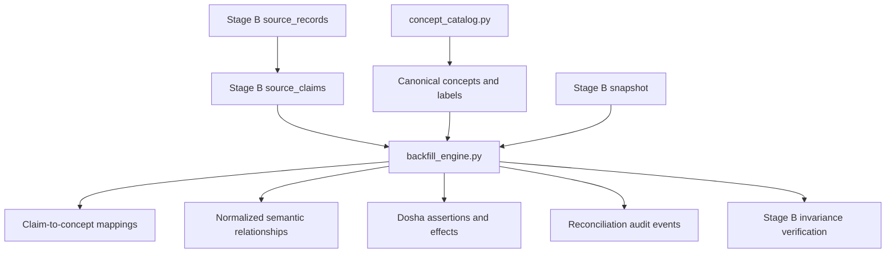

# Semantic Backfill Engine (`backfill_engine.py`)

**Source module:** `src/herbal_almanac/backfill_engine.py`  
**Architecture stage:** Stage C — Semantic Dravyaguna Architecture  
**Database requirement:** Stage C schema version 3

## 1. Purpose and responsibility

The `backfill_engine.py` module converts existing Stage B source claims into structured Stage C semantic representations.

Stage B introduced provenance-aware records. It stores the source, the individual source record, and the original textual assertions extracted from that record.

However, a source claim may still be represented as ordinary text.

For example:

```text
Source field: Rasa
Source expression: Madhura
```

The semantic layer needs to represent this as a relationship to a canonical concept:

```text
RASA_MADHURA
```

The backfill engine performs this conversion.

Its responsibilities include:

- Reading existing source claims.
- Determining the semantic domain of each claim.
- Splitting compound expressions into individual tokens.
- Matching tokens against canonical concept labels and synonyms.
- Decomposing Dosha expressions into Dosha/effect pairs.
- Creating claim-to-concept mappings.
- Creating normalized herb relationships.
- Preserving Stage B records.
- Recording backfill metrics and reconciliation events.
- Ensuring that repeated executions do not create duplicate mappings.

The backfill is a transformation of the database representation, not a replacement of the original source evidence.

## 2. Position in the project architecture



### Upstream dependencies

| Module | Usage |
|---|---|
| `concept_catalog.py` | Supplies the canonical vocabulary, label normalization, and catalog seeding. |
| `schema_capability_gate.py` | Verifies that the database supports Stage C operations. |
| `database_operator.py` | Coordinates the database transaction and upgrade process. |

### Downstream tables

The engine writes to Stage C semantic tables such as:

- `concept_claim_mappings`
- `herb_dravyaguna_properties`
- `dosha_claim_assertions`
- `herb_dosha_effects`
- `herb_plant_parts`
- `herb_preparations`
- `herb_indications`
- `source_reconciliation_events`

## 3. Imports

### Standard-library imports

| Import | Purpose |
|---|---|
| `hashlib` | Calculates SHA-256 hashes of Stage B table contents. |
| `re` | Splits source expressions into tokens. |
| `sqlite3` | Reads claims and writes semantic relationships. |
| `unicodedata` | Supports Unicode-related processing. |
| `datetime`, `timezone` | Validates UTC timestamps. |
| `Any` | Type annotations for snapshot metadata. |

### Internal imports

```python
from .schema_capability_gate import require_stage_c_schema_v3

from .concept_catalog import (
    seed_canonical_concept_catalog,
    normalize_label,
)
```

- `require_stage_c_schema_v3()` ensures that the required schema is available.
- `seed_canonical_concept_catalog()` ensures the canonical vocabulary exists.
- `normalize_label()` normalizes tokens before concept matching.

## 4. Classes

The current `backfill_engine.py` module does not define any classes.

Its behavior is implemented through standalone functions.

## 5. Constants and lookup data

The module contains:

### `STAGE_B_TABLES`

A collection of Stage B tables whose schema and contents must remain unchanged during semantic backfill.

The snapshot functions use this collection to determine which tables must be checked.

### `EXPLICIT_LEXICAL_SYNONYMS`

A dictionary that maps domain-specific alternative labels to canonical concept codes.

Its keys are pairs:

```python
(domain, normalized_label)
```

Its values are canonical concept codes.

Examples include:

| Domain | Source token | Canonical concept |
|---|---|---|
| Rasa | `svadu` | `RASA_MADHURA` |
| Rasa | `स्वादु` | `RASA_MADHURA` |
| Rasa | `tuvara` | `RASA_KASHAYA` |
| Guna | `ruksha` | `GUNA_RUKSHA` |
| Guna | `picchila` | `GUNA_PICCHILA` |
| Plant part | `leaf` | `PART_LEAF` |
| Plant part | `patra` | `PART_LEAF` |
| Plant part | `root` | `PART_ROOT` |
| Plant part | `mula` | `PART_ROOT` |

The dictionary provides explicit lexical equivalences that may not be represented by identical catalog labels.

**Important:** These are curated matching rules, not a general-purpose Sanskrit translation system.

## 6. Function reference

The functions can be divided into four groups:

1. Preconditions and timestamp validation.
2. Stage B invariance verification.
3. Semantic expression parsing and matching.
4. Database backfill.

### 6.1 `_validate_iso_utc_timestamp(ts)`

```python
_validate_iso_utc_timestamp(ts: str) -> None
```

Validates the timestamp used by the backfill operation.

Requirements:

- The timestamp must be a non-empty string.
- It must be valid ISO-8601.
- It must explicitly end with `Z` or `+00:00`.
- It must represent a zero-offset UTC time.

Invalid timestamps raise `ValueError`.

This ensures that audit records use consistent UTC timestamps.

### 6.2 `_check_preconditions(connection)`

```python
_check_preconditions(
    connection: sqlite3.Connection,
) -> None
```

Checks that the database is ready for backfill.

There are three requirements.

**1. Stage C schema**

```python
require_stage_c_schema_v3(connection)
```

The semantic tables must exist and be compatible with schema version 3.

**2. Foreign-key enforcement**

```sql
PRAGMA foreign_keys;
```

The result must indicate that foreign-key enforcement is enabled.

**3. Active transaction**

```python
connection.in_transaction
```

The connection must already have an active transaction.

This prevents the engine from running its semantic updates outside the expected transaction boundary.

## 7. Stage B table invariance

A major design requirement of Stage C is that semantic backfill must not damage the earlier provenance model.

The engine therefore contains two functions dedicated to checking Stage B invariance.

### 7.1 `capture_stage_b_table_snapshot(connection)`

```python
capture_stage_b_table_snapshot(
    connection: sqlite3.Connection,
) -> dict[str, dict[str, Any]]
```

Captures the state of the Stage B tables.

For each table in `STAGE_B_TABLES`, it records:

- Column names.
- Column types.
- Row count.
- SHA-256 hash of the table's row contents.

#### Step-by-step logic

1. Iterate over every Stage B table.
2. Read its schema using `PRAGMA table_info`.
3. Raise `KeyError` if the required table is missing.
4. Extract the column names and types.
5. Count the rows.
6. Read all rows in deterministic column order.
7. Calculate a SHA-256 hash over the serialized row values.
8. Store the metadata in the snapshot dictionary.

Conceptually, the output looks like:

```python
{
    "sources": {
        "columns": [...],
        "column_types": {...},
        "count": 5,
        "row_hash": "...",
    },
    "source_records": {
        "columns": [...],
        "column_types": {...},
        "count": 100,
        "row_hash": "...",
    },
}
```

The values above are illustrative, not actual database counts.

#### Why use a hash?

A row count alone cannot detect every mutation.

For example, changing a source claim's text does not change the number of rows.

The hash provides a way to detect content changes even when the row count remains constant.

### 7.2 `verify_stage_b_row_invariance(before_snapshot, after_snapshot)`

```python
verify_stage_b_row_invariance(
    before_snapshot: dict[str, dict[str, Any]],
    after_snapshot: dict[str, dict[str, Any]],
) -> None
```

Compares two snapshots.

For each Stage B table, it checks:

1. The table is present in both snapshots.
2. Column names are unchanged.
3. Column types are unchanged.
4. Row counts are unchanged.
5. Content hashes are unchanged.

If any check fails, it raises `AssertionError`.

Example:

```python
before = capture_stage_b_table_snapshot(connection)

# Perform semantic operations.

after = capture_stage_b_table_snapshot(connection)

verify_stage_b_row_invariance(before, after)
```

This makes preservation of the Stage B model an explicit verification requirement.

**Important limitation:** the snapshot is a verification mechanism for the listed tables and their captured schema/content. It does not independently prove that every possible external side effect is absent.

## 8. Semantic expression parsing

The next group of functions converts source text into concepts.

### 8.1 `_resolve_claim_domain_and_table(claim_type, source_field)`

```python
_resolve_claim_domain_and_table(
    claim_type: str,
    source_field: str,
) -> tuple[str, str] | None
```

Determines which semantic domain and destination relationship table should be used for a claim.

It uses the source field name and, in the Dosha case, the claim type.

| Source field or type | Semantic domain | Destination table |
|---|---|---|
| `Rasa...` | `rasa` | `herb_dravyaguna_properties` |
| `Guna...` | `guna` | `herb_dravyaguna_properties` |
| `Virya...` | `virya` | `herb_dravyaguna_properties` |
| `Vipaka...` | `vipaka` | `herb_dravyaguna_properties` |
| `Prabhava...` | `prabhava` | `herb_dravyaguna_properties` |
| `Karma...` | `karma` | `herb_dravyaguna_properties` |
| `Parts Used...` or `Part Used...` | `plant_part` | `herb_plant_parts` |
| `Dosage Formulation...` or `Preparation...` | `preparation_form` | `herb_preparations` |
| `Therapeutic Usage...`, `Vyadhi...`, or `Indication...` | `indication` | `herb_indications` |
| `Doshakarma...` or claim type `dosha_expression` | `dosha` | `herb_dosha_effects` |

If the source field cannot be classified, the function returns `None`.

Unrecognized claims are therefore not automatically forced into a semantic domain.

### 8.2 `_clean_and_tokenize_expression(expression)`

```python
_clean_and_tokenize_expression(
    expression: str,
) -> list[str]
```

Splits a compound source expression into separate tokens.

The current separators are:

- `/`
- `,`
- `;`
- `|`

Example:

```python
_clean_and_tokenize_expression(
    "Madhura / Tikta, Kashaya"
)
```

Produces:

```python
[
    "Madhura",
    "Tikta",
    "Kashaya",
]
```

Empty tokens are removed and surrounding whitespace is stripped.

The original source expression remains stored in the source-claim model; tokenization is used for semantic matching.

### 8.3 `_match_concept_in_domain(...)`

```python
_match_concept_in_domain(
    domain: str,
    token: str,
    domain_labels: dict[tuple[str, str], tuple[int, str]],
    concept_codes: dict[str, int],
) -> tuple[int, str] | None
```

Attempts to match a token against a canonical concept in the specified domain.

It uses four matching strategies.

#### Strategy 1: Direct label lookup

The token is normalized with:

```python
normalize_label(token)
```

The function checks:

```python
(domain, normalized_token)
```

against the prebuilt label lookup dictionary.

This is the most direct matching strategy.

#### Strategy 2: Explicit synonym lookup

If direct matching fails, the function checks:

```python
EXPLICIT_LEXICAL_SYNONYMS
```

The synonym must belong to the requested domain, and the mapped concept code must exist in the active concept lookup.

#### Strategy 3: Remove domain-specific suffixes

Some source expressions append the domain name to a concept label.

Examples:

```text
Madhura Rasa
Ushna Virya
Guru Guna
```

The function removes known suffixes and tries matching the remaining label.

Suffix handling is domain-specific.

#### Strategy 4: Concept-code token matching

The function checks whether the token matches the suffix of a canonical concept code within the specified domain.

For example, the token:

```text
Madhura
```

can match:

```text
RASA_MADHURA
```

when the requested domain is `rasa`.

If all strategies fail, the function returns `None`.

**Important:** The matching is intentionally limited to known labels, explicit synonyms, recognized suffixes, and concept-code tokens. It does not use an AI model or fuzzy semantic interpretation.

## 9. Dosha expression decomposition

### `_decompose_dosha_expression(...)`

```python
_decompose_dosha_expression(
    expression: str,
    dosha_concepts: dict[str, int],
    effect_concepts: dict[str, int],
) -> list[tuple[int, int]]
```

Dosha expressions require special handling because a single source statement may mention multiple Doshas and an effect.

For example:

```text
Vata-Pitta Shamaka
```

needs to become two relationships:

```text
Vata   -> decrease
Pitta  -> decrease
```

The function converts a textual expression into pairs of:

```text
(dosha_concept_id, effect_concept_id)
```

### Step 1: Tokenize the expression

The function uses `_clean_and_tokenize_expression()` to split compound expressions.

### Step 2: Determine the effect

The current implementation checks for increase-related terms, including:

- `vardhak`
- `kopan`
- `vriddhi`
- `kara`
- `वर्धक`
- `कोपन`
- `वृद्धि`

If one of these is present, the effect is:

```text
EFFECT_INCREASE
```

Otherwise, the current implementation defaults to:

```text
EFFECT_DECREASE
```

### Step 3: Determine the affected Dosha

The function recognizes the following Doshas:

| Dosha | Recognized forms include |
|---|---|
| Vata | `vata`, `vāt`, `वात`, `vayu` |
| Pitta | `pitta`, `pitt`, `पित्त` |
| Kapha | `kapha`, `kaph`, `sleshma`, `śleṣma`, `कफ`, `श्लेष्म` |

It also recognizes expressions for all three Doshas, including:

- `tridosh`
- `त्रिदोष`
- `sarvadosh`
- `सर्वदोष`

A tridosha expression produces relationships for Vata, Pitta, and Kapha.

### Step 4: Create concept pairs

For every recognized Dosha, the function combines its concept ID with the appropriate effect concept ID.

A set is used to avoid duplicate pairs.

The final result is sorted before being returned.

### Important limitation

The current implementation uses a relatively simple directional-effect heuristic.

If an expression contains no recognized increase term, it defaults to decrease. It does not independently prove that every unknown expression means a decrease.

Consequently, unusual, ambiguous, or conflicting source expressions should be reviewed carefully before the resulting assertion is treated as authoritative.

## 10. Main backfill function

### `run_stage_c_semantic_backfill(connection, now)`

```python
run_stage_c_semantic_backfill(
    connection: sqlite3.Connection,
    now: str,
) -> dict[str, int]
```

This is the main public operation of the module.

It scans Stage B source claims and creates corresponding Stage C mappings and relationships.

### Preconditions

Before executing the backfill:

- Stage C schema version 3 must be available.
- SQLite foreign-key enforcement must be enabled.
- The connection must have an active transaction.
- The supplied timestamp must be valid UTC ISO-8601.

If a precondition fails, the function raises an exception before performing the backfill.

### Step-by-step execution

#### Step 1: Validate the database and timestamp

The function calls:

```python
_check_preconditions(connection)
_validate_iso_utc_timestamp(now)
```

#### Step 2: Create a savepoint

```sql
SAVEPOINT wp4_backfill;
```

The savepoint provides a rollback boundary for the backfill operation.

If an exception occurs, the function rolls back to this savepoint and releases it before propagating the error.

#### Step 3: Ensure the concept catalog exists

The function checks:

```sql
SELECT COUNT(*) FROM dravyaguna_concepts;
```

If the table contains no concepts, it calls:

```python
seed_canonical_concept_catalog(connection)
```

This ensures that semantic mapping has a canonical vocabulary to work with.

#### Step 4: Build lookup dictionaries

The function loads active concepts and creates several in-memory dictionaries.

**Concept-code lookup**

```python
concept_codes = {
    concept_code: concept_id,
}
```

**Dosha concept lookup**

```python
dosha_concepts = {
    "DOSHA_VATA": ...,
    "DOSHA_PITTA": ...,
    "DOSHA_KAPHA": ...,
}
```

**Effect concept lookup**

```python
effect_concepts = {
    "EFFECT_INCREASE": ...,
    "EFFECT_DECREASE": ...,
}
```

**Domain-label lookup**

```python
domain_labels = {
    (concept_domain, normalized_label): (
        concept_id,
        concept_code,
    ),
}
```

These dictionaries reduce repeated SQL lookups while processing claims.

Only concepts with:

```text
status = 'active'
```

are included in the lookup.

#### Step 5: Retrieve source claims

The function selects claims using the source-claim and source-record tables.

Conceptually:

```sql
SELECT
    sc.source_claim_id,
    sc.source_record_id,
    sr.source_id,
    sc.claim_type,
    sc.source_field,
    sc.source_expression
FROM source_claims sc
JOIN source_records sr
    ON sr.source_record_id = sc.source_record_id
WHERE sc.verification_status != 'superseded'
ORDER BY sc.source_claim_id ASC;
```

The query excludes superseded claims.

**Important:** The current query does not exclude `rejected` claims. It excludes only `superseded` claims. This means that a rejected claim may still be considered by the backfill engine unless additional eligibility rules are introduced elsewhere.

This is an important distinction when interpreting the generated semantic data.

#### Step 6: Initialize metrics

The function tracks:

- `processed_claims`
- `inserted_mappings`
- `inserted_properties`
- `inserted_dosha_effects`
- `inserted_plant_parts`
- `inserted_preparations`
- `inserted_indications`

These counters form the result returned by the function.

#### Step 7: Resolve the claim's semantic domain

For every claim, the engine calls:

```python
_resolve_claim_domain_and_table(
    claim_type,
    source_field,
)
```

If no domain can be determined, the claim is skipped for semantic mapping.

#### Step 8: Associate the claim with a herb

The engine identifies the herb associated with the source claim using:

- `legacy_herb_map`
- `herbs`
- `source_records`
- `sources`

It uses source identity and external record keys to establish the relationship.

There are two important association paths:

**Source-backed herb**

The source key and external record key must match the herb's source and source record ID.

**Legacy/manual herb**

For records without a source record ID, the engine can use a `raw_artifact_ref` of the form:

```text
legacy_herb_id:<herb_id>
```

This is how legacy records are associated with their corresponding provenance-aware source records.

The association logic avoids assuming that matching herb names alone are sufficient evidence of identity.

#### Step 9: Process Dosha claims

For a claim classified as Dosha-related:

1. Call `_decompose_dosha_expression()`.
2. Obtain the Dosha/effect concept pairs.
3. Check whether each assertion already exists.
4. Insert a missing assertion into `dosha_claim_assertions`.
5. Link the assertion to the associated herb through `herb_dosha_effects`.
6. Update the corresponding metrics.

The assertion stores:

```text
mapping_method = lexicon_exact
mapping_confidence = NULL
verification_status = unreviewed
```

This is an important design choice: the engine does not invent a numerical confidence score.

#### Step 10: Process other semantic claims

For other domains:

1. Tokenize the source expression.
2. Match each token against the appropriate domain.
3. Skip unmatched tokens.
4. Check whether the claim-to-concept mapping already exists.
5. Insert a missing mapping into `concept_claim_mappings`.
6. Create the corresponding herb relationship if it does not already exist.

The destination relationship depends on the semantic domain.

| Semantic domain | Destination |
|---|---|
| Rasa | `herb_dravyaguna_properties` |
| Guna | `herb_dravyaguna_properties` |
| Virya | `herb_dravyaguna_properties` |
| Vipaka | `herb_dravyaguna_properties` |
| Prabhava | `herb_dravyaguna_properties` |
| Karma | `herb_dravyaguna_properties` |
| Plant part | `herb_plant_parts` |
| Preparation form | `herb_preparations` |
| Indication | `herb_indications` |

For properties, the engine inserts the relationship with `part_concept_id` set to `NULL`. For preparations, it similarly inserts the preparation relationship with `part_mapping_id` set to `NULL`.

These fields allow the schema to represent more detailed associations where supported.

#### Step 11: Record reconciliation events

After processing claims, the function creates an audit event for each source evaluated.

The event is written to:

```text
source_reconciliation_events
```

The event uses:

```text
event_type = ingest_batch
extraction_status = completed
is_complete_snapshot = 1
initiated_by = stage_c_backfill_engine
```

It also records claim and property reconciliation counts and a descriptive audit note.

This provides an operational record that semantic backfill was executed.

#### Step 12: Release the savepoint

On success:

```sql
RELEASE SAVEPOINT wp4_backfill;
```

The function returns its metrics dictionary.

On failure:

```sql
ROLLBACK TO SAVEPOINT wp4_backfill;
RELEASE SAVEPOINT wp4_backfill;
```

The exception is then re-raised.

The outer transaction remains under the control of the caller.

## 11. Idempotency

A major requirement is that running the backfill more than once should not create duplicate semantic mappings.

The implementation checks for existing records before inserting:

- Dosha assertions.
- Claim-to-concept mappings.
- Herb-to-property relationships.
- Herb-to-Dosha-effect relationships.
- Plant-part relationships.
- Preparation relationships.
- Indication relationships.

For example, before inserting a claim-to-concept mapping, it checks whether the same source claim is already mapped to the same concept.

If the mapping exists, the existing mapping ID is reused.

This is important because the upgrade process may be rerun after an interrupted operation or as part of database maintenance.

## 12. Mapping quality and verification

The backfill deliberately uses conservative mapping metadata.

For generated mappings, the current implementation uses:

```text
mapping_method = lexicon_exact
mapping_confidence = NULL
verification_status = unreviewed
```

This means:

- The mapping was generated through the engine's lexical rules.
- No numerical confidence is claimed.
- The mapping has not automatically become human-verified.

This is particularly important for traditional medical terminology, where a string match does not necessarily establish the full intended meaning.

The source claim remains available for review.

## 13. Returned metrics

The function returns a dictionary containing:

```python
{
    "processed_claims": ...,
    "inserted_mappings": ...,
    "inserted_properties": ...,
    "inserted_dosha_effects": ...,
    "inserted_plant_parts": ...,
    "inserted_preparations": ...,
    "inserted_indications": ...,
}
```

| Metric | Meaning |
|---|---|
| `processed_claims` | Number of non-superseded claims retrieved by the backfill query. |
| `inserted_mappings` | Number of new claim-to-concept mappings and Dosha assertions inserted. |
| `inserted_properties` | Number of new herb-property relationships. |
| `inserted_dosha_effects` | Number of new herb-to-Dosha-assertion relationships. |
| `inserted_plant_parts` | Number of new herb-to-plant-part relationships. |
| `inserted_preparations` | Number of new herb-to-preparation relationships. |
| `inserted_indications` | Number of new herb-to-indication relationships. |

The metrics count new insertions, not all mappings that exist after the operation.

Therefore, a second successful run against an unchanged database should generally report zero new insertions while still processing the eligible claims.

## 14. Example usage

The function requires:

- An upgraded Stage C database.
- Foreign keys enabled.
- An active transaction.
- A UTC timestamp.

```python
import sqlite3
from datetime import datetime, timezone

from herbal_almanac.backfill_engine import (
    run_stage_c_semantic_backfill,
)

connection = sqlite3.connect("AyurvedicDB.db")
connection.execute("PRAGMA foreign_keys = ON")

try:
    connection.execute("BEGIN IMMEDIATE")

    now = datetime.now(timezone.utc).isoformat()

    metrics = run_stage_c_semantic_backfill(
        connection,
        now,
    )

    connection.commit()

    print("Processed claims:", metrics["processed_claims"])
    print("New mappings:", metrics["inserted_mappings"])

except Exception:
    connection.rollback()
    raise

finally:
    connection.close()
```

This example demonstrates the required transaction boundary. It assumes that the Stage C schema has already been created.

## 15. Relationship between the backfill engine and database operator

The backfill engine is not responsible for the complete database upgrade process.

The responsibilities are divided as follows:

| Component | Responsibility |
|---|---|
| `database_operator.py` | Coordinates database initialization and upgrade. |
| `migrations/migration_0003_semantic_dravyaguna.py` | Creates the Stage C semantic schema. |
| `concept_catalog.py` | Supplies canonical concepts and labels. |
| `backfill_engine.py` | Converts source claims into semantic mappings and relationships. |
| `schema_capability_gate.py` | Verifies schema compatibility. |

This separation makes the semantic transformation easier to test and maintain.

## 16. Important limitations

### Lexical matching is not semantic understanding

The engine uses known labels, explicit synonyms, suffix removal, and concept-code matching. It does not understand arbitrary prose.

Unmatched expressions are skipped.

### Dosha parsing uses heuristics

The current Dosha parser has a limited vocabulary and defaults to decrease when it does not detect a recognized increase term.

Ambiguous expressions should not be interpreted as fully validated Dosha assertions.

### Rejected claims are not filtered by the current query

The source-claim query excludes superseded claims but does not explicitly exclude rejected claims.

This is worth considering when evaluating backfill eligibility and review workflows.

### Only active concepts are loaded

Provisional or deprecated concepts are not included in the matching lookup.

### No numerical confidence is assigned

The engine uses `NULL` for mapping confidence. This avoids suggesting a degree of certainty that the lexical matching process has not established.

### The engine does not replace source evidence

Original source expressions remain in Stage B. Stage C stores structured mappings derived from them.

## 17. Related files

- `concept_catalog.py`
- `database_operator.py`
- `schema_capability_gate.py`
- `migrations/migration_0003_semantic_dravyaguna.py`
- `claim_lifecycle.py`
- `repository_api.py`

## 18. Summary

`backfill_engine.py` is the bridge between the provenance-aware Stage B data model and the semantic Stage C data model.

It takes original source claims, identifies their domains, matches their expressions to canonical concepts, and creates normalized relationships without replacing the original evidence.

Its most important safeguards are:

- Schema and transaction precondition checks.
- Stage B schema/content invariance snapshots.
- Idempotent insertions.
- Savepoint-based rollback.
- Explicit unreviewed mapping status.
- Reconciliation audit events.

The result is a semantic representation of existing Ayurvedic data while retaining the provenance and historical source information on which that representation depends.
