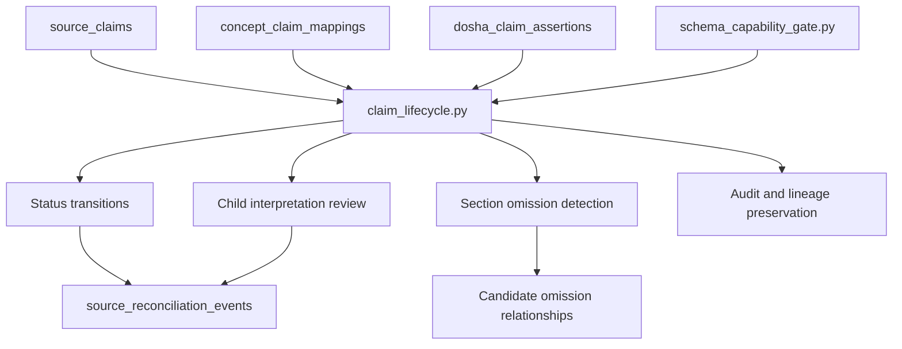

# Claim Lifecycle and Omission Engine (`claim_lifecycle.py`)

**Source module:** `src/herbal_almanac/claim_lifecycle.py`  
**Architecture stage:** Stage C.2 — Claim Lifecycle, Interpretation Review, and Section-Level Omission  
**Database requirement:** Stage C schema version 3

## 1. Purpose and responsibility

The `claim_lifecycle.py` module manages the review and lifecycle of source claims and the semantic interpretations derived from them.

A source claim is an assertion extracted from a source record. For example:

```text
Source: CCRAS DRAVYA
Source field: Rasa
Source expression: Madhura
```

The source claim may be mapped to a canonical concept such as `RASA_MADHURA`. These are related but distinct records:

- The source claim preserves what the source actually stated.
- The concept mapping records how the application interpreted that statement.
- A reviewer may accept, reject, or revise the interpretation independently of the original source claim.

The module provides controlled status transitions, administrative overrides, child-interpretation review, confidence validation, and section-level omission detection.

Its main responsibilities are:

- Enforce valid source-claim status transitions.
- Require reviewer identity and citations for appropriate decisions.
- Prevent routine workflows from reopening terminal claims.
- Allow authorized curator workflows to reopen claims with an audit trail.
- Propagate parent claim rejection or supersession to dependent interpretations.
- Preserve independently rejected or superseded child interpretations.
- Allow child mappings and Dosha assertions to be reviewed independently.
- Validate mapping-confidence values.
- Mark relationships as candidate omissions only when the source section is known to be complete.

## 2. Position in the project architecture



### Upstream callers

The module is intended to be called by application services, curator workflows, and reconciliation processes.

The module itself does not authenticate a user or determine whether someone is an authorized curator. That responsibility belongs to the application/service layer.

### Downstream database tables

| Table | Purpose |
|---|---|
| `source_claims` | Stores original source assertions and their review status. |
| `concept_claim_mappings` | Stores interpretations mapping claims to canonical concepts. |
| `dosha_claim_assertions` | Stores normalized Dosha/effect assertions. |
| `herb_dravyaguna_properties` | Stores herb-property relationships. |
| `herb_dosha_effects` | Stores herb-to-Dosha-effect relationships. |
| `herb_plant_parts` | Stores plant-part relationships. |
| `herb_preparations` | Stores preparation relationships. |
| `herb_indications` | Stores indication relationships. |
| `source_reconciliation_events` | Stores audit and reconciliation events. |

## 3. Imports

| Import | Purpose |
|---|---|
| `re` | Parses and removes inherited-lineage tags in reviewer notes. |
| `sqlite3` | Executes database queries and updates. |
| `Mapping` from `collections.abc` | Types the parsed-section completeness mapping. |
| `datetime`, `timezone` | Validates UTC timestamps. |
| `Any` | Supports the flexible administrative override calling convention. |

Internal import:

```python
from .schema_capability_gate import require_stage_c_schema_v3
```

This ensures that lifecycle operations run only against a valid Stage C schema.

## 4. Classes

The current module does not define any classes.

It uses standalone functions and a constant mapping to implement the lifecycle workflow.

## 5. Shared validation and lineage helpers

### 5.1 `_validate_iso_utc_timestamp(ts)`

```python
_validate_iso_utc_timestamp(ts: str) -> None
```

Validates that the supplied timestamp is a non-empty ISO-8601 timestamp representing UTC.

Accepted forms explicitly end with:

```text
Z
+00:00
```

A timestamp without an explicit UTC offset is rejected.

Invalid values raise `ValueError`.

This ensures consistent timestamps for review actions and audit events.

### 5.2 `_check_preconditions(connection)`

```python
_check_preconditions(
    connection: sqlite3.Connection,
) -> None
```

Verifies three conditions before a lifecycle operation:

1. Stage C schema version 3 is available.
2. SQLite foreign-key enforcement is enabled.
3. The connection is already inside an active transaction.

The transaction requirement is checked using:

```python
connection.in_transaction
```

The function does not start or commit a transaction. The caller is responsible for transaction management.

### 5.3 `_parse_inherited_tag(notes, source_claim_id=None)`

```python
_parse_inherited_tag(
    notes: str | None,
    source_claim_id: int | None = None,
) -> str | None
```

Extracts a previous child status from a tag embedded in reviewer notes.

The tag format is:

```text
[INHERITED_FROM_CLAIM:<claim_id>:PRIOR=<status>]
```

Example:

```text
[INHERITED_FROM_CLAIM:42:PRIOR=reviewed]
```

If a claim ID is provided, the function looks for the tag associated with that specific parent claim. Otherwise, it finds the first matching inherited tag.

It returns the previous status or `None`.

### 5.4 `_strip_inherited_tag(notes, source_claim_id=None)`

```python
_strip_inherited_tag(
    notes: str | None,
    source_claim_id: int | None = None,
) -> str | None
```

Removes the inherited-lineage tag from reviewer notes.

This is necessary when a parent claim is reopened or when a child interpretation receives an independent terminal decision.

The remaining reviewer notes are preserved.

## 6. Source claim lifecycle

### 6.1 `transition_claim_status(...)`

```python
transition_claim_status(
    connection: sqlite3.Connection,
    source_claim_id: int,
    new_status: str,
    now: str,
    reviewed_by: str | None = None,
    reviewer_notes: str | None = None,
    authority_citation: str | None = None,
    herb_id: int | None = None,
) -> None
```

This function handles routine source-claim status changes.

Valid statuses are:

- `unreviewed`
- `reviewed`
- `verified`
- `rejected`
- `superseded`

#### Routine transition matrix

| Current status | Allowed next statuses |
|---|---|
| `unreviewed` | `reviewed`, `verified`, `superseded`, `rejected` |
| `reviewed` | `verified`, `superseded`, `rejected` |
| `verified` | `superseded`, `rejected` |
| `superseded` | None |
| `rejected` | None |

The routine workflow is intentionally restrictive.

A terminal claim (`rejected` or `superseded`) cannot be reopened through this function. Status downgrades such as `verified` to `reviewed` are also prohibited.

Those operations require the administrative override function.

#### Reviewer requirements

Moving a claim to `reviewed` or `verified` requires a non-empty `reviewed_by` value.

Moving a claim to `verified` additionally requires an authority citation containing at least five non-whitespace characters.

The citation is appended to the reviewer notes using a marker:

```text
[AUTHORITY CITATION: <citation>]
```

Existing notes are retained rather than overwritten.

#### Same-status idempotency

If the claim already has the requested status, the function returns without making another update.

This avoids unnecessary updates and duplicate audit events.

#### Terminal-status cascade

When a source claim is rejected or superseded, dependent semantic interpretations must be handled carefully.

The function first captures the statuses of child records in:

- `concept_claim_mappings`
- `dosha_claim_assertions`

It distinguishes two cases:

**Independently terminal child**

A child already marked `rejected` or `superseded` without an inherited-parent tag has its independent status preserved.

**Inheriting child**

Other child interpretations inherit the new parent status. Their previous status is recorded in reviewer notes:

```text
[INHERITED_FROM_CLAIM:42:PRIOR=reviewed]
```

The parent claim is then updated. This update may activate database triggers that cascade status changes to dependent records. The function performs post-trigger restoration and lineage tagging to preserve the distinction between independent and inherited decisions.

#### Audit event

The function records verified and terminal transitions in:

```text
source_reconciliation_events
```

The event uses:

```text
event_type = manual_adjudication
extraction_status = completed
is_complete_snapshot = 0
```

The audit note records:

- Claim ID.
- Herb ID, if supplied.
- Previous and new statuses.
- Reviewer notes.
- Child-lineage counts for terminal transitions.

The function does not commit the transaction.

## 7. Administrative claim override

### `adjudicate_claim_status_override(...)`

```python
adjudicate_claim_status_override(
    connection: sqlite3.Connection,
    source_claim_id: int,
    new_status: str,
    *args: Any,
    now: str | None = None,
    authorized_curator_id: str | None = None,
    adjudication_reason: str | None = None,
    authority_citation: str | None = None,
    herb_id: int | None = None,
    **kwargs: Any,
) -> None
```

This function handles administrative status changes that are not allowed in routine pipelines.

It supports reopening terminal claims and records why the override occurred.

### Authorization boundary

The function explicitly expects the application service layer to authenticate the actor and confirm curator or administrator privileges before calling it.

`authorized_curator_id` is recorded for audit provenance. It is not proof of authorization, and this function does not authenticate the caller.

### Required information

The function requires:

- A valid target status.
- A UTC timestamp.
- A non-empty curator identifier.
- An adjudication reason of at least ten non-whitespace characters.

If the target status is `verified`, an authority citation of at least five non-whitespace characters is also required.

The function accepts several positional calling conventions, including the older ADR ordering and the alternative curator/reason/timestamp ordering. Keyword arguments are also supported.

For clarity, new application code should prefer explicit keyword arguments.

### Administrative transition rules

The override permits selected status changes that routine processing does not.

| Current status | Administrative target statuses |
|---|---|
| `reviewed` | `unreviewed` |
| `verified` | `reviewed`, `unreviewed` |
| `superseded` | `unreviewed`, `reviewed`, `verified`, `rejected` |
| `rejected` | `unreviewed`, `reviewed`, `verified`, `superseded` |

The exact permitted transitions are enforced by the `admin_permitted` mapping in the implementation.

### Reopening behavior

When a terminal claim is reopened:

1. The function finds child mappings and assertions.
2. It checks for inherited-lineage tags.
3. It restores only children whose status was inherited from the parent.
4. It removes the inherited tag from restored reviewer notes.
5. Independently rejected or superseded child interpretations remain terminal.
6. It records the number of reopened mappings and assertions in the audit note.

For inherited child records, the function restores the status conservatively:

- If the parent is reopened as `unreviewed`, or the child's recorded prior status was `unreviewed`, the child becomes `unreviewed`.
- Otherwise, the child becomes `reviewed`.

This is a deliberate safeguard: reopening a parent does not automatically make every child interpretation verified.

### Audit record

Every actual administrative transition inserts a `manual_adjudication` event into `source_reconciliation_events`.

The audit note includes:

- Claim ID and herb ID.
- Previous and new status.
- Curator identity.
- Adjudication reason.
- Optional citation.
- Selective reopening counts, when applicable.

## 8. Independent interpretation review

### `transition_interpretation_status(...)`

```python
transition_interpretation_status(
    connection: sqlite3.Connection,
    table_name: str,
    record_id: int,
    new_status: str,
    now: str,
    reviewed_by: str | None = None,
    reviewer_notes: str | None = None,
    authority_citation: str | None = None,
    herb_id: int | None = None,
) -> None
```

This function reviews a semantic interpretation independently of its parent source claim.

It accepts only two table names:

```text
concept_claim_mappings
dosha_claim_assertions
```

Any other table name raises `ValueError`.

### Parent-child review constraint

A child mapping or Dosha assertion can be moved to `reviewed` or `verified` only if its parent source claim is already `reviewed` or `verified`.

It cannot be approved while the parent is:

- `unreviewed`
- `rejected`
- `superseded`

This prevents an interpretation from being treated as trusted when its underlying source claim is not accepted.

### Reviewer and citation requirements

- `reviewed_by` is required for `reviewed` and `verified`.
- `authority_citation` is required for `verified`.
- Existing notes are retained and new notes are appended.
- When a child is independently rejected or superseded, an inherited-parent tag is removed so that its terminal status is recognized as independent.

The function writes an audit event to `source_reconciliation_events`.

## 9. Mapping-confidence validation

### `validate_calibrated_mapping_confidence(...)`

```python
validate_calibrated_mapping_confidence(
    mapping_method: str,
    mapping_confidence: float | None,
) -> None
```

Validates the relationship between the mapping method and its confidence value.

Accepted methods:

- `lexicon_exact`
- `rule_normalizer`
- `human_expert`
- `heuristic`

#### Confidence rules

For `lexicon_exact`:

```python
mapping_confidence must be None
```

Exact lexical matching should not be assigned an artificial numerical certainty score.

For the other accepted methods, confidence may be `None` or a numeric value in the inclusive range:

\[
0.0 \leq confidence \leq 1.0
\]

Unknown methods, non-numeric confidence values, and out-of-range values raise `ValueError`.

This prevents a numerical score from being mistaken for calibrated certainty when the mapping process does not support one.

## 10. Section-level omission detection

### `SECTION_DOMAIN_TABLE_MAP`

The module defines a mapping between section-domain names and their corresponding relationship tables.

| Section domain | Table | Primary key | Mapping/assertion foreign key |
|---|---|---|---|
| `dravyaguna_properties` | `herb_dravyaguna_properties` | `herb_property_id` | `mapping_id` |
| `dosha_effects` | `herb_dosha_effects` | `herb_dosha_effect_id` | `dosha_assertion_id` |
| `plant_parts` | `herb_plant_parts` | `herb_part_id` | `mapping_id` |
| `preparations` | `herb_preparations` | `herb_preparation_id` | `prep_mapping_id` |
| `indications` | `herb_indications` | `herb_indication_id` | `mapping_id` |

### `reconcile_section_omissions(...)`

```python
reconcile_section_omissions(
    connection: sqlite3.Connection,
    *,
    herb_id: int,
    source_id: int,
    event_id: int,
    section_domain: str,
    parsed_sections: Mapping[str, bool],
    active_relationship_ids: set[int],
    now: str,
) -> dict[str, int]
```

This function identifies relationships that were previously active but were not found in a newly parsed source section.

It does not immediately delete those relationships. Instead, it marks them as:

```text
candidate_omission
```

This is important because absence from a scrape is not necessarily proof that a fact has been removed from the source.

### Completeness gate

Before flagging omissions, the function checks the associated reconciliation event.

All of the following must be true:

1. The event exists.
2. The event belongs to the supplied `source_id`.
3. `is_complete_snapshot` equals `1`.
4. `extraction_status` equals `completed`.
5. `parsed_sections[section_domain]` is explicitly `True`.

If any condition fails, the function returns:

```python
{
    "flagged_candidate_omissions": 0,
    "skipped_incomplete": 1,
}
```

This is the section-level completeness contract.

An incomplete scrape or an unparsed section must not cause existing relationships to be marked as missing.

### Relationship comparison

The function retrieves active relationships for the supplied herb and source.

It then compares their IDs against `active_relationship_ids`.

Any active relationship absent from the new set is marked:

```text
source_presence_status = candidate_omission
```

If the target table contains a `last_reconciled_event_id` column, the function also records the reconciliation event ID.

The event's `omissions_flagged` counter is incremented by the number of relationships flagged.

### Return value

A successful completeness check returns:

```python
{
    "flagged_candidate_omissions": number_of_missing_relationships,
    "skipped_incomplete": 0,
}
```

The function does not automatically delete the candidate omissions or decide whether they are genuinely absent from the source.

## 11. Transaction and safety requirements

All public lifecycle operations that call `_check_preconditions()` require:

- A valid Stage C schema.
- Foreign-key enforcement enabled.
- An active caller-managed transaction.

A typical transaction boundary is:

```python
connection.execute("PRAGMA foreign_keys = ON")
connection.execute("BEGIN IMMEDIATE")

try:
    transition_claim_status(
        connection,
        source_claim_id=42,
        new_status="reviewed",
        now="2026-11-20T08:00:00Z",
        reviewed_by="curator-1",
    )
    connection.commit()
except Exception:
    connection.rollback()
    raise
```

The timestamp and claim ID above are illustrative.

The lifecycle functions do not independently commit. The caller decides whether to commit or roll back.

## 12. Imported functions being used

| Imported function | Source | Purpose |
|---|---|---|
| `require_stage_c_schema_v3()` | `schema_capability_gate.py` | Ensures lifecycle operations run against Stage C schema version 3. |

## 13. Important limitations and design boundaries

- The module does not authenticate curators. Authorization must happen in the calling service.
- The routine transition function cannot reopen terminal claims.
- The administrative override requires a substantial reason and records an audit event.
- A verified decision requires an authority citation.
- Child interpretations have their own lifecycle and can be reviewed independently.
- Parent terminal transitions preserve the distinction between inherited and independently terminal child statuses.
- Section omission detection requires explicit completeness evidence.
- Candidate omissions are not equivalent to confirmed deletions.
- Confidence validation checks allowed values; it does not calibrate a statistical model.

## 14. Related files

- `schema_capability_gate.py`
- `concept_catalog.py`
- `backfill_engine.py`
- `repository_api.py`
- `database_operator.py`
- Stage C migration and reconciliation SQL files

## 15. Summary

`claim_lifecycle.py` protects the trust and history of the project's semantic data.

It separates source assertions from their interpretations, makes review decisions explicit, prevents routine workflows from reopening terminal claims, preserves inherited and independent child decisions, and records adjudication events.

Its section-level omission engine follows an especially important rule: a missing relationship should be flagged only when the corresponding source section was successfully and completely parsed.
