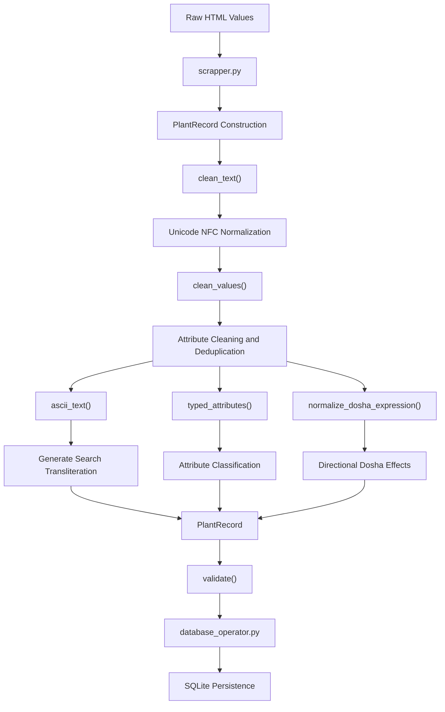

# Data Cleaning and Plant Records – `cleaning.py`

## 1. Role of the File in the Project

The `cleaning.py` module is responsible for cleaning, normalizing, classifying, and validating plant information before it is stored in the database.

It acts as the boundary between raw extracted information and structured application data.

The scraper extracts information from HTML, but raw HTML values are not always suitable for direct database storage.

They may contain:

- Unnecessary whitespace.
- Inconsistent Unicode representations.
- Emoji and formatting characters.
- Multiple values in one field.
- Inconsistent transliteration.
- Missing optional values.
- Ambiguous Dosha expressions.

The cleaning module addresses these problems.

### Position in the architecture

```text
CCRAS DRAVYA HTML
        |
        v
   scrapper.py
        |
        v
    RAW VALUES
        |
        v
    cleaning.py
        |
        +----> Unicode Normalization
        |
        +----> ASCII Transliteration
        |
        +----> Attribute Classification
        |
        +----> Dosha Normalization
        |
        +----> Record Validation
        |
        v
    PlantRecord
        |
        v
 database_operator.py
        |
        v
    SQLite
```

The module deliberately does not perform database operations or network requests.

This separation makes the cleaning rules deterministic and easier to test.

---

## 2. Imports Used

The module relies almost entirely on Python's standard library.

### 2.1 `dataclasses`

```python
from dataclasses import dataclass, field
```

Used to define structured data classes.

- `dataclass`: Automatically generates common methods such as initialization and representation.
- `field`: Defines default values and default factories for dataclass fields.

The module uses dataclasses for:

- `TypedAttribute`
- `PlantRecord`
- `DoshaNormalization`

### 2.2 `re`

```python
import re
```

Provides regular-expression functionality.

Used for:

- Splitting multiple source values.
- Detecting Dosha names and effects.
- Removing unsupported characters during Dosha parsing.

### 2.3 `unicodedata`

```python
import unicodedata
```

Provides Unicode character information and normalization operations.

This is especially important because the project handles Sanskrit, Hindi, and other Indian-language text.

It is used for:

- Unicode NFC normalization.
- Unicode compatibility decomposition.
- Identifying combining marks.
- Identifying character categories.
- Removing selected formatting and symbol characters.

### 2.4 `typing`

```python
from typing import Iterable, Literal
```

Used to provide more precise type annotations.

`Iterable` allows functions to accept iterable collections.

`Literal` restricts certain values to predefined strings.

For example:

```python
AttributeKind = Literal["disease", "ambiguous"]
```

This indicates that an attribute can have one of two classification values.

### 2.5 `urllib.parse.urlsplit`

```python
from urllib.parse import urlsplit
```

Used during record validation.

It separates a URL into components such as:

- Scheme.
- Hostname.
- Path.
- Query.
- Fragment.

The validator uses it to check whether the source URL is a valid HTTP or HTTPS URL with a hostname.

---

## 3. Constants and Configuration

### 3.1 `AttributeKind`

```python
AttributeKind = Literal["disease", "ambiguous"]
```

Defines the supported attribute classification types.

An attribute is classified as:

- `disease`: Known condition/indication field.
- `ambiguous`: Any other source field.

The classification is intentionally conservative.

### 3.2 `DoshaEffect`

```python
DoshaEffect = Literal[
    "decrease",
    "increase",
    "unspecified"
]
```

Defines the possible normalized effects of a Dosha expression.

### 3.3 `DOSHAS`

```python
DOSHAS = ("Vata", "Pitta", "Kapha")
```

Defines the three canonical Dosha names.

All Dosha normalization results use these canonical labels.

### 3.4 `DOSHA_ALIASES`

```python
DOSHA_ALIASES = {
    "vata": "Vata",
    "pitta": "Pitta",
    "kapha": "Kapha",
}
```

Maps normalized Dosha strings to their canonical representations.

This ensures that different capitalization styles do not create different Dosha identities.

### 3.5 `CONDITION_FIELDS`

```python
CONDITION_FIELDS = frozenset({
    "Therapeutic Usage.Name"
})
```

Identifies the source field that contains therapeutic condition names.

Values from this field are classified as `disease`.

Other fields remain `ambiguous`.

The use of a `frozenset` makes the configured field collection immutable.

Importantly, classification does not mean that the condition has been clinically verified.

### 3.6 `PRESERVED_FORMAT_CHARACTERS`

```python
PRESERVED_FORMAT_CHARACTERS = frozenset({
    "\u200c",
    "\u200d"
})
```

Contains two important Unicode characters:

| Character | Unicode | Meaning |
|---|---|---|
| ZWNJ | U+200C | Zero Width Non-Joiner |
| ZWJ | U+200D | Zero Width Joiner |

These characters affect how certain Indic-script characters are displayed.

Removing them indiscriminately can change the visual rendering of words.

Therefore, the cleaner preserves them even though it removes most other Unicode format characters.

### 3.7 `ROMANIZATION`

A translation table created using:

```python
str.maketrans()
```

It maps Sanskrit transliteration characters to ASCII equivalents.

Examples:

| Character | ASCII representation |
|---|---|
| ā | A |
| ī | I |
| ū | U |
| ṛ | R |
| ṝ | RR |
| ḷ | L |
| ṅ | G |
| ñ | J |
| ṭ | T |
| ḍ | D |
| ṇ | N |
| ś | z |
| ṣ | S |
| ḥ | H |
| ṃ | M |

Uppercase equivalents are also provided.

The mappings preserve important phonetic distinctions instead of treating every Sanskrit diacritic as an ordinary English letter.

### 3.8 `SPLIT_PATTERN`

```python
SPLIT_PATTERN = re.compile(
    r"\s*(?:\n|;|\|)\s*"
)
```

Recognizes the supported separators between values:

- Newline.
- Semicolon.
- Pipe character.

For example:

```text
Root; Leaf | Flower
```

Can be split into:

```python
["Root", "Leaf", "Flower"]
```

### 3.9 Dosha effect terminology

```python
DOSHA_DECREASE_TERMS = (
    "shamana",
    "zamana",
    "ghna",
    "hara"
)

DOSHA_INCREASE_TERMS = (
    "vardhaka",
    "vrddhi"
)
```

These tuples contain the terminology families recognized by the current normalizer.

The normalizer does not attempt to interpret arbitrary Sanskrit suffixes or unrelated English descriptions.

---

## 4. Classes and Data Structures

The module defines three main dataclasses.

### 4.1 `TypedAttribute`

```python
@dataclass(frozen=True, slots=True)
class TypedAttribute:
    field: str
    value: str
    kind: AttributeKind
```

Represents one extracted attribute with its classification.

| Field | Purpose |
|---|---|
| `field` | Original section-qualified field name |
| `value` | Extracted attribute value |
| `kind` | Attribute classification |

Example:

```python
TypedAttribute(
    field="Therapeutic Usage.Name",
    value="Kāsa",
    kind="disease"
)
```

This makes the distinction between disease-related information and ordinary extracted attributes explicit.

The class is immutable because it uses `frozen=True`.

### 4.2 `PlantRecord`

```python
@dataclass(slots=True)
class PlantRecord:
    source: str
    source_record_id: int
    source_url: str
    retrieved_at: str
    ayurvedic_name: str
    botanical_name: str | None = None
    family: str | None = None
    attributes: dict[str, list[str]] = field(
        default_factory=dict
    )
    source_values: dict[str, str] = field(
        default_factory=dict
    )
    attribute_metadata: dict[
        str, dict[str, str | bool]
    ] = field(default_factory=dict)
    dosha_expressions: list[str] = field(
        default_factory=list
    )
    translation_failures: list[str] = field(
        default_factory=list
    )
    transliterated_name: str = ""
    transliterated_botanical_name: str | None = None
    transliterated_family: str | None = None
```

This is the most important class in the module.

It acts as the common data contract between:

- Scraper.
- Cleaner.
- Translator.
- Validator.
- Database operator.

Instead of passing unrelated dictionaries between modules, the application uses one structured object.

#### Field descriptions

| Field | Purpose |
|---|---|
| `source` | Name of the data source, currently CCRAS DRAVYA |
| `source_record_id` | Original plant identifier from the source |
| `source_url` | URL of the source monograph |
| `retrieved_at` | Time when the source record was retrieved |
| `ayurvedic_name` | Primary Ayurvedic name |
| `botanical_name` | Scientific botanical name |
| `family` | Botanical family |
| `attributes` | Section-qualified attribute names mapped to value lists |
| `source_values` | Combined source wording associated with extracted fields |
| `attribute_metadata` | Additional attribute metadata |
| `dosha_expressions` | Original Dosha expressions |
| `translation_failures` | Translation failure information |
| `transliterated_name` | ASCII transliteration of the Ayurvedic name |
| `transliterated_botanical_name` | ASCII transliteration of the scientific name |
| `transliterated_family` | ASCII transliteration of the botanical family |

#### Why use `default_factory`?

Consider:

```python
attributes: dict[str, list[str]] = field(
    default_factory=dict
)
```

A mutable dictionary should not be shared between different `PlantRecord` objects.

`default_factory` creates a new dictionary for every instance.

This prevents accidental data sharing between records.

### 4.3 `DoshaNormalization`

```python
@dataclass(frozen=True, slots=True)
class DoshaNormalization:
    source_expression: str
    effects: dict[str, DoshaEffect]
```

Stores the result of Dosha normalization.

| Field | Purpose |
|---|---|
| `source_expression` | Original source expression |
| `effects` | Normalized effect for Vata, Pitta, and Kapha |

Example:

```python
DoshaNormalization(
    source_expression="KaphaVātahara",
    effects={
        "Vata": "decrease",
        "Pitta": "unspecified",
        "Kapha": "decrease"
    }
)
```

The original expression is retained even after interpretation.

This is important for later source verification.

---

## 5. Functions

### 5.1 `clean_text()`

```python
def clean_text(value: str) -> str:
```

**Purpose:** Performs the primary Unicode text-cleaning operation.

This function is used throughout the project whenever raw source text needs to be normalized.

#### Step 1 – Unicode NFC normalization

```python
value = unicodedata.normalize("NFC", value)
```

Unicode characters can sometimes have multiple valid internal representations.

For example, a character may be represented as:

- One precomposed Unicode character.
- A base character followed by a combining mark.

NFC normalization converts canonically equivalent sequences into a consistent representation where possible.

This is particularly important for Sanskrit and other Indic-language text.

#### Step 2 – Remove unwanted characters

```python
unicodedata.category(character)
```

The function examines the Unicode category of every character.

It removes:

- Most Unicode format characters (`Cf`).
- Symbol, Other characters (`So`).
- Modifier symbols (`Sk`).
- Variation selectors in the range U+FE00 to U+FE0F.

The exception is that ZWNJ and ZWJ are preserved.

#### Step 3 – Normalize whitespace

```python
return " ".join(value.split())
```

This removes leading and trailing whitespace and collapses multiple spaces, tabs, and newlines into single spaces.

Example:

Input:

```text
"   तुलसी     (Holy Basil)   "
```

Output:

```text
"तुलसी (Holy Basil)"
```

The function preserves the original script rather than converting everything into English.

### 5.2 `clean_optional_text()`

```python
def clean_optional_text(
    value: str | None
) -> str | None:
```

**Purpose:** Cleans optional text fields.

If the value is `None`, it returns `None`.

Otherwise, it calls `clean_text()`.

If the cleaned value is empty, it returns `None`.

Example:

```python
clean_optional_text("   ")
```

Returns:

```python
None
```

This is useful for optional botanical names and family information.

It avoids storing empty strings where a missing value is more appropriate.

### 5.3 `ascii_text()`

```python
def ascii_text(value: str) -> str:
```

**Purpose:** Generates ASCII transliteration for search and display compatibility.

This function is particularly useful when users need to search for Sanskrit names using ordinary English keyboard characters.

#### Step 1 – NFC normalization

```python
value = unicodedata.normalize("NFC", value)
```

#### Step 2 – Apply romanization mappings

```python
value = value.translate(ROMANIZATION)
```

Sanskrit diacritics are converted using the predefined romanization table.

#### Step 3 – Unicode compatibility decomposition

```python
value = unicodedata.normalize("NFKD", value)
```

NFKD decomposes compatible characters into their component forms.

#### Step 4 – Remove combining marks

```python
character
for character in value
if not unicodedata.combining(character)
```

Combining marks are removed.

#### Step 5 – Convert to ASCII

```python
value.encode("ascii", "ignore").decode("ascii")
```

Characters that cannot be represented in ASCII are discarded.

The resulting string is passed through `clean_text()`.

#### Example

```python
ascii_text("Kāsa")
```

Returns:

```text
KAsa
```

This function does not replace the original Ayurvedic name.

It creates a separate transliterated representation.

### 5.4 `clean_values()`

```python
def clean_values(
    values: Iterable[str]
) -> list[str]:
```

**Purpose:** Cleans a collection of values and removes duplicates.

The function:

1. Iterates over every value.
2. Applies `clean_text()`.
3. Ignores empty results.
4. Checks whether the cleaned value has already appeared.
5. Preserves the original order.

Example:

Input:

```python
[
    "Root",
    " Leaf ",
    "Root",
    "",
    "Flower"
]
```

Output:

```python
[
    "Root",
    "Leaf",
    "Flower"
]
```

The implementation uses a list for ordered output and a set for efficient duplicate detection.

### 5.5 `attribute_kind()`

```python
def attribute_kind(
    field: str,
    value: str
) -> AttributeKind:
```

**Purpose:** Classifies extracted attributes.

The current implementation checks whether the field name belongs to `CONDITION_FIELDS`.

```python
return (
    "disease"
    if clean_text(field) in CONDITION_FIELDS
    else "ambiguous"
)
```

The `value` parameter is currently unused.

This is intentional: classification is based on the known source field, not on guessing what an arbitrary value means.

Example:

```python
attribute_kind(
    "Therapeutic Usage.Name",
    "Kāsa"
)
```

Returns:

```text
disease
```

Whereas:

```python
attribute_kind(
    "Parts Used.Name",
    "Root"
)
```

Returns:

```text
ambiguous
```

The term `disease` indicates a source condition/indication field, not a verified medical diagnosis.

### 5.6 `PlantRecord.clean()`

```python
def clean(self) -> PlantRecord:
```

**Purpose:** Cleans and normalizes an entire plant record.

This method is one of the most important operations in the module.

It mutates the existing record and returns the same object.

#### Step 1 – Clean primary fields

```python
self.source = clean_text(self.source)
self.retrieved_at = clean_text(self.retrieved_at)
self.ayurvedic_name = clean_text(self.ayurvedic_name)
```

#### Step 2 – Clean optional fields

```python
self.botanical_name = clean_optional_text(
    self.botanical_name
)

self.family = clean_optional_text(
    self.family
)
```

Empty optional values become `None`.

#### Step 3 – Generate transliterations

```python
self.transliterated_name = ascii_text(
    self.ayurvedic_name
)
```

Similar operations are performed for botanical name and family.

The original Unicode fields remain unchanged apart from normalization.

#### Step 4 – Clean attributes

Every field name is normalized.

Every value list is processed through `clean_values()`.

Fields that become empty are discarded.

If different original field names normalize to the same cleaned field name, their values are merged while preserving order and avoiding duplicates.

#### Step 5 – Clean source values

The `source_values` dictionary is normalized.

Empty field names and empty values are discarded.

#### Step 6 – Clean Dosha expressions

```python
self.dosha_expressions = clean_values(
    self.dosha_expressions
)
```

Duplicate source expressions are removed.

#### Step 7 – Clean attribute metadata keys

The field names in `attribute_metadata` are normalized, and empty field names are excluded.

The associated metadata values are retained.

Finally, the method returns the updated record.

### 5.7 `PlantRecord.typed_attributes()`

```python
def typed_attributes(
    self
) -> Iterable[TypedAttribute]:
```

**Purpose:** Produces typed representations of individual attributes.

It iterates through:

```python
self.attributes
```

For each field-value combination, it creates:

```python
TypedAttribute(
    field=field,
    value=value,
    kind=attribute_kind(field, value)
)
```

The method uses `yield`, so it returns a generator rather than building an entire list immediately.

Example:

```python
record = PlantRecord(
    source="CCRAS DRAVYA",
    source_record_id=1,
    source_url="https://example.org/plant/1",
    retrieved_at="2026-01-01T00:00:00Z",
    ayurvedic_name="Tulsi",
    attributes={
        "Therapeutic Usage.Name": ["Kāsa"],
        "Parts Used.Name": ["Leaf"]
    }
)

for attribute in record.typed_attributes():
    print(attribute)
```

The output contains one disease-classified attribute and one ambiguous attribute.

This provides a consistent classification interface for downstream ingestion.

### 5.8 `PlantRecord.validate()`

```python
def validate(self) -> None:
```

**Purpose:** Ensures that a record satisfies the required minimum data conditions.

The function raises `ValueError` when validation fails.

It checks:

#### Source

The source must be a non-empty string.

#### Retrieval timestamp

The retrieval timestamp must be a non-empty string.

#### Source record ID

The source record ID must be positive.

Boolean values are explicitly rejected.

#### Source URL

```python
parsed_url = urlsplit(self.source_url)
```

The URL must have:

- HTTP or HTTPS scheme.
- A valid hostname.

#### Ayurvedic name

The primary Ayurvedic name must not be empty.

The method does not silently repair invalid records.

It raises an exception so the caller can handle the failure.

Note that `clean()` and `validate()` have separate responsibilities:

- `clean()` normalizes.
- `validate()` checks required conditions.

### 5.9 `split_values()`

```python
def split_values(value: str) -> list[str]:
```

**Purpose:** Splits multiple values contained in one source string.

Implementation:

```python
return clean_values(
    SPLIT_PATTERN.split(value)
)
```

Supported separators:

- Newline.
- Semicolon.
- Pipe.

Example:

```python
split_values(
    "Root; Leaf | Flower"
)
```

Returns:

```python
[
    "Root",
    "Leaf",
    "Flower"
]
```

It also cleans the individual values and removes duplicates.

### 5.10 `normalize_dosha_expression()`

```python
def normalize_dosha_expression(
    expression: str
) -> DoshaNormalization:
```

**Purpose:** Converts documented traditional Dosha expressions into explicit directional effects.

This is one of the most important domain-specific functions in the project.

The original source may contain a compound expression describing the effect of a plant on one or more Doshas.

The application attempts to interpret only the terminology patterns explicitly supported by its normalization rules.

#### Step 1 – Normalize the expression

```python
normalized = re.sub(
    r"[^a-z]",
    "",
    ascii_text(clean_text(expression)).casefold()
)
```

This performs several operations:

1. Unicode text cleaning.
2. ASCII transliteration.
3. Case normalization.
4. Removal of characters other than lowercase English letters.

For example:

```text
KaphaVātahara
```

becomes:

```text
kaphavatahara
```

This makes it easier to recognize Dosha and effect terms regardless of capitalization or diacritics.

#### Step 2 – Initialize the effects dictionary

```python
effects_by_dosha = {
    dosha: set()
    for dosha in DOSHAS
}
```

Initially:

```python
{
    "Vata": set(),
    "Pitta": set(),
    "Kapha": set()
}
```

Sets are used because the expression may contain multiple assertions for the same Dosha.

#### Step 3 – Identify Dosha groups

The parser uses a cursor to scan the normalized expression from left to right.

It first recognizes:

```text
tridosa
tridosha
```

These represent all three Doshas.

Otherwise, it looks for individual Dosha names:

```text
vata
pitta
kapha
```

After recognizing one Dosha, it also checks whether additional Dosha names immediately follow.

This allows expressions involving multiple Doshas to be handled together.

#### Step 4 – Identify the directional effect

After a Dosha group is recognized, the parser looks for supported effect terminology.

Decrease terms:

```text
shamana
zamana
ghna
hara
```

Increase terms:

```text
vardhaka
vrddhi
```

If a recognized decrease term follows the Dosha group, the effect becomes:

```text
decrease
```

If a recognized increase term follows it, the effect becomes:

```text
increase
```

The effect is then associated with each Dosha in the recognized group.

#### Step 5 – Check complete expression consumption

The cursor must reach the end of the normalized expression.

If the expression contains:

- An unknown trailing term.
- An incomplete Dosha/effect group.
- An unsupported sequence.

The entire expression is treated as ambiguous.

In that case, all three Dosha effects are reset to empty sets.

This prevents the parser from accepting only a recognizable substring of a longer unsupported expression.

#### Step 6 – Resolve the final effects

For each Dosha:

- Exactly one recognized effect produces that effect.
- No recognized effect produces `unspecified`.
- Multiple conflicting effects for the same Dosha produce `unspecified` for that Dosha.

An expression with conflicting effects is therefore not treated as a single unambiguous assertion.

#### Step 7 – Return the normalization result

```python
return DoshaNormalization(
    source_expression=expression,
    effects={
        dosha: (
            next(iter(effects))
            if len(effects) == 1
            else "unspecified"
        )
        for dosha, effects in effects_by_dosha.items()
    }
)
```

The original expression is retained.

---

## 6. Dosha Normalization Examples

### Example 1 – One Dosha

Input:

```text
Kaphahara
```

Interpretation:

```text
Kapha -> decrease
Vata  -> unspecified
Pitta -> unspecified
```

### Example 2 – Multiple Doshas

Input:

```text
KaphaVātahara
```

Interpretation:

```text
Kapha -> decrease
Vata  -> decrease
Pitta -> unspecified
```

### Example 3 – Tridosha expression

Input:

```text
TridoshaShamana
```

Interpretation:

```text
Vata  -> decrease
Pitta -> decrease
Kapha -> decrease
```

### Example 4 – Increase effect

Input:

```text
Pittavṛddhi
```

Interpretation:

```text
Vata  -> unspecified
Pitta -> increase
Kapha -> unspecified
```

### Example 5 – Independent effects

Input:

```text
VātavardhakaPittahara
```

Interpretation:

```text
Vata  -> increase
Pitta -> decrease
Kapha -> unspecified
```

This is particularly important because the parser must not assume that every Dosha in an expression has the same effect.

### Example 6 – Unsupported expression

If the parser encounters an unknown trailing term, it resets the entire expression to unspecified.

This is preferable to incorrectly assigning an effect based on a partially recognized expression.

---

## 7. Important Design Decisions

### 7.1 Preserve Unicode source information

The project works with Sanskrit and multiple Indian languages.

Converting all text into ASCII would destroy important linguistic information.

Therefore, the application keeps Unicode-normalized original fields and stores transliterations separately.

### 7.2 Why NFC instead of converting everything to NFKD?

NFC is used for ordinary source-text cleaning because it preserves the original script while making canonically equivalent strings consistent.

NFKD is used specifically in `ascii_text()` as part of the transliteration pipeline.

### 7.3 Why Harvard-Kyoto-style romanization?

Ordinary accent removal can collapse linguistically distinct Sanskrit characters.

The custom mapping preserves distinctions such as:

```text
ś -> z
ṣ -> S
ṅ -> G
ñ -> J
ṇ -> N
```

This makes the transliteration more useful than simply removing all diacritics.

### 7.4 Why use typed attributes?

Not every extracted field represents a disease.

For example:

```text
Therapeutic Usage.Name
Parts Used.Name
Rasa.Name
```

These fields have different meanings.

The typed-attribute system identifies the known condition field while leaving other fields ambiguous.

It avoids making unsupported assumptions based on arbitrary text values.

### 7.5 Why preserve original Dosha expressions?

Normalization is an interpretation.

Keeping the original expression allows future developers and researchers to verify whether the interpretation was correct.

### 7.6 Why use unspecified rather than guessing?

The absence of a documented effect is not evidence of a neutral effect.

Therefore, the normalizer uses `unspecified` rather than assigning an unsupported increase or decrease.

### 7.7 Why separate cleaning from translation?

Cleaning should be deterministic and independent of network availability.

Translation may fail, take time, or return imperfect results.

Keeping translation in `translation.py` prevents an external translation service from becoming a requirement for basic data cleaning.

---

## 8. Complete Data Flow



---

## 9. Testing

Cleaning-related behavior is covered by the project's test suite, including scraper integration tests.

Important behaviors to test include:

- Unicode NFC normalization.
- Preservation of ZWJ and ZWNJ.
- ASCII romanization.
- Duplicate value removal.
- Multiple-value splitting.
- Optional-field handling.
- PlantRecord validation.
- Typed attribute classification.
- Dosha expression recognition.
- Independent Dosha effects.
- Unsupported expression handling.
- Conflicting effects.

Run the scraper regression tests:

```bash
python -m pytest tests/test_scrapper.py -q
```

Run the full suite:

```bash
python -m pytest -q
```

---

## 10. Limitations

- ASCII transliteration is a search/display representation, not a substitute for the original Sanskrit or vernacular text.
- The Dosha normalizer recognizes only its configured terminology families.
- Unrecognized expressions are not automatically translated into semantic meanings.
- Attribute classification currently recognizes only the configured `Therapeutic Usage.Name` field as a disease-related field.
- The cleaner does not independently verify botanical or clinical claims.
- `clean()` modifies the existing PlantRecord instance rather than producing a separate immutable record.

---

## 11. Summary

The `cleaning.py` module ensures that information entering Herbal Almanac is consistently represented without losing its source-language content.

Its main responsibilities are:

1. Unicode normalization.
2. ASCII transliteration.
3. Value splitting and deduplication.
4. Typed attribute classification.
5. PlantRecord construction support.
6. Record validation.
7. Conservative Dosha normalization.

The most important design principle is that normalized information must remain connected to its original source expression.

This allows later project stages to build semantic representations without losing the evidence on which those representations depend.
