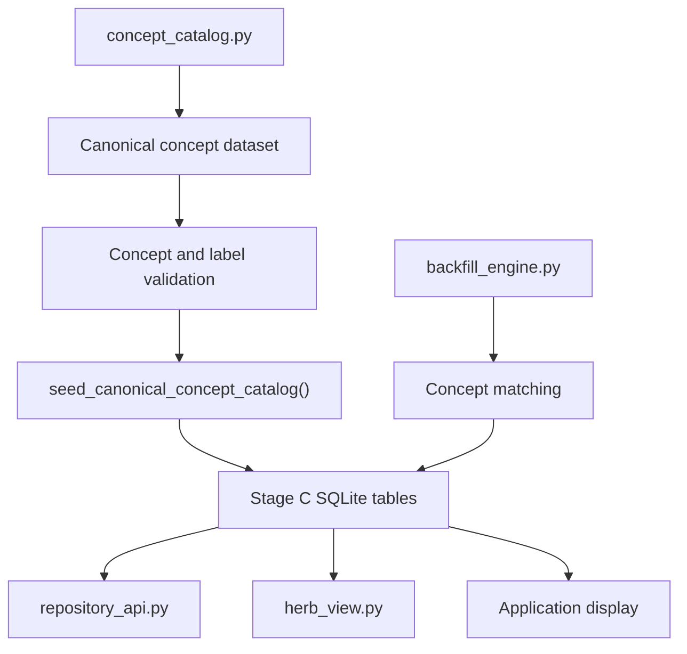

# Canonical Dravyaguna Concept Catalog (`concept_catalog.py`)

**Source module:** `src/herbal_almanac/concept_catalog.py`  
**Architecture stage:** Stage C — Semantic Dravyaguna Architecture  
**Database requirement:** Stage C schema version 3

## 1. Purpose and responsibility

The `concept_catalog.py` module defines the canonical vocabulary used to represent Ayurvedic Dravyaguna properties in a consistent, structured way.

Different sources may express the same Ayurvedic concept using:

- Sanskrit in Devanagari.
- Sanskrit transliteration in Latin script.
- Hindi equivalents.
- English translations.
- Alternative spellings.
- Synonyms.

For example, the concept of sweetness may appear as:

- मधुर
- Madhura
- Madura
- Sweet

Without a canonical vocabulary, the application would have to treat these as unrelated strings.

The concept catalog solves this problem by assigning a stable concept code and associating multiple language and script labels with that concept.

Its responsibilities are:

- Define the canonical concept dataset.
- Establish naming conventions for concept identifiers.
- Validate concept codes and domains.
- Normalize labels for matching.
- Seed concepts, labels, and citations into SQLite.
- Resolve the best available display label for a concept.
- Retrieve canonical Sanskrit references.

The catalog is a central part of the Stage C semantic architecture.

## 2. Position in the project architecture



### Upstream dependencies

| Module | Responsibility |
|---|---|
| `schema_capability_gate.py` | Ensures the database supports Stage C operations. |
| `migrations/migration_0003_semantic_dravyaguna.py` | Creates the semantic schema. |

### Downstream consumers

| Module | Responsibility |
|---|---|
| `backfill_engine.py` | Matches source expressions against canonical labels and concepts. |
| `repository_api.py` | Retrieves semantic information for application use. |
| `herb_view.py` | Presents normalized herb properties. |
| `database_operator.py` | Coordinates catalog seeding during Stage C upgrade. |

## 3. Imports

The module uses:

| Import | Purpose |
|---|---|
| `re` | Validates concept-code naming conventions. |
| `sqlite3` | Inserts and queries concept data. |
| `unicodedata` | Normalizes Unicode labels. |
| `datetime`, `timezone` | Generates and validates UTC timestamps. |
| `Any` | Type annotations. |
| `NamedTuple` | Defines immutable catalog seed structures. |

Internal dependency:

```python
from .schema_capability_gate import require_stage_c_schema_v3
```

This function checks that the database has the required Stage C schema before catalog operations are performed.

## 4. Concept domains and namespaces

The module defines:

```python
DOMAIN_PREFIX_MAP
```

This dictionary maps each semantic domain to its required identifier prefix.

| Concept domain | Prefix | Meaning |
|---|---|---|
| `rasa` | `RASA_` | Taste or Rasa. |
| `guna` | `GUNA_` | Qualities or Gunas. |
| `virya` | `VIRYA_` | Potency. |
| `vipaka` | `VIPAKA_` | Post-digestive effect. |
| `prabhava` | `PRABHAVA_` | Specific or distinctive effect. |
| `karma` | `KARMA_` | Actions or pharmacological activities. |
| `dosha` | `DOSHA_` | Dosha concepts. |
| `dosha_effect` | `EFFECT_` | Directional Dosha effects. |
| `plant_part` | `PART_` | Plant parts used. |
| `preparation_form` | `PREP_` | Preparation and dosage forms. |
| `indication` | `IND_` | Therapeutic indications. |

There are 11 accepted semantic domains.

### Example concept identifiers

```text
RASA_MADHURA
GUNA_GURU
VIRYA_USHNA
VIPAKA_MADHURA
DOSHA_VATA
EFFECT_DECREASE
PART_LEAF
PREP_CHURNA
IND_JVARA
```

The identifier is designed to remain stable even if a preferred display label changes.

## 5. Concept-code validation

### `CONCEPT_CODE_REGEX`

```python
CONCEPT_CODE_REGEX = re.compile(
    r"^[A-Z]+_[A-Z0-9_]+$"
)
```

A valid concept code must:

1. Be a non-empty string.
2. Use uppercase ASCII letters and digits.
3. Contain underscores.
4. Follow the expected domain prefix.
5. Belong to one of the accepted domains.

### `validate_concept_code_prefix(concept_code, concept_domain)`

```python
validate_concept_code_prefix(
    concept_code: str,
    concept_domain: str,
) -> None
```

Validates that a concept code belongs to the supplied domain.

Example:

```python
validate_concept_code_prefix(
    "RASA_TIKTA",
    "rasa",
)
```

This succeeds because:

- `RASA_TIKTA` matches the naming pattern.
- `rasa` is an accepted domain.
- `RASA_TIKTA` begins with the required `RASA_` prefix.

An invalid combination raises `ValueError`.

For example:

```python
validate_concept_code_prefix(
    "GUNA_GURU",
    "rasa",
)
```

This fails because the code uses `GUNA_`, whereas the `rasa` domain requires `RASA_`.

## 6. Data structures

The module uses three `NamedTuple` classes to define the catalog's seed data.

### 6.1 `LabelSeed`

```python
class LabelSeed(NamedTuple):
    language_code: str
    script_code: str
    label_text: str
    label_type: str
    translation_origin: str
    is_preferred: int = 1
    normalized_label: str | None = None
```

Represents one language-specific label for a concept.

| Field | Meaning |
|---|---|
| `language_code` | Language identifier, such as `sa`, `hi`, or `en`. |
| `script_code` | Script identifier, such as `Deva` or `Latn`. |
| `label_text` | Actual label displayed to the user. |
| `label_type` | Role of the label, such as canonical Sanskrit, transliteration, synonym, or translation. |
| `translation_origin` | Origin of the label, such as a classical lexicon or human curation. |
| `is_preferred` | Whether the label is preferred within its group. |
| `normalized_label` | Optional precomputed normalized representation. |

Example:

```python
LabelSeed(
    "sa",
    "Deva",
    "मधुर",
    "canonical_sanskrit",
    "classical_lexicon",
    1,
)
```

The same concept can have several labels in different languages and scripts.

#### `get_normalized()`

```python
get_normalized() -> str
```

Returns the supplied `normalized_label` when available. Otherwise, it calls `normalize_label()` on `label_text`.

### 6.2 `CitationSeed`

```python
class CitationSeed(NamedTuple):
    authority_citation: str
    citation_type: str = "classical_text"
    citation_notes: str | None = None
    target_language: str = "sa"
    target_script: str = "Deva"
```

Represents a reference associated with a canonical concept.

Fields:

- `authority_citation`: textual reference to an authority.
- `citation_type`: classification of the reference.
- `citation_notes`: explanation of its relevance.
- `target_language`: language of the referenced material.
- `target_script`: script of the referenced material.

Example:

```python
CitationSeed(
    "Caraka Saṃhitā, Sūtrasthāna 26.42",
    "classical_text",
    "Canonical definition of Madhura rasa",
)
```

This allows the concept catalog to retain references rather than storing only labels.

### 6.3 `ConceptSeed`

```python
class ConceptSeed(NamedTuple):
    concept_code: str
    concept_domain: str
    status: str
    parent_concept_code: str | None
    labels: list[LabelSeed]
    citations: list[CitationSeed]
```

Represents a complete canonical concept.

It combines:

- Stable identifier.
- Semantic domain.
- Lifecycle status.
- Optional parent concept.
- Multilingual labels.
- Authority citations.

A concept can therefore be seeded together with its linguistic representations and supporting references.

## 7. Canonical concept dataset

The module defines:

```python
CANONICAL_CONCEPTS: list[ConceptSeed]
```

This is the built-in seed dataset.

The current source contains **136 `ConceptSeed` entries** and **649 multilingual labels** across those concepts as of the current seed data.

To recount them programmatically from Python:

```python
from herbal_almanac.concept_catalog import CANONICAL_CONCEPTS
concept_count = len(CANONICAL_CONCEPTS)
label_count = sum(len(c.labels) for c in CANONICAL_CONCEPTS)
print(f'{concept_count} concepts, {label_count} labels')
```

Or from SQLite after running `upgrade_to_stage_c()`:

```sql
SELECT count(*) FROM dravyaguna_concepts; -- 136
SELECT count(*) FROM concept_labels;      -- 649
```

The dataset covers the 11 domains listed earlier.

### Example: Rasa concepts

The catalog includes the six classical Rasa categories:

| Concept code | Sanskrit | English label |
|---|---|---|
| `RASA_MADHURA` | मधुर | Sweet |
| `RASA_AMLA` | अम्ल | Sour |
| `RASA_LAVANA` | लवण | Salty |
| `RASA_KATU` | कटु | Pungent |
| `RASA_TIKTA` | तिक्त | Bitter |
| `RASA_KASHAYA` | कषाय | Astringent |

Each concept can contain multiple labels, including transliterations, synonyms, and vernacular equivalents.

### Example: Guna concepts

The catalog also defines the Gurvadi and Paradi quality concepts.

Examples include:

- Guru
- Laghu
- Shita
- Ushna
- Snigdha
- Ruksha

The complete vocabulary is defined in `CANONICAL_CONCEPTS`; this documentation lists examples rather than reproducing the entire seed dataset.

### Why a fixed concept dataset?

A controlled catalog prevents every source from creating a new concept merely because it uses a different spelling.

For example:

```text
Madhura
Madura
मधुर
Sweet
```

can all be represented as labels of the same canonical concept:

```text
RASA_MADHURA
```

## 8. Label normalization

### `normalize_label(label)`

```python
normalize_label(label: str) -> str
```

Returns a normalized representation of a label.

The current implementation:

1. Removes leading and trailing whitespace.
2. Converts the text to lowercase.
3. Applies Unicode NFC normalization.

```python
unicodedata.normalize(
    "NFC",
    label.strip().lower(),
)
```

This is used to create consistent label keys for matching and deduplication.

**Important distinction:** this function does not perform full transliteration, semantic interpretation, or broad spelling correction. It is a basic Unicode and case normalization function.

## 9. Dataset validation

### `_validate_iso_utc_timestamp(ts)`

Validates that a timestamp is a non-empty ISO-8601 timestamp representing UTC.

It accepts timestamps ending in:

```text
Z
+00:00
```

It rejects timestamps that do not explicitly represent UTC.

### `validate_catalog_dataset(concepts)`

```python
validate_catalog_dataset(
    concepts: list[ConceptSeed],
) -> None
```

Validates the built-in or supplied catalog dataset before it is seeded.

The validation layer checks the structural and semantic consistency of the seed definitions, including concept identifiers, domains, labels, and citations.

This prevents an invalid vocabulary definition from being silently inserted into the database.

## 10. Database seeding

### `seed_canonical_concept_catalog(...)`

```python
seed_canonical_concept_catalog(
    conn: sqlite3.Connection,
    now: str | None = None,
    dataset: list[ConceptSeed] | None = None,
)
```

This is the main database-writing function.

It inserts the canonical concepts and their associated labels and citations into the Stage C database.

#### Parameters

| Parameter | Description |
|---|---|
| `conn` | SQLite connection with the Stage C schema. |
| `now` | Optional UTC timestamp for the seeding operation. |
| `dataset` | Optional custom concept dataset. When omitted, the built-in `CANONICAL_CONCEPTS` is used. |

#### Step-by-step logic

1. Verify that the connection supports Stage C schema version 3.
2. Determine the timestamp used for the operation.
3. Select the supplied dataset or the built-in canonical dataset.
4. Validate the dataset.
5. Insert or reconcile concept records.
6. Resolve concept IDs for associated labels and citations.
7. Insert label records with their language, script, type, origin, and preferred status.
8. Store citation information associated with the concepts.
9. Return the seeding result.

The function is designed to support repeatable catalog initialization rather than requiring a new database every time.

### Why seeding is important

The backfill engine needs a known vocabulary before it can map source expressions to semantic concepts.

The catalog therefore acts as the controlled reference vocabulary for Stage C.

## 11. Display-label resolution

### `resolve_concept_display_label(...)`

```python
resolve_concept_display_label(
    conn: sqlite3.Connection,
    concept_id: int,
    language: str = "en",
    allow_provisional: bool = False,
)
```

Returns the best eligible display label for a concept.

It considers:

- Concept lifecycle status.
- Requested language.
- Available scripts.
- Label verification status.
- Preferred-label flag.
- Stable label ID ordering.

#### Concept-status rules

- A missing concept returns `None`.
- A deprecated concept is not displayed.
- A provisional concept is excluded unless `allow_provisional=True`.

#### Language priority

For Hindi requests (`language="hi"`), the current priority is:

1. Hindi, Devanagari.
2. English, Latin.
3. Sanskrit, Devanagari.
4. Sanskrit, Latin.

For other requests, the current implementation uses:

1. English, Latin.
2. Hindi, Devanagari.
3. Sanskrit, Devanagari.
4. Sanskrit, Latin.

#### Verification priority

Within the eligible language/script candidates:

1. `verified`
2. `reviewed`
3. `unreviewed`

Preferred labels are ranked before non-preferred labels within the same verification tier.

Labels marked `disputed` or `rejected` are excluded.

#### Fallback behavior

If no eligible label exists, the resolver can fall back to the concept code.

The fallback is marked as unreviewed and identified as a fallback rather than being presented as a verified translation.

This makes the display behavior transparent.

## 12. Sanskrit reference resolution

### `resolve_concept_sanskrit_references(...)`

```python
resolve_concept_sanskrit_references(
    conn: sqlite3.Connection,
    concept_id: int,
    allow_provisional: bool = False,
) -> dict[str, str | None]
```

Retrieves the best available Sanskrit labels in Devanagari and Latin script.

The returned structure has two fields:

```python
{
    "canonical_sanskrit_deva": "...",
    "canonical_sanskrit_iast": "...",
}
```

The resolver:

1. Checks whether the concept exists.
2. Checks its lifecycle status.
3. Excludes deprecated concepts.
4. Excludes provisional concepts unless explicitly allowed.
5. Retrieves eligible Sanskrit labels.
6. Excludes disputed and rejected labels.
7. Ranks labels by verification status and preference.
8. Selects the best Devanagari and Latin-script labels.

If no eligible reference is available, the corresponding value is `None`.

## 13. Database relationships

The catalog interacts primarily with the following Stage C tables.

| Table | Responsibility |
|---|---|
| `dravyaguna_concepts` | Stores concept identity, domain, and lifecycle status. |
| `concept_labels` | Stores multilingual labels and verification information. |
| `concept_label_sources` | Stores source information associated with labels. |
| `concept_claim_mappings` | Connects source claims to canonical concepts. |

The catalog's responsibility is to define and resolve concepts. The backfill engine is responsible for mapping source claims to those concepts.

This separation prevents the catalog from becoming dependent on the specific layout of individual source records.

## 14. Example usage

### Validate a concept code

```python
from herbal_almanac.concept_catalog import (
    validate_concept_code_prefix,
)

validate_concept_code_prefix(
    "RASA_TIKTA",
    "rasa",
)
```

### Seed the catalog

```python
import sqlite3

from herbal_almanac.concept_catalog import (
    seed_canonical_concept_catalog,
)

conn = sqlite3.connect("AyurvedicDB.db")
conn.execute("PRAGMA foreign_keys = ON")

try:
    conn.execute("BEGIN")

    result = seed_canonical_concept_catalog(conn)

    conn.commit()
    print(result)

except Exception:
    conn.rollback()
    raise

finally:
    conn.close()
```

The database must already have the Stage C schema. The example uses an explicit transaction so the calling code controls commit and rollback.

### Resolve a display label

```python
import sqlite3

from herbal_almanac.concept_catalog import (
    resolve_concept_display_label,
)

conn = sqlite3.connect("AyurvedicDB.db")
conn.execute("PRAGMA foreign_keys = ON")

try:
    label = resolve_concept_display_label(
        conn,
        concept_id=1,
        language="en",
    )

    print(label)

finally:
    conn.close()
```

## 15. Design principles

### Stable identifiers

Concept codes are independent of display language. A concept remains identifiable even if its preferred label changes.

### Multilingual representation

A concept can have several labels without creating several unrelated concepts.

### Script awareness

Language and script are stored separately. Sanskrit in Devanagari and Sanskrit in Latin transliteration are distinguishable representations.

### Traceable labels

Labels retain information about their type and translation origin. Citations provide additional authority context.

### Verification awareness

The catalog distinguishes verified, reviewed, unreviewed, disputed, and rejected labels through the database's verification model.

### Separation of vocabulary and evidence

The catalog defines what a concept means and how it can be labelled. Source claims provide the evidence that a particular herb has that property.

## 16. Important implementation notes

- The current catalog contains 136 `ConceptSeed` entries.
- The catalog defines 11 semantic domains.
- The Stage C schema must exist before catalog operations.
- `normalize_label()` performs basic Unicode and case normalization, not full linguistic equivalence.
- `validate_concept_code_prefix()` enforces domain-specific namespaces.
- Display-label resolution excludes deprecated concepts and disputed/rejected labels.
- Provisional concepts require explicit permission to display.
- The canonical dataset is defined in code, not dynamically inferred from scraped records.

## 17. Related files

- `backfill_engine.py`
- `schema_capability_gate.py`
- `migrations/migration_0003_semantic_dravyaguna.py`
- `database_operator.py`
- `repository_api.py`
- `herb_view.py`

## 18. Summary

`concept_catalog.py` provides the controlled vocabulary for the semantic layer of Herbal Almanac. It gives each Dravyaguna concept a stable identifier, supports multilingual labels and citations, validates the vocabulary, and resolves appropriate labels for display.

Without this catalog, the semantic layer would be forced to treat different spellings and translations as separate concepts. With it, source expressions can be mapped to a common, traceable vocabulary.
