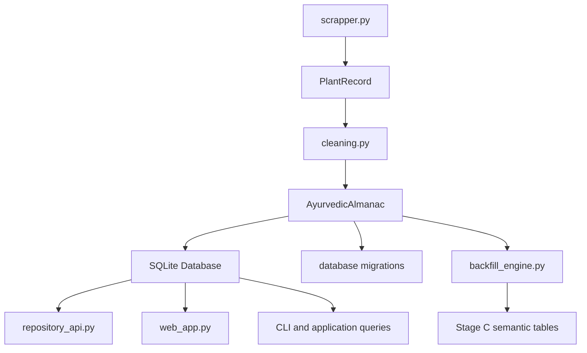

# Database Operator — SQLite Persistence and Schema Management

**Source module:** `src/herbal_almanac/database_operator.py`  
**Package:** `herbal_almanac`  
**Database:** SQLite

## 1. Purpose and responsibility

The `database_operator.py` module is the primary persistence layer of Herbal Almanac. It connects the cleaned records produced by the scraper to the SQLite database and provides the operations required by the CLI, web interface, and other application modules.

Its responsibilities include:

- Creating and connecting to the SQLite database.
- Creating the initial application schema.
- Applying versioned database migrations.
- Preserving legacy records while introducing provenance and semantic data models.
- Inserting and updating scraped herb records.
- Recording source records and source claims.
- Maintaining botanical names and taxonomy associations.
- Storing herb attributes, Dosha effects, illnesses, and treatments.
- Searching and retrieving herb and illness information.
- Upgrading an existing database to the Stage C semantic schema.

The module is more than a collection of SQL queries. It coordinates the transition from the original flat database design to a provenance-aware and semantically structured data model.

## 2. Position in the project architecture

The database operator sits between data ingestion and data consumption.



### Main upstream dependencies

| Module | How it interacts |
|---|---|
| `cleaning.py` | Supplies `PlantRecord`, text normalization, transliteration, Dosha normalization, and the `DOSHAS` constant. |
| `scrapper.py` | Uses `AyurvedicAlmanac` to initialize the database and persist scraped records. |
| `migrations/` | Supplies the Stage C semantic migration. |

### Main downstream consumers

- `cli.py`
- `web_app.py`
- `repository_api.py`
- `herb_view.py`
- Other modules that retrieve herb, illness, treatment, or provenance information.

## 3. Imports and their purpose

### Standard-library imports

| Import | Purpose |
|---|---|
| `sqlite3` | SQLite connections, SQL execution, transactions, and database errors. |
| `contextmanager` | Implements transaction-scoped connection management. |
| `datetime`, `timezone` | Generates UTC timestamps for migration and provenance records. |
| `SequenceMatcher` | Supports approximate matching during search ranking. |
| `os` | Reads platform-specific environment variables. |
| `Path` | Handles database paths. |
| `re` | Performs normalization of illness identifiers and search-related strings. |
| `sys` | Detects the operating system platform. |
| `Any`, `Iterable`, `Iterator` | Type annotations for records and database operations. |
| `RLock` | Protects database initialization when an instance is shared across threads. |

### Internal imports

```python
from .cleaning import (
    DOSHAS,
    PlantRecord,
    ascii_text,
    clean_text,
    normalize_dosha_expression,
)
```

These provide the cleaned record contract and normalization utilities.

```python
from .schema_capability_gate import (
    validate_schema_migration_ledger,
    require_stage_c_schema_v3,
    get_schema_version,
)
```

These functions verify that database operations are being performed against a compatible schema.

```python
from .migrations import migration_0003_semantic_dravyaguna
```

This provides the Stage C schema migration.

```python
from .concept_catalog import seed_canonical_concept_catalog
```

This seeds the canonical Dravyaguna concept vocabulary.

```python
from .backfill_engine import (
    capture_stage_b_table_snapshot,
    verify_stage_b_row_invariance,
    run_stage_c_semantic_backfill,
)
```

These functions support safe Stage C backfilling and verification that existing Stage B data remains unchanged.

## 4. Classes and exceptions

### 4.1 `MigrationError`

```python
class MigrationError(RuntimeError):
    ...
```

Raised when a legacy database cannot be migrated safely.

For example, the database operator validates source identities before creating the provenance mapping. If multiple legacy herb rows share the same normalized source identity, migration cannot safely determine which row represents the original source record.

Rather than guessing, it raises `MigrationError`.

### 4.2 `ClaimAssociationError`

```python
class ClaimAssociationError(ValueError):
    ...
```

Raised when a source claim cannot be safely associated with a herb.

This protects the provenance model from attaching a source assertion to an unrelated or ambiguous herb record.

### 4.3 `AyurvedicAlmanac`

```python
class AyurvedicAlmanac:
    ...
```

This is the central database interface.

It manages:

- Database location.
- Connections and transactions.
- Schema creation and migrations.
- Record insertion and synchronization.
- Search and retrieval operations.
- Stage C upgrades and backfills.

#### Constructor

```python
AyurvedicAlmanac(database_path: str | Path | None = None)
```

If a path is supplied, it is used as the database location. Otherwise, the application selects a platform-specific writable location.

The constructor also initializes:

- `_initialized`: tracks whether this instance has initialized its database.
- `_initialization_lock`: a re-entrant lock protecting initialization.

## 5. Module-level functions

### 5.1 `search_key(value)`

```python
search_key(value: str) -> str
```

Creates a normalized search representation.

The function:

1. Cleans the input using `clean_text`.
2. Converts it to lowercase using `casefold()`.
3. Keeps alphanumeric characters and whitespace.
4. Removes surrounding whitespace.

This gives the search system a consistent representation of differently formatted names.

### 5.2 `canonical_illness_key(value)`

```python
canonical_illness_key(value: str) -> str
```

Creates a normalized key for illness names.

It first applies `ascii_text()` and `search_key()`, then removes a trailing `h`.

The final step helps reconcile variations in Sanskrit transliteration, especially forms involving visarga.

### 5.3 `detect_script(text)`

```python
detect_script(text: str) -> str
```

Detects a script using Unicode character ranges.

The current implementation recognizes:

| Script | Returned code |
|---|---|
| Devanagari | `Deva` |
| Bengali | `Beng` |
| Gurmukhi | `Guru` |
| Gujarati | `Gujr` |
| Odia | `Orya` |
| Tamil | `Taml` |
| Telugu | `Telu` |
| Kannada | `Knda` |
| Malayalam | `Mlym` |
| Latin | `Latn` |
| Other or no recognized script | `Zyyy` |

It returns the first recognized script encountered in the input.

### 5.4 `default_database_path()`

```python
default_database_path() -> Path
```

Returns the default writable database location.

| Platform | Base directory |
|---|---|
| Windows | `%APPDATA%` or the user's roaming application-data directory |
| macOS | `~/Library/Application Support` |
| Linux and other platforms | `$XDG_DATA_HOME` or `~/.local/share` |

The final database path is:

```text
herbal-almanac/AyurvedicDB.db
```

## 6. Important database methods

### 6.1 Connection management

#### `connect()`

```python
connect() -> sqlite3.Connection
```

- Creates the database's parent directory if necessary.
- Opens a SQLite connection.
- Enables foreign-key enforcement.
- Configures rows to be accessible through `sqlite3.Row`.

#### `_connection()`

```python
_connection() -> Iterator[sqlite3.Connection]
```

This context manager provides a transaction-scoped connection.

Its general behavior is:

1. Open a connection.
2. Enter SQLite's transaction context.
3. Yield the connection to the caller.
4. Commit on successful completion.
5. Roll back when an exception occurs.
6. Close the connection in all cases.

This avoids leaving database connections open after operations.

### 6.2 `create_database()`

```python
create_database() -> None
```

This is one of the most important methods in the module.

It creates the core tables and applies pending versioned migrations.

The core schema includes:

- `herbs`
- `illness`
- `treatment`
- `herb_attributes`
- `herb_doshas`

It also creates or updates the migration ledger and applies the required migration sequence.

#### Initialization safety

The method uses several safeguards:

- An instance-level `RLock` prevents duplicate initialization by threads sharing the same object.
- `BEGIN IMMEDIATE` reserves the SQLite write transaction.
- `PRAGMA busy_timeout = 10000` allows SQLite to wait for a competing writer.
- Static DDL statements are executed individually rather than using `executescript()`, because `executescript()` can implicitly commit a pending transaction.
- Migration versions are checked before applying migrations.
- Exceptions cause a rollback.
- Connections are closed in a `finally` block.

The migration ledger records the migration version, name, and application timestamp.

Current migration constants include:

| Version | Name | Responsibility |
|---|---|---|
| 1 | `core_identity_and_provenance` | Introduces source identity, source records, claims, names, and legacy mappings. |
| 2 | `normalized_botanical_taxonomy` | Introduces normalized botanical taxonomy. |
| 3 | Semantic Dravyaguna migration | Introduces the Stage C semantic schema through the migration module. |

The first two migrations are managed in `database_operator.py`; Stage C schema creation is coordinated through `migrations/`.

### 6.3 `insert_record(record)`

```python
insert_record(record: PlantRecord) -> int
```

Inserts or updates one cleaned plant record and returns its database herb ID.

This method is the main persistence endpoint used by the scraper.

#### Step-by-step logic

1. Ensures that the database has been initialized.
2. Opens a transaction.
3. Inserts the herb identity into `herbs`.
4. Uses the `(source, source_record_id)` identity to detect an existing source record.
5. Updates the existing herb if that identity already exists.
6. Retrieves the resulting herb ID.
7. Replaces the scraped attribute rows for that herb.
8. Removes previously scraped treatment and Dosha rows.
9. Inserts the current attributes and their metadata.
10. Rebuilds treatment relationships from relevant attributes.
11. Rebuilds normalized Dosha effects.
12. Ensures the source exists in `sources`.
13. Ensures the corresponding source record exists.
14. Creates or maintains the legacy herb mapping.
15. Synchronizes herb names.
16. Synchronizes botanical taxonomy associations.
17. Synchronizes source claims.
18. Returns the herb ID.

The use of `ON CONFLICT(source, source_record_id)` makes repeated ingestion of the same source record an update rather than an unrelated duplicate insertion.

**Important distinction:** scraped attributes, treatments, and Dosha rows are refreshed during re-ingestion. The method does not simply append another copy of every scraped value.

The provenance synchronization steps preserve the relationship between the current herb representation and its source evidence.

### 6.4 `insert_records(records)`

```python
insert_records(records: Iterable[PlantRecord]) -> int
```

Inserts records one at a time by calling `insert_record()`.

Returns the number of records processed successfully. An exception from an individual insertion propagates to the caller.

### 6.5 Manual insertion methods

| Method | Purpose |
|---|---|
| `insert_herb(id, english_name)` | Backward-compatible insertion helper for the original prototype. |
| `insert_illness(id, english_name)` | Backward-compatible illness insertion helper. |
| `add_herb(...)` | Inserts a manually entered herb and creates the associated legacy/provenance records. |
| `add_illness(english_name)` | Inserts an illness with normalized search keys. |
| `add_treatment(herb_id, illness_id)` | Creates a herb-to-illness relationship. |

The newer `add_herb()` operation also creates the corresponding source identity and legacy mapping. It does not merely insert a row into `herbs`.

### 6.6 Search and retrieval methods

| Method | Responsibility |
|---|---|
| `dashboard_summary()` | Returns counts, recent herbs, and frequently linked illnesses. |
| `get_herb(herb_id)` | Retrieves a herb's core identity. |
| `search_herbs(query="")` | Searches herb names, botanical names, and vernacular-name matches. |
| `search_illnesses(query="")` | Searches illness names and canonical keys. |
| `_rank_rows(...)` | Ranks search candidates using normalized matching and approximate similarity. |
| `treatment_details(herb_id)` | Retrieves treatment relationships for a herb. |
| `get_illness(illness_id)` | Retrieves one illness. |
| `illness_summaries(query="")` | Returns illness summaries. |
| `herbs_for_illness(illness_id)` | Retrieves herbs associated with an illness. |
| `herb_attributes(herb_id)` | Retrieves stored attributes. |
| `herb_doshas(herb_id)` | Retrieves normalized Dosha effects. |
| `herb_claims(herb_id)` | Retrieves source claims associated with a herb. |
| `herb_source_record(herb_id)` | Retrieves the associated source-record information. |
| `all_records()` | Returns collections of records for application use. |

#### Herb search

`search_herbs()` retrieves candidate herbs and checks vernacular-name attributes. It then delegates ranking to `_rank_rows()`.

The ranking logic considers normalized matches and approximate similarity rather than relying only on literal SQL substring matching.

#### Illness search

`search_illnesses()` uses both ordinary search keys and canonical illness keys. It can also incorporate aliases and terms from `illness_glossary.py`.

This makes the search system more tolerant of spelling and transliteration variations.

## 7. Provenance and taxonomy synchronization

One of the major architectural changes in the project is that the database no longer treats a herb row as the only representation of collected information.

The module maintains separate records for:

- Source identity.
- Source records.
- Source claims.
- Herb-name variants.
- Botanical taxa.
- Herb-to-taxon associations.
- Legacy herb ID mappings.

Important internal methods include:

| Method | Responsibility |
|---|---|
| `_ensure_source()` | Finds or creates a source identity. |
| `_ensure_source_record()` | Finds or creates a source record. |
| `_record_claim()` | Records an individual source assertion. |
| `_ensure_legacy_herb_map()` | Preserves the relationship between old herb IDs and the new provenance model. |
| `_sync_herb_names()` | Synchronizes Ayurvedic, vernacular, and botanical names. |
| `_sync_herb_taxa()` | Synchronizes botanical taxonomy associations. |
| `_sync_attribute_claims()` | Converts record attributes into source claims. |

The purpose of these operations is to retain the origin of information rather than storing only a final normalized value.

## 8. Database schema overview

The schema is organized around the project's development stages.

### Core tables

| Table | Purpose |
|---|---|
| `herbs` | Main herb identity and source information. |
| `illness` | Illness and condition records. |
| `treatment` | Herb-to-illness relationships. |
| `herb_attributes` | Flexible source attributes and translation metadata. |
| `herb_doshas` | Normalized Dosha effects with original expressions. |

### Stage B provenance and taxonomy tables

| Table | Purpose |
|---|---|
| `schema_migrations` | Applied migration history. |
| `sources` | Source identity and publication metadata. |
| `source_records` | Individual records within a source. |
| `source_claims` | Individual assertions extracted from source records. |
| `legacy_herb_map` | Mapping between legacy herb IDs and provenance-aware herb IDs. |
| `herb_names` | Multilingual and botanical names. |
| `taxa` | Botanical taxonomic concepts. |
| `taxon_relationships` | Relationships between taxonomic concepts. |
| `herb_taxa` | Herb-to-taxon associations. |

### Stage C semantic tables

| Table | Purpose |
|---|---|
| `dravyaguna_concepts` | Canonical Dravyaguna concepts. |
| `concept_labels` | Multilingual labels for concepts. |
| `concept_label_sources` | Source information for concept labels. |
| `concept_claim_mappings` | Links source claims to canonical concepts. |
| `herb_dravyaguna_properties` | Normalized pharmacological properties. |
| `dosha_claim_assertions` | Dosha-effect assertions derived from claims. |
| `herb_dosha_effects` | Links herb records to Dosha assertions. |
| `herb_plant_parts` | Normalized plant-part associations. |
| `herb_preparations` | Preparation and dosage-form associations. |
| `herb_indications` | Normalized therapeutic indications. |

## 9. Stage C upgrade and backfill

### `upgrade_to_stage_c(now=None)`

```python
upgrade_to_stage_c(now: str | None = None) -> dict[str, Any]
```

Coordinates the database upgrade to Stage C.

At a high level, the upgrade:

1. Ensures the earlier database schema exists.
2. Validates the migration ledger and current schema state.
3. Applies the Stage C semantic migration.
4. Seeds the canonical concept catalog.
5. Captures Stage B table snapshots.
6. Executes the semantic backfill.
7. Verifies Stage B table invariance.
8. Returns structured upgrade information.

### `run_stage_c_backfill(now=None)`

```python
run_stage_c_backfill(now: str | None = None) -> dict[str, Any]
```

Coordinates semantic backfill against an already upgraded database.

The actual claim-to-concept mapping logic resides in `backfill_engine.py`; the database operator supplies the database transaction and orchestration.

## 10. Example usage

```python
from pathlib import Path

from herbal_almanac.database_operator import AyurvedicAlmanac

db = AyurvedicAlmanac(Path("data/ayurvedic.db"))

# Create the schema and apply pending migrations.
db.create_database()

# Search for herbs.
results = db.search_herbs("Tulsi")

for herb in results:
    print(
        herb["english_name"],
        herb["botanical_name"],
        herb["family"],
    )

# Retrieve a single herb.
herb = db.get_herb(1)

if herb:
    print(herb["english_name"])

# Retrieve a dashboard summary.
summary = db.dashboard_summary()
print(summary["herbs"])
```

## 11. Design principles

### Atomicity

A record insertion and its related updates are performed inside a transaction. This reduces the risk of partially persisted herb records.

### Referential integrity

Foreign keys are enabled on database connections. Relationships between herbs, illnesses, source records, and claims are therefore constrained by the schema.

### Idempotent ingestion

A source record is identified using its source identity and external record ID. Re-ingesting the same source record updates the existing record rather than creating a new unrelated herb.

### Migration safety

Schema changes are versioned. The migration process checks existing data and refuses ambiguous legacy identities rather than silently guessing.

### Provenance preservation

Source claims retain the original source expressions and their relationship to source records. A normalized concept does not replace the original statement.

### Separation of concerns

The database operator handles persistence and orchestration. Cleaning, translation, concept vocabulary, schema capability validation, and semantic backfill are implemented in their own modules.

## 12. Important implementation notes

- The default database is stored in a user-writable application-data directory, not necessarily inside the repository.
- `create_database()` is safe to call repeatedly on the same initialized instance.
- `insert_record()` refreshes scraped attributes and scraped relationships for the same source identity.
- The original source expressions are retained through the provenance model.
- Stage C mapping is not performed by `insert_record()` alone; it is coordinated through the upgrade/backfill workflow.
- The legacy helper methods exist for compatibility with the earlier prototype API.

## 13. Related files

- `cleaning.md`
- `scrapper.md`
- `concept_catalog.md`
- `backfill_engine.md`
- `schema_capability_gate.py`
- `migrations/migration_0003_semantic_dravyaguna.py`
- `claim_lifecycle.py`
- `repository_api.py`

## 14. Summary

`database_operator.py` is the persistence backbone of Herbal Almanac. It began as a SQLite interface for herbs, illnesses, and treatments, but now also manages source provenance, botanical taxonomy, multilingual names, schema migrations, and the orchestration of semantic data upgrades.

Its most important role is to connect the ingestion pipeline with a database model that preserves both the original source evidence and the structured information derived from it.
