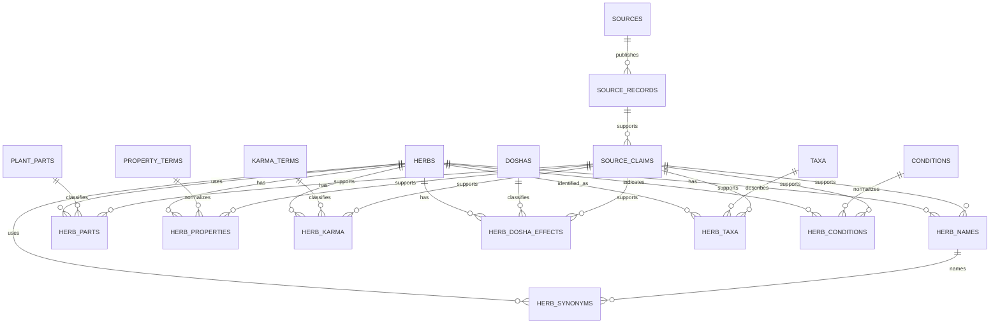

# Normalized Dravyaguna Database Schema

## Status and scope

This document is a design proposal. It describes the current SQLite model and a
future normalized model for Dravyaguna data. It does not change the existing
schema, migrations, scraper, cleaner, or database code.

The design keeps source expressions and normalized interpretations side by
side. Normalized values are claims made about a source record, not replacements
for the source wording. An uncertain or unavailable interpretation remains
nullable or `unspecified` rather than being guessed.

## Current schema assessment

The current implementation creates these application tables:

| Table | Current purpose |
|---|---|
| `herbs` | Main plant row, transliterated compatibility name, original name, botanical/family fields, source identity, URL, and retrieval timestamp. |
| `illness` | Illness/indication names with search and canonical keys plus machine-generation and verification flags. |
| `treatment` | Many-to-many herb-to-illness links. `source` distinguishes scraped from manual links. |
| `herb_attributes` | Flexible section-qualified source fields, values, source text, language, and translation metadata. |
| `herb_doshas` | Current normalized Dosha effects, one row per Dosha and source expression, added after the original prototype. |

The generated schema uses stable integer primary keys. `herbs` has a unique
`(source, source_record_id)` constraint. `illness` has unique display and
canonical names. `treatment` has a composite primary key and cascading foreign
keys. `herb_attributes` has a composite `(herb_id, field_name, value)` primary
key. `herb_doshas` has a composite key over herb, Dosha, expression, and source;
its checks currently restrict Doshas to Vata, Pitta, and Kapha and effects to
`decrease`, `increase`, and `unspecified`.

Every application connection enables `PRAGMA foreign_keys = ON`. Search indexes
cover herb and illness search keys; unique indexes cover source identity and
illness canonical names. There are no separate source, source-record, claim,
name, part, property, Karma, taxonomy, or condition-mapping tables yet.

### Current record and update behavior

`PlantRecord` carries source name, source record ID, URL, retrieval timestamp,
Unicode source names, flexible attributes, source text, translation metadata,
and Dosha expressions. The scraper parses section-qualified tables and passes
the record to the database operator.

`insert_record()` upserts a herb by `(source, source_record_id)` in one
transaction. It replaces all flexible attributes and scraped treatment links,
then recreates the current scraped links. Manual treatment links survive
because only rows with `source = 'scraped'` are deleted. Scraped Dosha rows are
refreshed in the same transaction. The original source URL, source record ID,
and retrieval timestamp remain on the herb row, but provenance is currently
record-level rather than claim-level.

Therapeutic Usage values are stored as source attributes and the exact
`Therapeutic Usage.Name` field currently creates unverified illness rows and
scraped treatment links. This is intentionally not a validated disease model.

## Problems and limitations

1. `herbs` combines stable identity, source identity, source provenance, and
   denormalized display names. A second source for the same plant can create a
   second herb row instead of contributing evidence to one stable identity.
2. `english_name` and `original_name` encode compatibility and source behavior
   in column names that assume an English-facing model. Language and script are
   not first-class name attributes.
3. `herb_attributes` preserves source data well but stores domain concepts as
   strings. Rasa, Guna, Virya, Vipaka, Karma, plant parts, and taxonomy cannot
   be queried reliably without source-specific string interpretation.
4. A single `source_url` and `retrieved_at` on `herbs` cannot represent separate
   evidence for separate names, properties, or relationships.
5. `illness` and `treatment` do not distinguish an unverified source indication
   from a validated disease mapping at the relationship level.
6. `herb_doshas` preserves expressions but currently lacks a normalized source
   record reference, confidence, and the `neutral` effect requested by the
   broader model.
7. Existing migrations are lightweight `CREATE TABLE IF NOT EXISTS`, `ALTER
   TABLE`, and cleanup operations. They are suitable for the prototype but do
   not yet provide versioned, reversible migration history.

## Proposed normalized schema

The proposal uses stable internal IDs for concepts and keeps source evidence
in separate source-record and claim tables. Names, properties, and
relationships can therefore come from multiple sources without changing the
identity of a herb.

### Identity and taxonomy

#### `herbs`

| Column | Type | Constraints and purpose |
|---|---|---|
| `herb_id` | INTEGER | Primary key. Stable internal identity. |
| `created_at` | TEXT | Required UTC timestamp. |
| `updated_at` | TEXT | Required UTC timestamp. |
| `status` | TEXT | Required lifecycle status such as `active` or `deprecated`. |

A herb row contains no source-specific display name. Identity resolution is a
curated operation and must not silently merge records based only on fuzzy name
similarity.

#### `herb_names`

| Column | Type | Constraints and purpose |
|---|---|---|
| `herb_name_id` | INTEGER | Primary key. |
| `herb_id` | INTEGER | Foreign key to `herbs`. |
| `name_text` | TEXT | Required original or normalized name text. |
| `normalized_text` | TEXT | Search form; not a replacement for `name_text`. |
| `language_code` | TEXT | BCP 47-like code or project language code; nullable when unknown. |
| `script_code` | TEXT | Script identifier such as Devanagari or Latin; nullable when unknown. |
| `name_type` | TEXT | `ayurvedic`, `vernacular`, `botanical_source`, `accepted_botanical`, or `trade`. |
| `is_preferred` | INTEGER | Boolean preference within a name type. |
| `source_claim_id` | INTEGER | Foreign key to `source_claims`; nullable for curated values. |

Recommended indexes are `(herb_id, name_type)`, `(normalized_text)`, and
`(language_code, normalized_text)`. The same text may legitimately occur in
multiple scripts or sources, so uniqueness should not be global.

#### `herb_synonyms`

| Column | Type | Constraints and purpose |
|---|---|---|
| `herb_id` | INTEGER | Foreign key to `herbs`. |
| `herb_name_id` | INTEGER | Foreign key to an alternative row in `herb_names`. |
| `synonym_type` | TEXT | `classical`, `vernacular`, `trade`, `historical`, or `source_alias`. |
| `source_claim_id` | INTEGER | Foreign key to the evidence for the synonym relationship. |

The primary key is `(herb_id, herb_name_id, synonym_type)`. Keeping synonyms as
relationships makes it possible for one name row to be associated with an
identity only when evidence supports that association.

#### `taxa` and `herb_taxa`

`taxa` stores reusable taxonomy nodes: `taxon_id`, `parent_taxon_id`, `rank`,
`scientific_name`, `accepted_name`, `authority`, and optional `registry` and
`registry_id`. `herb_taxa` links `herb_id` to `taxon_id` with `relationship_type`
(`source_identification`, `accepted`, or `synonym`), `is_preferred`, and
`source_claim_id`.

Taxonomy is justified as a separate concept because accepted names, source
identifications, and taxonomic parents can be shared by many herbs and can
change independently of Ayurvedic names.

### Parts and Dravyaguna properties

#### `plant_parts` and `herb_parts`

`plant_parts` is a controlled vocabulary with `part_id`, `canonical_name`, and
optional `parent_part_id`. `herb_parts` stores `(herb_id, part_id,
source_expression, source_claim_id)` and has a composite primary key over the
herb, part, expression, and claim. A nullable `part_id` allows an unnormalized
source expression to be retained until reviewed.

#### `property_terms` and `herb_properties`

`property_terms` stores controlled terms with `property_term_id`,
`property_type` (`rasa`, `guna`, `virya`, or `vipaka`), `canonical_value`, and
optional `display_value`. `herb_properties` stores:

- `herb_property_id` as the primary key;
- `herb_id` and optional `property_term_id` foreign keys;
- `property_type`;
- `source_expression`;
- optional `normalized_value`;
- `source_claim_id`;
- `confidence` and `verification_status`.

The source expression is mandatory. A normalized term is nullable, so a new
source expression can be ingested without inventing a controlled vocabulary
entry. A uniqueness rule should apply only to an identical herb, property type,
source expression, and source claim; separate sources may provide different
values.

#### `karma_terms` and `herb_karma`

`karma_terms` stores reusable Karma classifications with `karma_id`,
`canonical_name`, and optional description. `herb_karma` stores the many-to-many
relationship `(herb_id, karma_id, source_expression, source_claim_id,
confidence, verification_status)`. `karma_id` may be null while a source
expression is awaiting normalization.

### Dosha effects

#### `doshas` and `herb_dosha_effects`

`doshas` is a three-row lookup table with stable IDs and canonical names Vata,
Pitta, and Kapha. `herb_dosha_effects` stores:

| Column | Type | Purpose |
|---|---|---|
| `herb_dosha_effect_id` | INTEGER | Primary key. |
| `herb_id` | INTEGER | Foreign key to `herbs`. |
| `dosha_id` | INTEGER | Foreign key to `doshas`. |
| `effect` | TEXT | `increase`, `decrease`, `neutral`, or `unspecified`. |
| `source_expression` | TEXT | Required original Doshakarma expression. |
| `source_claim_id` | INTEGER | Evidence for the expression and interpretation. |
| `confidence` | REAL | Nullable value from 0 to 1. |
| `verification_status` | TEXT | `unverified`, `reviewed`, or `verified`. |

The existing `DoshaNormalization` helper supplies the rule-based starting
point. It must remain conservative: absent Doshas are `unspecified`, conflicts
are not forced into an effect, and the original expression is retained. The
proposed table separates normalized effect vocabulary from source provenance
and adds `neutral` for future reviewed data.

### Conditions and indications

#### `conditions`

`conditions` stores normalized concepts with `condition_id`, `canonical_label`,
`vocabulary`, optional `code`, and `status`. A condition is not created merely
because a source uses a word in `Therapeutic Usage.Name`.

#### `herb_conditions`

| Column | Type | Purpose |
|---|---|---|
| `herb_condition_id` | INTEGER | Primary key. |
| `herb_id` | INTEGER | Foreign key to `herbs`. |
| `condition_id` | INTEGER | Nullable FK to `conditions`; null for an unmapped source term. |
| `source_term` | TEXT | Required original indication wording. |
| `mapping_type` | TEXT | `source_indication`, `candidate_mapping`, or `validated_mapping`. |
| `confidence` | REAL | Nullable value from 0 to 1. |
| `source_claim_id` | INTEGER | Evidence for the indication or mapping. |
| `verification_status` | TEXT | Review state. |

This relationship explicitly distinguishes an unverified source indication from
a validated disease mapping. A later crosswalk can create a `condition_id`
without rewriting or deleting `source_term`.

### Sources and provenance

#### `sources`

`sources` stores `source_id`, `publisher`, `title`, `edition_or_version`,
`publication_date`, `default_url`, `license`, `attribution_text`, and
`notes`. License and attribution belong to the source, not to an individual
herb.

#### `source_records`

`source_records` stores one externally addressable record per source:
`source_record_id`, `source_id`, `external_record_key`, `source_url`,
`retrieved_at`, optional `published_at`, `content_hash`, and `raw_artifact_ref`.
The unique key is `(source_id, external_record_key)`. This is the normalized
successor to the current `(source, source_record_id)` identity fields on
`herbs`.

#### `source_claims`

`source_claims` provides claim-level provenance for names, properties, parts,
Karma, Dosha effects, taxonomy links, and conditions. It contains:

- `source_claim_id` as the primary key;
- `source_record_id` as a foreign key;
- `claim_type` and `source_field`;
- `source_expression` and optional `language_code`;
- `retrieved_at` when different from the source record;
- `confidence` and `verification_status`;
- optional `normalization_method` and reviewer metadata.

Normalized tables reference `source_claim_id`, so one source record can support
many claims and one herb can combine claims from multiple sources. A future
`source_claim_evidence` table can be added if a claim needs multiple page
ranges or artifacts; it is not required for the first normalized migration.

## Relationship summary

- One `herb` has many names, synonyms, source claims, parts, properties, Karma
  rows, Dosha effects, taxonomy links, and condition relationships.
- One source has many source records; one source record has many claims.
- A name, property, part, Karma, Dosha, taxonomy, or condition relationship may
  point to one claim, while the stable herb identity remains independent of the
  source.
- One normalized condition or taxonomy node may be linked to many herbs.
- Manual curation is represented by nullable source claims plus verification
  metadata, rather than by overwriting source claims.

## Entity-relationship diagram



## Example representation

A single herb can be represented as follows. The values are illustrative and
retain source wording rather than asserting that every normalization is
validated.

```text
herbs
  herb_id=42, status=active

herb_names
  (42, "Talisha", "talisha", "sa", "Devanagari-or-Latin source script", ayurvedic, preferred)
  (42, "Himalayan silver", "himalayan silver", "en", "Latn", vernacular, preferred)
  (42, "Abies webbiana", "abies webbiana", "la", "Latn", botanical_source, false)

herb_parts
  (42, part_id=3, source_expression="Root", claim_id=701)

herb_properties
  (42, property_type=rasa, normalized_value=null,
       source_expression="Tikta", claim_id=702)
  (42, property_type=virya, normalized_value="cooling",
       source_expression="Śīta", claim_id=703)

herb_karma
  (42, karma_id=null, source_expression="Dīpana", claim_id=704)

herb_dosha_effects
  (42, Vata, decrease, "KaphaVātahara", claim_id=705, confidence=0.90)
  (42, Kapha, decrease, "KaphaVātahara", claim_id=705, confidence=0.90)
  (42, Pitta, unspecified, "KaphaVātahara", claim_id=705, confidence=0.90)

herb_conditions
  (42, condition_id=null, source_term="Kāsa",
       mapping_type=source_indication, confidence=null, claim_id=706)

source_records
  (701..706, source_id=1, external_record_key="12",
       source_url="https://dravya.ccras.org.in/plant/12", retrieved_at="...")
```

The exact language and script values must come from the source or a documented
curation rule. The example does not validate the Ayurvedic meanings of the
terms.

## Staged migration and rollback

The migration should be additive and observable:

1. **Inventory and backup.** Snapshot the existing SQLite file, record row
   counts and foreign-key relationships, and create a migration version record
   outside the application tables. Do not modify source rows in this stage.
2. **Create new tables.** Add the normalized tables and indexes without
   removing `herb_attributes`, `illness`, `treatment`, or the existing
   `herb_doshas` table. Existing application behavior continues unchanged.
3. **Create source records.** Add a CCRAS DRAVYA `sources` row and one
   `source_records` row for each existing `(source, source_record_id)` pair.
   Preserve existing URLs and retrieval timestamps; use a documented legacy
   migration marker where values are unavailable.
4. **Map stable identities.** Initially map each current `herbs.id` to one new
   `herb_id` through a temporary `legacy_herb_map`. Do not merge records during
   this mechanical migration. Later identity resolution can be reviewed as a
   separate operation.
5. **Backfill names and attributes.** Convert `original_name` and
   `english_name` into source-tagged `herb_names` rows. Convert only known
   vernacular, translation, taxonomy, part, property, Karma, and Doshakarma
   fields into structured rows. Retain every original `herb_attributes` row.
6. **Backfill indications and Doshas.** Convert `illness` and `treatment` into
   unverified `conditions` and `herb_conditions`, preserving whether each
   relationship was manual or scraped. Convert current `herb_doshas` rows into
   `herb_dosha_effects`, including their source expressions and a low or
   explicitly unknown confidence where no legacy confidence exists.
7. **Validate and dual-read.** Compare counts, source keys, manually inserted
   treatment links, attribute values, and representative search results. Run
   the existing offline regression suite and migration-specific checks before
   changing writers.
8. **Switch writers gradually.** Add a compatibility adapter that writes the
   old and new representations together, then switch reads after parity is
   demonstrated. Keep the old tables read-only for a deprecation period.
9. **Retire only after confirmation.** Remove or archive old tables only in a
   separately approved migration after backups, export parity, and rollback
   procedures have been verified.

Rollback before writer cutover is a drop of only the new tables followed by
restoring the backup if needed. After dual writes begin, rollback requires
stopping the new writer and retaining the old tables until parity is restored.
No migration step may delete or overwrite manually maintained records.

## Design decisions and trade-offs

- **Stable identity versus source identity:** `herbs.herb_id` is internal and
  stable; `(source_id, external_record_key)` identifies a source record. This
  prevents a source rename or a second source from changing the herb identity.
- **Claims instead of one universal provenance column:** claim-level links avoid
  falsely implying that one source supports every field on an herb. They add
  joins and require careful backfill, but the auditability is important for
  research data.
- **Controlled vocabularies with nullable links:** normalized terms enable
  querying, while nullable term IDs preserve unfamiliar source expressions.
  This is preferable to silently assigning a wrong term.
- **Separate name and synonym relations:** language, script, name type, and
  source evidence are first-class. This costs more rows than two name columns
  but avoids an English/Sanskrit assumption.
- **Keep `herb_attributes` during transition:** a flexible attribute store is
  useful for source fields not yet modeled. It should be a compatibility and
  discovery layer, not the only long-term domain model.
- **SQLite first:** the proposed design remains compatible with SQLite and the
  current Python API. A future server database can be considered after query
  patterns and migration tooling are stable.

## Unresolved questions

- Which botanical authority and version should control accepted taxa?
- What language and script registry should be used for source values with no
  reliable language metadata?
- Which controlled vocabularies are authorized for Rasa, Guna, Virya, Vipaka,
  Karma, and conditions?
- Should manual curation be represented as source `manual` records, reviewer
  claims, or both?
- How should confidence be calibrated and reviewed across different source
  types?
- Should source publication pages, raw HTML artifacts, and page ranges receive
  separate evidence tables?
- What exact migration versioning mechanism should replace the current
  lightweight in-place migrations?

## Verification checklist

This design can be reviewed without changing the application:

- Every proposed relationship has an owning foreign key and a stated purpose.
- Source expressions remain present wherever a normalized interpretation is
  proposed.
- Unknown conditions, properties, parts, Karma, and Dosha effects have nullable
  normalized links or `unspecified` values.
- Existing manual treatment links and flexible attributes have explicit staged
  migration paths.
- The Mermaid diagram names every proposed relationship family.
- No implementation or database migration is part of this document.
