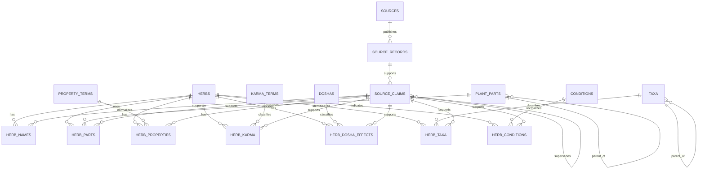

# Normalized Dravyaguna Database Schema

## Status and scope

This document describes the current SQLite model and the normalized model for
Dravyaguna data. Migration 1 implements only the core identity and provenance
tables identified below. The remaining domain tables are still a design
proposal and have not been implemented.

The design keeps source expressions and normalized interpretations side by
side. Normalized values are claims made about a source record, not replacements
for the source wording. An uncertain or unavailable interpretation remains
nullable or `unspecified` rather than being guessed.

## Refinement decisions

- `source_claims` belongs to a `source_record`, not directly to a herb. Domain
  rows such as names, properties, and herb-condition relationships connect the
  claim to their subject. Reusing one claim on several rows supports a single
  expression such as Tridosha effects without adding a subject abstraction.
- Every claim-bearing domain row has a required, non-null `source_claim_id`.
  Manual curation therefore creates a claim too, using a manual source record;
  nullable normalized concept IDs represent unknown mappings instead.
- `herb_names` is the only name table. Synonyms are name rows with a
  `name_type`, not a second synonym table that duplicates name text.
- Relationship tables use surrogate IDs and explicit unique indexes over
  non-null identity columns. Nullable normalized IDs are deliberately excluded
  from those indexes because SQLite permits duplicate `NULL` values in UNIQUE
  constraints.
- `confidence` describes the normalization or mapping decision and remains
  nullable until a defensible calibration method exists. `verification_status`
  describes review workflow; neither field claims clinical validity.

## Current schema assessment

The current implementation creates these application tables:

| Table | Current purpose |
|---|---|
| `herbs` | Main plant row, transliterated compatibility name, original name, botanical/family fields, source identity, URL, and retrieval timestamp. |
| `illness` | Illness/indication names with search and canonical keys plus machine-generation and verification flags. |
| `treatment` | Many-to-many herb-to-illness links. `source` distinguishes scraped from manual links. |
| `herb_attributes` | Flexible section-qualified source fields, values, source text, language, and translation metadata. |
| `herb_doshas` | Current normalized Dosha effects, one row per Dosha and source expression, added after the original prototype. |

Migration 1 additionally creates these additive tables without changing the
legacy application contract:

| Table | Migration 1 purpose |
|---|---|
| `schema_migrations` | Idempotent migration version tracking. |
| `sources` | Source/provider identity, including a `manual` source for future curation. |
| `source_records` | Source-level record identity and retrieval metadata. |
| `source_claims` | Source-record-owned assertions with review metadata and correction lineage. |
| `legacy_herb_map` | One-to-one mapping from existing `herbs.id` values to themselves for staged migration. |
| `herb_names` | Source-backed multilingual/name-type associations for existing herbs. |

The generated schema uses stable integer primary keys. `herbs` has a unique
`(source, source_record_id)` constraint. `illness` has unique display and
canonical names. `treatment` has a composite primary key and cascading foreign
keys. `herb_attributes` has a composite `(herb_id, field_name, value)` primary
key. `herb_doshas` has a composite key over herb, Dosha, expression, and source;
its checks currently restrict Doshas to Vata, Pitta, and Kapha and effects to
`decrease`, `increase`, and `unspecified`.

Every application connection enables `PRAGMA foreign_keys = ON`. Search indexes
cover herb and illness search keys; unique indexes cover source identity and
illness canonical names. No part, property, Karma, taxonomy, Dosha-effect, or
condition-mapping tables are implemented by Migration 1; those remain proposed
future tables.

### Current record and update behavior

`PlantRecord` carries source name, source record ID, URL, retrieval timestamp,
Unicode source names, flexible attributes, source text, translation metadata,
and Dosha expressions. The scraper parses section-qualified tables and passes
the record to the database operator.

`insert_record()` upserts a herb by `(source, source_record_id)` in one
transaction. It replaces all flexible attributes and scraped treatment links,
then recreates the current scraped links. Manual treatment links survive
because only rows with `source = 'scraped'` are deleted. Scraped Dosha rows are
refreshed in the same transaction. The original source URL, source record ID,
and retrieval timestamp remain on the herb row, but provenance is currently
record-level rather than claim-level.

Therapeutic Usage values are stored as source attributes and the exact
`Therapeutic Usage.Name` field currently creates unverified illness rows and
scraped treatment links. This is intentionally not a validated disease model.

## Problems and limitations

1. `herbs` combines stable identity, source identity, source provenance, and
   denormalized display names. A second source for the same plant can create a
   second herb row instead of contributing evidence to one stable identity.
2. `english_name` and `original_name` encode compatibility and source behavior
   in column names that assume an English-facing model. Language and script are
   not first-class name attributes.
3. `herb_attributes` preserves source data well but stores domain concepts as
   strings. Rasa, Guna, Virya, Vipaka, Karma, plant parts, and taxonomy cannot
   be queried reliably without source-specific string interpretation.
4. A single `source_url` and `retrieved_at` on `herbs` cannot represent separate
   evidence for separate names, properties, or relationships.
5. `illness` and `treatment` do not distinguish an unverified source indication
   from a validated disease mapping at the relationship level.
6. `herb_doshas` preserves expressions but currently lacks a normalized source
   record reference, confidence, and the `neutral` effect requested by the
   broader model.
7. Existing migrations are lightweight `CREATE TABLE IF NOT EXISTS`, `ALTER
   TABLE`, and cleanup operations. They are suitable for the prototype but do
   not yet provide versioned, reversible migration history.

## Proposed and implemented normalized schema

The proposal uses stable internal IDs for concepts and keeps source evidence
in separate source-record and claim tables. Names, properties, and
relationships can therefore come from multiple sources without changing the
identity of a herb.

The `sources`, `source_records`, `source_claims`, `legacy_herb_map`, and
`herb_names` definitions in this section are implemented by Migration 1.
Properties, Karma, Dosha-effect, taxonomy, condition, and related vocabulary
tables remain proposed and are not active application tables.

### Identity and taxonomy

#### `herbs`

| Column | Type | Constraints and purpose |
|---|---|---|
| `herb_id` | INTEGER | Primary key. Stable internal identity. |
| `created_at` | TEXT | Required UTC timestamp. |
| `updated_at` | TEXT | Required UTC timestamp. |
| `status` | TEXT | Required lifecycle status such as `active` or `deprecated`. |

A herb row contains no source-specific display name. Identity resolution is a
curated operation and must not silently merge records based only on fuzzy name
similarity.

#### `herb_names`

| Column | Type | Constraints and purpose |
|---|---|---|
| `herb_name_id` | INTEGER | Primary key. |
| `herb_id` | INTEGER | Foreign key to `herbs`. |
| `name_text` | TEXT | Required original or normalized name text. |
| `normalized_text` | TEXT | Search form; not a replacement for `name_text`. |
| `language_code` | TEXT | Required BCP 47-like code or `und` when unknown. |
| `script_code` | TEXT | Required script identifier or `Zyyy` when unknown. |
| `name_type` | TEXT | `ayurvedic`, `vernacular`, `botanical_source`, `accepted_botanical`, `botanical_synonym`, `historical`, or `trade`. |
| `is_preferred` | INTEGER | Boolean preference within a name type. |
| `source_claim_id` | INTEGER | Required foreign key to `source_claims`, including manual claims. |

Recommended indexes are `(herb_id, name_type)`, `(normalized_text)`, and
`(language_code, normalized_text)`. The same text may legitimately occur in
multiple scripts or sources, so uniqueness should not be global. Use a
surrogate `herb_name_id` primary key and a unique index on
`(herb_id, name_text, normalized_text, language_code, script_code, name_type,
source_claim_id)`. All columns in that index are required, so SQLite NULL
semantics cannot create duplicate claim-backed names.

Synonyms do not need a separate relationship table. A Sanskrit, vernacular,
trade, historical, source-alias, or botanical synonym is another
`herb_names` row with the corresponding `name_type`. `accepted_botanical` is
the preferred accepted name row; `botanical_synonym` rows preserve alternate
botanical names. The same spelling may occur for multiple herbs only when each
association has a separate explicit identity-resolution decision and claim.

#### `taxa` and `herb_taxa`

`taxa` stores reusable taxonomy nodes: `taxon_id`, `parent_taxon_id`, `rank`,
`scientific_name`, `accepted_name`, `authority`, and optional `registry` and
`registry_id`. `herb_taxa` has a surrogate `herb_taxon_id` primary key and
links `herb_id` to `taxon_id` with required `relationship_type`
(`source_identification`, `accepted`, or `synonym`), `is_preferred`, and a
required `source_claim_id`. Use a unique index on
`(herb_id, taxon_id, relationship_type, source_claim_id)` and indexes on
`(taxon_id)` and `(herb_id, relationship_type)`.

Taxonomy is justified as a separate concept because accepted names, source
identifications, and taxonomic parents can be shared by many herbs and can
change independently of Ayurvedic names.

### Parts and Dravyaguna properties

#### `plant_parts` and `herb_parts`

`plant_parts` is a controlled vocabulary with `part_id`, `canonical_name`, and
optional `parent_part_id`. `herb_parts` has a surrogate `herb_part_id` primary
key, required `herb_id`, required `source_expression`, and required
`source_claim_id`; `part_id` is nullable while an expression awaits review.
Use a unique index on `(herb_id, source_expression, source_claim_id)` and
indexes on `(part_id)` and `(herb_id)`.

#### `property_terms` and `herb_properties`

`property_terms` stores controlled terms with `property_term_id`,
`property_type` (`rasa`, `guna`, `virya`, or `vipaka`), `canonical_value`, and
optional `display_value`. `herb_properties` stores:

- `herb_property_id` as the primary key;
- `herb_id` and optional `property_term_id` foreign keys;
- `property_type`;
- `source_expression`;
- optional `normalized_value`;
- required `source_claim_id`;
- nullable `confidence` and required `verification_status`.

The source expression is mandatory. A normalized term is nullable, so a new
source expression can be ingested without inventing a controlled vocabulary
entry. Use a surrogate `herb_property_id` primary key and a unique index on
`(herb_id, property_type, source_expression, source_claim_id)`; do not include
the nullable `property_term_id` in the duplicate key. Separate sources may
provide different values.

#### `karma_terms` and `herb_karma`

`karma_terms` stores reusable Karma classifications with `karma_id`,
`canonical_name`, and optional description. `herb_karma` has a surrogate
`herb_karma_id` primary key, required `herb_id`, required `source_expression`,
required `source_claim_id`, nullable `karma_id`, nullable `confidence`, and
required `verification_status`. Use a unique index on
`(herb_id, source_expression, source_claim_id)` and indexes on `(karma_id)` and
`(herb_id)`.

### Dosha effects

#### `doshas` and `herb_dosha_effects`

`doshas` is a three-row lookup table with stable IDs and canonical names Vata,
Pitta, and Kapha. `herb_dosha_effects` stores:

| Column | Type | Purpose |
|---|---|---|
| `herb_dosha_effect_id` | INTEGER | Surrogate primary key. |
| `herb_id` | INTEGER | Required foreign key to `herbs`. |
| `dosha_id` | INTEGER | Required foreign key to `doshas`. |
| `effect` | TEXT | `increase`, `decrease`, `neutral`, or `unspecified`. |
| `source_expression` | TEXT | Required original Doshakarma expression. |
| `source_claim_id` | INTEGER | Required foreign key to the evidence claim. |
| `confidence` | REAL | Nullable value from 0 to 1. |
| `verification_status` | TEXT | `unreviewed`, `reviewed`, `verified`, `rejected`, or `superseded`. |

The existing `DoshaNormalization` helper supplies the rule-based starting
point. It must remain conservative: absent Doshas are `unspecified`, conflicts
are not forced into an effect, and the original expression is retained. The
proposed table separates normalized effect vocabulary from source provenance
and adds `neutral` for future reviewed data. Use a unique index on
`(herb_id, dosha_id, source_expression, source_claim_id)` and indexes on
`(dosha_id, effect)` and `(herb_id)`.

### Conditions and indications

#### `conditions`

`conditions` stores normalized concepts with `condition_id`, `canonical_label`,
`vocabulary`, optional `code`, and `status`. A condition is not created merely
because a source uses a word in `Therapeutic Usage.Name`. Use a unique index on
`(vocabulary, canonical_label)` and allow the vocabulary to identify the
normalization authority.

#### `herb_conditions`

| Column | Type | Purpose |
|---|---|---|
| `herb_condition_id` | INTEGER | Surrogate primary key. |
| `herb_id` | INTEGER | Required foreign key to `herbs`. |
| `condition_id` | INTEGER | Nullable FK to `conditions`; null for an unmapped source term. |
| `source_term` | TEXT | Required original indication wording. |
| `mapping_type` | TEXT | `source_indication`, `candidate_mapping`, or `validated_mapping`. |
| `confidence` | REAL | Nullable value from 0 to 1. |
| `source_claim_id` | INTEGER | Required foreign key to the indication or mapping claim. |
| `verification_status` | TEXT | `unreviewed`, `reviewed`, `verified`, `rejected`, or `superseded`. |
| `clinical_validity_status` | TEXT | Separate nullable status for clinical validity; not implied by review. |

This relationship explicitly distinguishes an unverified source indication from
a validated disease mapping. A later crosswalk can create a `condition_id`
without rewriting or deleting `source_term`.
Use a unique index on `(herb_id, source_term, source_claim_id)` and indexes on
`(condition_id, mapping_type)` and `(herb_id)`.

### Sources and provenance

#### `sources`

`sources` stores `source_id`, `publisher`, `title`, `edition_or_version`,
`publication_date`, `default_url`, `license`, `attribution_text`, and
`notes`. License and attribution belong to the source, not to an individual
herb.

#### `source_records`

`source_records` stores one externally addressable record per source:
`source_record_id`, `source_id`, `external_record_key`, `source_url`,
`retrieved_at`, optional `published_at`, `content_hash`, and `raw_artifact_ref`.
The unique key is `(source_id, external_record_key)`. This is the normalized
successor to the current `(source, source_record_id)` identity fields on
`herbs`.

#### `source_claims`

`source_claims` provides claim-level provenance for names, properties, parts,
Karma, Dosha effects, taxonomy links, and conditions. It belongs to one source
record and deliberately does not contain a direct `herb_id`. A source claim is
attached to its subject by one or more domain rows that reference the claim.
This keeps the claim reusable when one expression supports several related
rows, while an unresolved claim can exist before a normalized subject is
known. It contains:

- `source_claim_id` as the primary key;
- `source_record_id` as a required foreign key;
- `claim_type` and `source_field`;
- required `source_expression` and `language_code` (`und` when unknown);
- `retrieved_at` when different from the source record;
- required `verification_status` for source-claim review;
- `created_by_type` (`ingest`, `human`, or `system`), `created_by`,
  `created_at`, and `updated_at`;
- optional `reviewed_by`, `reviewed_at`, `reviewer_notes`,
  `normalization_method`, and `supersedes_claim_id`.

Normalized tables reference `source_claim_id`, so one source record can support
many claims and one herb can combine claims from multiple sources. The same
claim can be referenced by several domain rows when justified, for example the
three Dosha rows produced from one Tridosha expression. A future
`source_claim_evidence` table can be added if a claim needs multiple page
ranges or artifacts; it is not required for the first normalized migration.
Index `source_claims` by `(source_record_id, claim_type, source_field)` and
retain duplicate expressions when they represent separate claims or review
events.

Manual curation uses a `manual` source and a manual `source_record` rather than
nullable provenance. Human claims can coexist with scraped and automated
claims. A correction appends a new claim, points `supersedes_claim_id` to the
old claim, and leaves the original source expression intact. Scraper upserts
may refresh only claims owned by that scraper/source record; they must never
delete manual claims or manual treatment relationships.

Migration 1 cannot enforce that every source record describes exactly one
herb: `source_records` intentionally has no `herb_id`, and the current legacy
model stores source identity on `herbs`. During this migration, the one-to-one
`legacy_herb_map` and matching external keys provide the validation boundary.
The application-level `_validate_herb_claim()` helper now validates that a
claim's source record and the associated herb refer to the same source record
before inserting a `herb_names` row. A separate
subject-association abstraction is deferred until one source claim genuinely
needs subjects beyond the existing domain relationships.

Migration preflight rejects duplicate non-null normalized legacy source
identities before creating any Migration 1 tables. Null source-record IDs use
explicit legacy artifact references, and the backfill uses inserted row IDs
instead of selecting a matching source record by an ambiguous query.

`confidence` belongs on normalized interpretation or mapping rows, not on the
raw source claim. It is a nullable numeric value in the closed interval `[0, 1]`
and means confidence in that normalization or mapping decision, not confidence
that the source text was copied correctly. No value is assigned when
calibration evidence is unavailable, including for legacy backfill.
`verification_status` tracks workflow review and acceptance; `verified` does
not by itself mean clinical validity. `clinical_validity_status` on condition
relationships is the separate place for that domain judgment. Source fidelity
is represented by the unchanged `source_expression`, source field, and source
record.

## Relationship summary

- One `herb` has many names, source claims, parts, properties, Karma
  rows, Dosha effects, taxonomy links, and condition relationships.
- One source has many source records; one source record has many claims.
- A name, property, part, Karma, Dosha, taxonomy, or condition relationship may
  point to one claim, while the stable herb identity remains independent of the
  source. A single claim may be referenced by more than one such row.
- One normalized condition or taxonomy node may be linked to many herbs.
- Manual curation is represented by explicit manual source claims plus review
  metadata, rather than by overwriting source claims.

## Entity-relationship diagram



## Example representation

A single herb can be represented as follows. The values are illustrative and
retain source wording rather than asserting that every normalization is
validated.

```text
herbs
  herb_id=42, status=active

herb_names
  (42, "Talisha", "talisha", "sa", "Devanagari-or-Latin source script", ayurvedic, preferred)
  (42, "Himalayan silver", "himalayan silver", "en", "Latn", vernacular, preferred)
  (42, "Abies webbiana", "abies webbiana", "la", "Latn", botanical_source, false)

herb_parts
  (42, part_id=3, source_expression="Root", claim_id=701)

herb_properties
  (42, property_type=rasa, normalized_value=null,
       source_expression="Tikta", claim_id=702)
  (42, property_type=virya, normalized_value="cooling",
       source_expression="Śīta", claim_id=703)

herb_karma
  (42, karma_id=null, source_expression="Dīpana", claim_id=704)

herb_dosha_effects
  (42, Vata, decrease, "KaphaVātahara", claim_id=705, confidence=null)
  (42, Kapha, decrease, "KaphaVātahara", claim_id=705, confidence=null)
  (42, Pitta, unspecified, "KaphaVātahara", claim_id=705, confidence=null)

herb_conditions
  (42, condition_id=null, source_term="Kāsa",
       mapping_type=source_indication, confidence=null, claim_id=706)

source_records
  (701..706, source_id=1, external_record_key="12",
       source_url="https://dravya.ccras.org.in/plant/12", retrieved_at="...")
```

The exact language and script values must come from the source or a documented
curation rule. The example does not validate the Ayurvedic meanings of the
terms.

## Staged migration and rollback

The migration should be additive and observable:

1. **Inventory and backup.** Snapshot the existing SQLite file, record row
   counts and foreign-key relationships, and create a migration version record
   outside the application tables. Do not modify source rows in this stage.
2. **Create new tables.** Add the normalized tables and indexes without
   removing `herb_attributes`, `illness`, `treatment`, or the existing
   `herb_doshas` table. Existing application behavior continues unchanged.
3. **Create source records and claims.** Add a CCRAS DRAVYA `sources` row and
  one `source_records` row for each existing `(source, source_record_id)` pair.
  Preserve existing URLs and retrieval timestamps; use a documented legacy
  migration marker where values are unavailable. Create one non-null-owned
  claim for each backfilled source expression or relationship; use explicit
  `manual` source records for existing manual data where its creator is known
  only as a legacy operator.
4. **Map stable identities.** Initially map each current `herbs.id` to one new
   `herb_id` through a temporary `legacy_herb_map`. Do not merge records during
   this mechanical migration. Later identity resolution can be reviewed as a
   separate operation.
5. **Backfill names and attributes.** Convert `original_name` and
  `english_name` into source-tagged `herb_names` rows; use `name_type` rather
  than a synonym table. Convert only known vernacular, translation, taxonomy,
  part, property, Karma, and Doshakarma fields into structured rows. Retain
  every original `herb_attributes` row and require a claim reference on each
  new structured row.
6. **Backfill indications and Doshas.** Convert `illness` and `treatment` into
  unverified `conditions` and `herb_conditions`, preserving whether each
  relationship was manual or scraped. Convert current `herb_doshas` rows into
  `herb_dosha_effects`, including their source expressions and null confidence
  where no legacy confidence exists. Do not mark legacy values verified merely
  because they were present in the database.
7. **Validate and dual-read.** Compare counts, source keys, manually inserted
  treatment links, attribute values, claim references, nullable-term rows,
  and representative search results. Check every proposed unique index for
  duplicate non-null keys. Run the existing offline regression suite and
  migration-specific checks before changing writers.
8. **Switch writers gradually.** Add a compatibility adapter that writes the
   old and new representations together, then switch reads after parity is
   demonstrated. Keep the old tables read-only for a deprecation period.
9. **Retire only after confirmation.** Remove or archive old tables only in a
   separately approved migration after backups, export parity, and rollback
   procedures have been verified.

Rollback before writer cutover is a drop of only the new tables followed by
restoring the backup if needed. After dual writes begin, rollback requires
stopping the new writer and retaining the old tables until parity is restored.
No migration step may delete or overwrite manually maintained records. Existing
manual treatment rows remain protected by their manual source marker, and
manual claims are never eligible for scraper-owned replacement.

## Design decisions and trade-offs

- **Stable identity versus source identity:** `herbs.herb_id` is internal and
  stable; `(source_id, external_record_key)` identifies a source record. This
  prevents a source rename or a second source from changing the herb identity.
- **Claims instead of one universal provenance column:** claim-level links avoid
  falsely implying that one source supports every field on an herb. They add
  joins and require careful backfill, but the auditability is important for
  research data.
- **Controlled vocabularies with nullable links:** normalized terms enable
  querying, while nullable term IDs preserve unfamiliar source expressions.
  This is preferable to silently assigning a wrong term.
- **Separate name and synonym relations:** language, script, name type, and
  source evidence are first-class. This costs more rows than two name columns
  but avoids an English/Sanskrit assumption.
- **Keep `herb_attributes` during transition:** a flexible attribute store is
  useful for source fields not yet modeled. It should be a compatibility and
  discovery layer, not the only long-term domain model.
- **SQLite first:** the proposed design remains compatible with SQLite and the
  current Python API. A future server database can be considered after query
  patterns and migration tooling are stable.

## Unresolved questions

- Which botanical authority and version should control accepted taxa?
- What language and script registry should be used for source values with no
  reliable language metadata?
- Which controlled vocabularies are authorized for Rasa, Guna, Virya, Vipaka,
  Karma, and conditions?
- Which publisher, attribution, and reviewer identity metadata should be
  required for manual source records?
- How should confidence be calibrated and reviewed across different source
  types?
- Should source publication pages, raw HTML artifacts, and page ranges receive
  separate evidence tables?
- What exact migration versioning mechanism should replace the current
  lightweight in-place migrations?

## Verification checklist

This design can be reviewed without changing the application:

- Every proposed relationship has an owning foreign key and a stated purpose.
- Source expressions remain present wherever a normalized interpretation is
  proposed.
- Unknown conditions, properties, parts, Karma, and Dosha effects have nullable
  normalized links or `unspecified` values.
- Existing manual treatment links and flexible attributes have explicit staged
  migration paths.
- Duplicate legacy identities fail before Migration 1 tables or bookkeeping
  are written.
- Application-level herb/claim subject validation is distinct from SQLite
  foreign-key existence checks.
- The Mermaid diagram names every proposed relationship family.
- Migration 1 is implemented and documented here; future domain migrations and
  application cutover are not implemented by this document.
