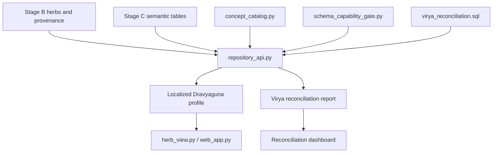

# Repository API and Presentation Services (`repository_api.py`)

**Source module:** `src/herbal_almanac/repository_api.py`  
**Architecture stage:** Stage C.2 — Repository and Presentation Services  
**Database requirement:** Stage C schema version 3

## 1. Purpose and responsibility

The `repository_api.py` module provides read-oriented services for retrieving and presenting the normalized semantic data stored in Herbal Almanac.

Earlier modules perform ingestion, cleaning, concept mapping, and claim review. The repository API brings the resulting information together into application-friendly structures.

It has two major responsibilities:

1. Build a localized Dravyaguna profile for an herb.
2. Reconcile Virya information across different herb records and sources.

The module does not scrape data or create new semantic mappings. It reads the existing Stage C representation and applies presentation and eligibility rules.

Its responsibilities include:

- Retrieving normalized properties for an herb.
- Resolving multilingual concept labels.
- Including canonical Sanskrit references in Devanagari and IAST.
- Returning Dosha effects, plant parts, preparations, and indications.
- Excluding rejected or superseded claims.
- Excluding disputed mappings by default.
- Excluding provisional concepts by default.
- Comparing Virya claims across records.
- Distinguishing candidate divergence from verified disagreement.
- Identifying multiple conflicting mappings derived from the same source claim.

## 2. Position in the project architecture



### Upstream dependencies

| Module or resource | Purpose |
|---|---|
| `concept_catalog.py` | Resolves display labels and canonical Sanskrit references. |
| `schema_capability_gate.py` | Ensures that Stage C schema version 3 is available. |
| `migrations/virya_reconciliation.sql` | Supplies the four SQL queries used for Virya reconciliation. |
| Stage B and Stage C tables | Supply herb identities, source claims, mappings, and semantic relationships. |

### Downstream consumers

The repository API is intended for use by:

- `herb_view.py`
- `web_app.py`
- Stage C profile views
- Virya reconciliation dashboards
- Other application services that need structured semantic data

## 3. Imports

The module uses the following standard-library imports:

| Import | Purpose |
|---|---|
| `datetime`, `timezone` | Generates the reconciliation report timestamp in UTC. |
| `Path` | Locates the SQL reconciliation file relative to the module. |
| `sqlite3` | Executes SQLite queries. |
| `Any` | Types flexible profile result dictionaries. |
| `Literal` | Restricts selected string fields to known values. |
| `TypedDict` | Defines the structure of returned records and reports. |
| `cast` | Provides static type-casting support. |

Internal imports:

```python
from .concept_catalog import (
    resolve_concept_display_label,
    resolve_concept_sanskrit_references,
)

from .schema_capability_gate import (
    FeatureUnavailableError,
    require_stage_c_schema_v3,
)
```

The catalog functions are used to resolve multilingual labels and Sanskrit references.

The schema gate is used before Stage C queries.

`FeatureUnavailableError` is imported for the module's capability-error interface, while the actual schema check is performed through `require_stage_c_schema_v3()`.

## 4. SQL resource path

The module defines:

```python
RECONCILIATION_SQL_PATH = (
    Path(__file__).resolve().parent
    / "migrations"
    / "virya_reconciliation.sql"
)
```

This makes the reconciliation SQL location relative to the installed Python package rather than the process's current working directory.

The SQL file contains four accepted queries:

1. Unreviewed candidate divergence.
2. Reviewed candidate divergence.
3. Verified source disagreement.
4. Same-claim mapping ambiguity.

The repository API loads these queries when reconciliation is requested.

## 5. Data structures

The module defines several `TypedDict` structures.

These are primarily static typing contracts for the dictionaries returned by the repository functions. They do not create database tables or perform runtime validation of every returned value.

### 5.1 `ViryaPairwiseDivergenceRecord`

Represents a pairwise comparison between two herb records.

Important fields include:

| Field | Meaning |
|---|---|
| `botanical_identity` | Botanical identity used for comparison. |
| `identity_basis` | How the two records were associated. |
| `herb_1_id`, `herb_2_id` | Compared herb IDs. |
| `herb_1_name`, `herb_2_name` | Compared herb names. |
| `source_1`, `source_2` | Source identifiers or names. |
| `part_1_code`, `part_2_code` | Plant-part concepts, when available. |
| `virya_1`, `virya_2` | Canonical Virya concepts. |
| `raw_claim_1`, `raw_claim_2` | Original source expressions. |
| `mapping_1_status`, `mapping_2_status` | Mapping review statuses. |
| `mapping_1_type`, `mapping_2_type` | Mapping types. |
| `part_comparison_scope` | How the plant parts compare. |
| `source_scope` | Whether the comparison is within or across sources. |
| `divergence_tier` | Classification of the divergence. |

The type also includes reviewer and verifier audit fields for both compared claims and mappings.

The `identity_basis` field distinguishes cases such as:

- Same herb record.
- Shared accepted taxon with verified identity.
- Shared accepted taxon with reviewed identity.
- Candidate match based on botanical-string equality.
- Unmatched records.

The type makes identity evidence explicit rather than treating every matching botanical name as equally reliable.

### 5.2 `ViryaSameClaimAmbiguityRecord`

Represents an ambiguity where one source claim has multiple Virya mappings.

Important fields include:

- Herb identity.
- Source record ID.
- Source claim ID.
- Original source field and expression.
- Claim verification status.
- Plant-part IDs.
- First and second mapping IDs.
- First and second Virya concepts.
- Mapping statuses and types.
- Audit category.

The audit category is:

```text
HERB_SAME_SOURCE_CLAIM_MAPPING_AMBIGUITY
```

This is distinct from disagreement between two separate sources. It identifies ambiguity within the interpretation of one source claim.

### 5.3 `ViryaReconciliationSummary`

Contains aggregate reconciliation counts:

```python
class ViryaReconciliationSummary(TypedDict):
    tier_1_unreviewed_divergence_count: int
    tier_2_reviewed_divergence_count: int
    tier_3_verified_disagreement_count: int
    same_claim_mapping_ambiguity_count: int
    total_reconciled_pairs: int
```

These counts summarize the records included in the returned reconciliation report.

### 5.4 `ViryaReconciliationReport`

Defines the complete report returned by `reconcile_herb_virya()`.

It contains:

- Target herb ID.
- Reconciliation timestamp.
- Summary counts.
- Tier 1 divergence records.
- Tier 2 divergence records.
- Tier 3 verified disagreements.
- Same-claim ambiguity records.

### 5.5 Dravyaguna profile types

The module defines five types for the profile categories.

| Type | Represents |
|---|---|
| `DravyagunaProfileProperty` | Rasa, Guna, Virya, Vipaka, Prabhava, and Karma properties. |
| `DravyagunaProfileDoshaEffect` | Dosha and directional-effect relationships. |
| `DravyagunaProfilePlantPart` | Plant parts associated with an herb. |
| `DravyagunaProfilePreparation` | Preparation forms, optionally associated with a plant part. |
| `DravyagunaProfileIndication` | Therapeutic indications. |

These structures preserve both the normalized concept and its source evidence.

For example, a property record includes:

- Canonical concept code.
- Display label.
- Display-label verification status.
- Canonical Sanskrit labels.
- Mapping type and confidence.
- Mapping verification status.
- Dispute status.
- Source claim ID.
- Original source expression.
- Source key.

This allows the application to display normalized information without losing the ability to trace it back to the original source assertion.

## 6. Main function: localized Dravyaguna profile

### `herb_dravyaguna_profile(...)`

```python
herb_dravyaguna_profile(
    connection: sqlite3.Connection,
    herb_id: int,
    language: str = "en",
    include_disputed: bool = False,
    include_provisional: bool = False,
) -> dict[str, Any]
```

This function constructs the normalized semantic profile for one herb.

It combines information from multiple Stage C tables and resolves appropriate display labels.

### Parameters

| Parameter | Meaning |
|---|---|
| `connection` | Open SQLite connection. |
| `herb_id` | ID of the herb whose profile is requested. |
| `language` | Preferred display language; defaults to English. |
| `include_disputed` | Whether disputed mappings should be included. |
| `include_provisional` | Whether provisional concepts should be included. |

### Step 1: Check schema capability

The function begins with:

```python
require_stage_c_schema_v3(connection)
```

A valid Stage C schema is required.

It then executes:

```sql
PRAGMA foreign_keys = ON;
```

This enables foreign-key enforcement for the connection.

### Step 2: Verify herb identity

The function queries the Stage B `herbs` table:

```sql
SELECT id, english_name, botanical_name
FROM herbs
WHERE id = ?;
```

If the herb does not exist, it raises `KeyError`.

The function does not silently return an empty profile for an invalid herb ID.

### Step 3: Retrieve Dravyaguna properties

The first major query retrieves:

- Herb-property relationship.
- Canonical concept.
- Concept domain.
- Optional plant-part concept.
- Mapping method and confidence.
- Mapping verification status.
- Source presence status.
- Original source claim.
- Original source expression.
- Source key.

The property domains include:

- Rasa
- Guna
- Virya
- Vipaka
- Prabhava
- Karma

The query joins:

```text
herb_dravyaguna_properties
    -> concept_claim_mappings
    -> dravyaguna_concepts
    -> source_claims
    -> source_records
    -> sources
```

It also optionally joins the plant-part concept.

#### Eligibility filters

The query includes only active property relationships:

```sql
p.source_presence_status = 'active'
```

It excludes mappings and parent claims marked:

```text
superseded
rejected
```

It also applies the requested provisional and disputed filters.

By default:

- Only active concepts are included.
- Disputed mappings are excluded.
- Rejected or superseded parent claims are excluded.
- Rejected or superseded mappings are excluded.

#### Label resolution

For each property, the function calls:

```python
resolve_concept_display_label(
    connection,
    concept_id,
    language=language,
    allow_provisional=include_provisional,
)
```

It also calls:

```python
resolve_concept_sanskrit_references(
    connection,
    concept_id,
    allow_provisional=include_provisional,
)
```

If a property has a plant-part concept, its display label is resolved separately.

The resulting record retains both the localized display information and the original source claim.

### Step 4: Retrieve Dosha effects

The Dosha query joins:

```text
herb_dosha_effects
    -> dosha_claim_assertions
    -> dravyaguna_concepts (Dosha)
    -> dravyaguna_concepts (effect)
    -> source_claims
```

It retrieves:

- Dosha concept code.
- Effect concept code.
- Assertion status.
- Source presence status.
- Source claim ID.
- Original source expression.

It excludes inactive relationships and rejected or superseded assertions and parent claims.

Both the Dosha and effect concepts must satisfy the requested active/provisional eligibility.

The function resolves display labels for both concepts.

The resulting profile can represent relationships such as:

```text
Vata -> Decrease
Pitta -> Increase
Kapha -> Decrease
```

These are illustrative relationships; actual results depend on the database contents.

### Step 5: Retrieve plant parts

The plant-part query joins:

```text
herb_plant_parts
    -> concept_claim_mappings
    -> dravyaguna_concepts
    -> source_claims
```

It retrieves active plant-part relationships and applies the mapping and parent-claim status filters.

For each plant part, it resolves:

- Localized display label.
- Display-label status.
- Canonical Sanskrit in Devanagari.
- Canonical Sanskrit in IAST.

It also returns the original source claim and expression.

### Step 6: Retrieve preparations

The preparation query joins:

```text
herb_preparations
    -> concept_claim_mappings (preparation)
    -> dravyaguna_concepts (preparation)
```

An optional second mapping connects the preparation to a plant part.

The function retrieves:

- Preparation concept code.
- Preparation display label.
- Optional plant-part concept code.
- Optional plant-part display label.
- Source presence status.
- Mapping status.
- Dispute status.
- Source claim ID.
- Original source expression.

It checks the eligibility of both the preparation and its optional plant-part mapping.

A disputed preparation or disputed associated plant-part mapping is represented as disputed. By default, disputed preparation relationships are filtered out.

### Step 7: Retrieve indications

The indication query joins:

```text
herb_indications
    -> concept_claim_mappings
    -> dravyaguna_concepts
    -> source_claims
```

It retrieves active indication relationships, excluding rejected or superseded mappings and parent claims.

For each indication, it resolves:

- Localized display label.
- Display-label verification status.
- Canonical Sanskrit in Devanagari.
- Canonical Sanskrit in IAST.

It also retains the original source expression and claim ID.

### Step 8: Assemble the result

The function returns one dictionary:

```python
{
    "herb_id": herb_id,
    "english_name": ...,
    "botanical_name": ...,
    "language": language,
    "properties": [...],
    "dosha_effects": [...],
    "plant_parts": [...],
    "preparations": [...],
    "indications": [...],
}
```

Each collection contains structured records rather than plain display strings.

This is important because the application can display a property and still retain its mapping status and source provenance.

## 7. Virya reconciliation SQL loader

### `_load_virya_reconciliation_queries()`

```python
_load_virya_reconciliation_queries() -> tuple[str, str, str, str]
```

Loads the SQL file defined by `RECONCILIATION_SQL_PATH`.

The function:

1. Checks whether the SQL file exists.
2. Reads it using UTF-8.
3. Splits the contents on semicolons.
4. Keeps query fragments containing `SELECT`.
5. Requires at least four queries.
6. Returns the first four queries.

If the file is missing, it raises `FileNotFoundError`.

If fewer than four queries are found, it raises `ValueError`.

The four returned queries are used by the reconciliation service.

**Implementation note:** the loader uses a simple semicolon split and a `SELECT` check. It is designed for the current SQL file, not as a general SQL parser.

## 8. Main function: Virya reconciliation

### `reconcile_herb_virya(...)`

```python
reconcile_herb_virya(
    connection: sqlite3.Connection,
    herb_id: int,
) -> ViryaReconciliationReport
```

This function compares the target herb's Virya information against other eligible herb records and produces a structured report.

It uses the four queries from:

```text
migrations/virya_reconciliation.sql
```

The report distinguishes candidate divergence, reviewed divergence, verified disagreement, and ambiguity within one source claim.

### Step 1: Check schema capability

The function calls:

```python
require_stage_c_schema_v3(connection)
```

It then enables foreign-key enforcement:

```sql
PRAGMA foreign_keys = ON;
```

### Step 2: Verify the target herb

It queries:

```sql
SELECT id
FROM herbs
WHERE id = ?;
```

If the herb does not exist, it raises `KeyError`.

### Step 3: Load the four SQL queries

The function calls:

```python
q1, q2, q3, q4 = _load_virya_reconciliation_queries()
```

Each query represents a different reconciliation category.

### Step 4: Build active concept lookups

The function loads:

```sql
SELECT concept_code
FROM dravyaguna_concepts
WHERE status = 'active';
```

It also loads active concept IDs.

These lookups are used to filter out records referencing non-active concepts.

Both concept codes and IDs are needed because the first three reconciliation queries use concept codes for plant-part filtering, while the same-claim ambiguity query uses plant-part IDs.

### Step 5: Execute Tier 1

The first query is executed inside a subquery, restricted to rows where the target herb appears as either compared herb.

Conceptually:

```sql
SELECT *
FROM (<Tier 1 query>) AS q
WHERE q.herb_1_id = ?
   OR q.herb_2_id = ?;
```

Tier 1 represents unreviewed candidate divergence.

The returned records are filtered to ensure that:

- Both Virya concepts are active.
- Any supplied plant-part concept codes are active.

The function then constructs `ViryaPairwiseDivergenceRecord` dictionaries.

For Tier 1, reviewer and verifier audit fields are set to `None` because the records are candidate-level results rather than verified decisions.

### Step 6: Execute Tier 2

The second query follows the same target-herb filtering approach.

Tier 2 represents reviewed candidate divergence.

It applies the same active-concept filtering and builds the same structured pairwise record type.

The reviewer/verifier audit fields in the current implementation are set to `None` in the constructed Tier 2 records as well.

### Step 7: Execute Tier 3

The third query identifies verified source disagreements.

The function filters out records referencing non-active Virya or plant-part concepts.

For the resulting Tier 3 records, it sets:

```text
mapping_1_status = verified
mapping_1_type = exact
mapping_2_status = verified
mapping_2_type = exact
```

It also carries through the reviewer and verifier identity/timestamp fields returned by the SQL query.

This tier is intended to distinguish a verified disagreement between sources from an unresolved candidate difference.

### Step 8: Execute Query 4 — same-claim ambiguity

The fourth query identifies cases where a single source claim has multiple Virya mappings.

It is restricted to the target herb:

```sql
WHERE q.herb_id = ?
```

The function filters out records whose Virya concepts or associated plant-part IDs are not active.

It then builds `ViryaSameClaimAmbiguityRecord` dictionaries.

This category is important because two different mappings from the same source statement should not be mistaken for independent agreement or disagreement between separate sources.

### Step 9: Calculate summary counts

The function calculates:

```python
tier_1_count = len(tier_1_rows)
tier_2_count = len(tier_2_rows)
tier_3_count = len(tier_3_rows)
ambiguity_count = len(ambiguity_rows)
```

The total is:

```python
total_reconciled = (
    tier_1_count
    + tier_2_count
    + tier_3_count
    + ambiguity_count
)
```

These counts describe the records returned by the four filtered queries.

### Step 10: Build the report

The function generates a UTC timestamp:

```python
datetime.now(timezone.utc).isoformat().replace("+00:00", "Z")
```

It returns:

```python
{
    "target_herb_id": herb_id,
    "reconciled_at": now_iso,
    "summary_counts": summary,
    "tier_1_unreviewed_divergence": tier_1_rows,
    "tier_2_reviewed_divergence": tier_2_rows,
    "tier_3_verified_disagreements": tier_3_rows,
    "same_claim_ambiguities": ambiguity_rows,
}
```

The function produces a report; it does not automatically adjudicate disagreements or modify the source claims.

## 9. Understanding the reconciliation tiers

| Category | Meaning | Interpretation |
|---|---|---|
| Tier 1 | Unreviewed candidate divergence | Different Virya values have been mapped, but the relevant interpretation is not yet reviewed. |
| Tier 2 | Reviewed candidate divergence | A difference remains among reviewed interpretations, but it is not yet a verified source disagreement. |
| Tier 3 | Verified source disagreement | Verified source-backed information disagrees. |
| Same-claim ambiguity | Multiple mappings from one source claim | One original source expression has more than one Virya interpretation. |

The distinction is important.

A disagreement between two unreviewed mappings should not be presented as equivalent to a disagreement between two independently verified source assertions.

Likewise, two mappings from the same source claim are not independent sources of evidence.

## 10. Understanding comparison scope

The pairwise record also describes how two records were compared.

### Identity basis

The `identity_basis` field records the basis for considering two herb records comparable.

Examples include:

- Same herb record.
- Shared accepted taxon with verified taxonomic identity.
- Shared accepted taxon with reviewed identity.
- Candidate botanical-string equality.
- Unmatched.

This prevents the application from silently treating a textual botanical-name match as a verified taxonomic identity.

### Plant-part comparison scope

The `part_comparison_scope` field describes the relationship between the plant parts associated with two Virya assertions.

Possible values include:

- `exact_part_match`
- `different_part_or_unspecified_compatible`
- `both_parts_unspecified`
- `unspecified_vs_specified_part`

This matters because two sources may report different Virya properties for different plant parts without necessarily contradicting each other.

### Source scope

The `source_scope` field distinguishes:

- Same-source internal divergence.
- Cross-source divergence.
- Cross-source verified disagreement.
- Intra-source record divergence.
- Intra-source multi-record divergence.

This provides additional context when interpreting the reconciliation report.

## 11. Imported functions being used

| Imported function | Source | Purpose |
|---|---|---|
| `resolve_concept_display_label()` | `concept_catalog.py` | Resolves localized labels for canonical concepts. |
| `resolve_concept_sanskrit_references()` | `concept_catalog.py` | Retrieves Sanskrit labels in Devanagari and IAST. |
| `require_stage_c_schema_v3()` | `schema_capability_gate.py` | Ensures Stage C schema compatibility. |

The module also uses the imported `Path` class to locate its SQL file and the datetime utilities to timestamp reports.

## 12. Example usage

### Retrieve a localized profile

```python
import sqlite3

from herbal_almanac.repository_api import (
    herb_dravyaguna_profile,
)

connection = sqlite3.connect("AyurvedicDB.db")

try:
    profile = herb_dravyaguna_profile(
        connection,
        herb_id=1,
        language="en",
    )

    print("Herb:", profile["english_name"])
    print("Properties:", len(profile["properties"]))
    print("Dosha effects:", len(profile["dosha_effects"]))
    print("Plant parts:", len(profile["plant_parts"]))
    print("Preparations:", len(profile["preparations"]))
    print("Indications:", len(profile["indications"]))

finally:
    connection.close()
```

### Include disputed or provisional records

```python
profile = herb_dravyaguna_profile(
    connection,
    herb_id=1,
    language="hi",
    include_disputed=True,
    include_provisional=True,
)
```

These options deliberately broaden the returned data. They should be used with clear UI labels so users can distinguish provisional or disputed interpretations from ordinary profile entries.

### Generate a Virya reconciliation report

```python
from herbal_almanac.repository_api import (
    reconcile_herb_virya,
)

report = reconcile_herb_virya(
    connection,
    herb_id=1,
)

print(report["summary_counts"])
print(report["tier_1_unreviewed_divergence"])
print(report["tier_3_verified_disagreements"])
print(report["same_claim_ambiguities"])
```

The example assumes that the database has already been upgraded to Stage C and contains the required reconciliation SQL file.

## 13. Design principles

### Read-oriented service layer

The repository API retrieves and structures existing information. It does not perform scraping, source ingestion, or claim adjudication.

### Provenance remains visible

Profile entries retain source claim IDs, source expressions, and source identifiers.

### Conservative presentation defaults

Disputed mappings and provisional concepts are excluded by default.

### Localization is separate from concept identity

The canonical concept code remains stable while the display label can change according to the requested language.

### Reconciliation is not adjudication

The API reports divergence and disagreement. It does not decide which source is correct.

### Identity evidence is explicit

The comparison output records how herb identity was established, rather than assuming that matching botanical strings prove identity.

## 14. Important limitations

- The profile function requires Stage C schema version 3.
- The profile queries exclude rejected and superseded claims and mappings.
- Provisional and disputed data require explicit inclusion flags.
- Display labels depend on the available catalog labels and their verification state.
- Virya reconciliation depends on the four SQL queries in `migrations/virya_reconciliation.sql`.
- The SQL loader is a simple semicolon-based splitter, not a general SQL parser.
- The reconciliation report is a snapshot of query results; it does not modify claims or resolve disagreements.
- The repository API does not authenticate users or apply curator permissions.
- The profile and reconciliation functions do not establish clinical safety or therapeutic effectiveness.

## 15. Related files

- `concept_catalog.py`
- `schema_capability_gate.py`
- `claim_lifecycle.py`
- `herb_view.py`
- `web_app.py`
- `migrations/virya_reconciliation.sql`

## 16. Summary

`repository_api.py` is the read-oriented bridge between the Stage C semantic database and the application's presentation layer.

It converts normalized database relationships into localized herb profiles while retaining source provenance, review status, and dispute information.

Its Virya reconciliation service compares source-backed information in distinct review tiers and explicitly identifies same-claim ambiguity.

The module's central principle is that normalized presentation should make the data easier to understand without hiding where the information came from or how confidently it has been interpreted.
