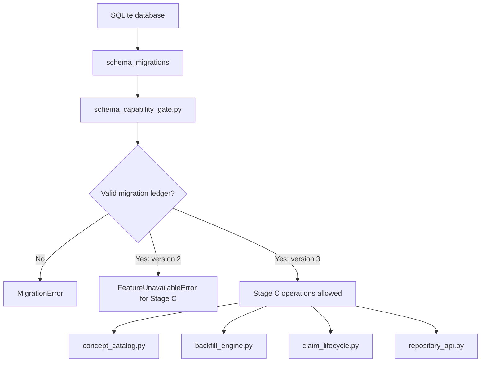

# Schema Capability Gate (`schema_capability_gate.py`)

**Source module:** `src/herbal_almanac/schema_capability_gate.py`  
**Architecture stage:** Stage C.2 — Schema-Version Compatibility  
**Database:** SQLite

## 1. Purpose and responsibility

The `schema_capability_gate.py` module determines whether a database has a valid migration history and whether it is safe to use Stage C semantic features.

Herbal Almanac has evolved through multiple database schema versions.

Stage B databases use schema version 2. Stage C introduces normalized Dravyaguna concepts and semantic relationships and requires schema version 3.

A Stage C operation must not blindly assume that its required tables exist.

The capability gate provides a central check before Stage C functionality runs.

Its responsibilities are:

- Confirm that the `schema_migrations` table exists.
- Read the recorded migration sequence.
- Accept only supported migration sequences.
- Reject missing, duplicate, gapped, malformed, or future migration versions.
- Return the validated schema version.
- Prevent Stage C operations from running on a valid version 2 database.

The module is deliberately small. It centralizes schema compatibility rules rather than allowing each application module to implement its own migration checks.

## 2. Position in the project architecture



The gate is used by modules that depend on Stage C tables and behavior.

Examples include:

- `concept_catalog.py`
- `backfill_engine.py`
- `claim_lifecycle.py`
- `repository_api.py`
- Database upgrade and application services

## 3. Imports

| Import | Purpose |
|---|---|
| `sqlite3` | Inspects the migration ledger using a SQLite connection. |
| `Any` | Supports the generic callable type annotation. |
| `Callable` | Describes the callable type used by the decorator-related type variable. |
| `TypeVar` | Defines a reusable callable type variable. |

The module does not depend on other project modules. It is a low-level compatibility component.

## 4. Classes

### 4.1 `MigrationError`

```python
class MigrationError(RuntimeError):
    pass
```

Raised when the migration ledger is missing or does not match one of the supported sequences.

Examples include:

- The `schema_migrations` table does not exist.
- The ledger is empty.
- A migration version is missing.
- A migration version is duplicated.
- An unsupported future migration is present.
- The recorded sequence is out of order.

This exception indicates that the database's migration state cannot be trusted by the application.

### 4.2 `FeatureUnavailableError`

```python
class FeatureUnavailableError(RuntimeError):
    pass
```

Raised when a valid version 2 database attempts to use a Stage C semantic feature.

This is different from `MigrationError`.

- `MigrationError` means the migration ledger is invalid or unsupported.
- `FeatureUnavailableError` means the ledger is valid, but the requested feature requires a newer schema.

This distinction lets callers provide a meaningful response instead of treating every incompatibility as database corruption.

## 5. Functions

### 5.1 `validate_schema_migration_ledger(conn)`

```python
validate_schema_migration_ledger(
    conn: sqlite3.Connection,
) -> int
```

This function reads and validates the migration history.

#### Step 1: Check that the ledger table exists

It queries SQLite's internal `sqlite_master` table:

```sql
SELECT 1
FROM sqlite_master
WHERE type = 'table'
  AND name = 'schema_migrations';
```

If no table is found, it raises `MigrationError`.

The error message instructs the caller to initialize the database using `create_database()`.

#### Step 2: Read the migration versions

The current implementation executes:

```sql
SELECT version
FROM schema_migrations
ORDER BY rowid ASC;
```

It reads the migration versions in insertion order.

#### Step 3: Validate the exact sequence

Only two migration sequences are accepted:

| Migration sequence | Schema version | Description | Status |
|---|---|---|---|
| `[1, 2]` | 2 | Schema version 2 (Stage B operational provenance) | Valid |
| `[1, 2, 3]` | 3 | Schema version 3 (Stage C semantic Dravyaguna) | Valid |

Any other sequence raises `MigrationError`.

Examples:

| Recorded sequence | Result |
|---|---|
| `[]` | Rejected |
| `[1]` | Rejected |
| `[1, 3]` | Rejected |
| `[2, 3]` | Rejected |
| `[1, 2, 2]` | Rejected |
| `[0, 1, 2]` | Rejected |
| `[1, 2, 3, 4]` | Rejected |
| `[2, 1]` | Rejected |

The function requires an exact sequence, not merely a maximum version number.

This prevents a database with a missing or unexpected migration from being treated as compatible.

### 5.2 `require_stage_c_schema_v3(conn)`

```python
require_stage_c_schema_v3(
    conn: sqlite3.Connection,
) -> None
```

This is the main Stage C capability check.

It first calls:

```python
version = validate_schema_migration_ledger(conn)
```

Then:

- If the version is `2`, it raises `FeatureUnavailableError`.
- If the version is `3`, it returns normally.
- If the ledger is invalid, `MigrationError` propagates from the validation function.

The version 2 error explains that Stage C normalized semantic features require schema version 3 and that Migration 3 is needed to enable Dravyaguna semantic profiles.

The function does not apply a migration. It only checks whether the requested capability is available.

### 5.3 `get_schema_version(conn)`

```python
get_schema_version(
    conn: sqlite3.Connection,
) -> int
```

A convenience function that delegates directly to:

```python
validate_schema_migration_ledger(conn)
```

It returns either `2` or `3`, and raises the same exception when the ledger is invalid.

## 6. Type variable and decorator-related declarations

The module also defines:

```python
F = TypeVar("F", bound=Callable[..., Any])
```

This is a generic callable type declaration.

**Implementation note:** The module implements explicit procedural gating via `require_stage_c_schema_v3(connection)` rather than a decorator. Although `Callable` and generic type variable `F` are declared in the module, schema verification is performed directly by calling the procedural validator.

## 7. Imported functions being used

The current module imports no functions from other project modules.

It operates directly on the supplied `sqlite3.Connection`.

## 8. How other modules use the gate

A typical Stage C module imports:

```python
from .schema_capability_gate import require_stage_c_schema_v3
```

Then, before performing semantic database operations, it calls:

```python
require_stage_c_schema_v3(connection)
```

For example, the concept catalog uses this gate before seeding or resolving canonical semantic concepts.

The claim lifecycle module uses it before changing source-claim or interpretation statuses.

The repository API uses it before retrieving normalized Stage C profiles and reconciliation reports.

Centralizing this check means these modules use the same definition of a valid Stage C database.

## 9. Example usage

### Check the current schema version

```python
import sqlite3

from herbal_almanac.schema_capability_gate import (
    get_schema_version,
)

connection = sqlite3.connect("AyurvedicDB.db")

try:
    version = get_schema_version(connection)
    print("Database schema version:", version)
finally:
    connection.close()
```

### Require Stage C functionality

```python
import sqlite3

from herbal_almanac.schema_capability_gate import (
    FeatureUnavailableError,
    MigrationError,
    require_stage_c_schema_v3,
)

connection = sqlite3.connect("AyurvedicDB.db")

try:
    require_stage_c_schema_v3(connection)
    print("Stage C features are available.")

except FeatureUnavailableError as error:
    print("Stage C is not available:", error)

except MigrationError as error:
    print("Database migration state is invalid:", error)

finally:
    connection.close()
```

The example checks capability only. It does not run a migration.

## 10. Exception behavior

| Situation | Exception or result |
|---|---|
| Valid ledger `[1, 2]` passed to `get_schema_version()` | Returns `2` |
| Valid ledger `[1, 2, 3]` passed to `get_schema_version()` | Returns `3` |
| Valid version 2 passed to `require_stage_c_schema_v3()` | `FeatureUnavailableError` |
| Valid version 3 passed to `require_stage_c_schema_v3()` | Returns `None` |
| Missing `schema_migrations` table | `MigrationError` |
| Invalid or unsupported ledger | `MigrationError` |

## 11. Design principles

### Exact migration history

The module checks the full sequence instead of trusting the largest recorded version.

### Fail-fast behavior

Stage C operations should fail before attempting queries against missing semantic tables.

### Separate failure meanings

An invalid database migration history is different from a valid but older database.

### No implicit migration

The gate never upgrades the database automatically. Schema changes remain the responsibility of the database migration and upgrade workflow.

### Centralized compatibility policy

All Stage C consumers rely on one implementation of schema compatibility.

## 12. Important limitations

- The gate validates the migration ledger, not every table, column, index, trigger, or constraint in the database.
- A valid `[1, 2, 3]` ledger is not by itself proof that every migration-created object is intact.
- The gate does not apply migrations.
- The gate does not start a transaction.
- The gate does not enable foreign keys; callers that require foreign-key enforcement must configure it separately.
- Only migration sequences `[1, 2]` and `[1, 2, 3]` are currently accepted.

## 13. Related files

- `database_operator.py`
- `migrations/migration_0003_semantic_dravyaguna.py`
- `concept_catalog.py`
- `backfill_engine.py`
- `claim_lifecycle.py`
- `repository_api.py`

## 14. Summary

`schema_capability_gate.py` is the compatibility boundary between the Stage B database and Stage C semantic features.

It verifies the complete migration sequence, distinguishes invalid migration histories from unavailable features, and prevents semantic operations from running against a valid but insufficient version 2 database.

It does not migrate or repair the database. Its role is to verify capability and fail safely.
