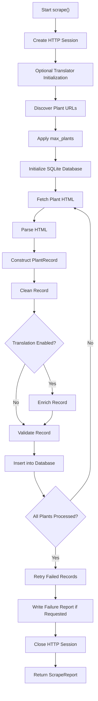

# Web Scraper and HTML Parser – `scrapper.py`

## 1. Role of the File in the Project

The `scrapper.py` module is responsible for collecting Ayurvedic medicinal plant information from the CCRAS DRAVYA portal.

It acts as the source-ingestion layer of Herbal Almanac.

The module performs the following operations:

1. Connects to the CCRAS DRAVYA website.
2. Discovers plant monograph URLs through directory pagination.
3. Downloads individual plant pages.
4. Parses the HTML structure.
5. Extracts botanical information, Ayurvedic names, vernacular names, and section attributes.
6. Constructs a `PlantRecord`.
7. Cleans the extracted record.
8. Optionally enriches it through machine translation.
9. Validates the record.
10. Sends the record to the SQLite database operator.

### Position in the architecture

```text
CCRAS DRAVYA
      |
      v
scrapper.py
      |
      +----> Directory Discovery
      |
      +----> HTTP Retrieval
      |
      +----> HTML Parsing
      |
      +----> PlantRecord Construction
      |
      v
cleaning.py
      |
      v
PlantRecord Validation
      |
      v
database_operator.py
      |
      v
SQLite Database
```

The scraper does not own SQL schema creation or the underlying text-cleaning algorithms.

---

## 2. Imports Used

The module combines Python standard-library modules with third-party libraries and internal project modules.

### 2.1 Standard-library imports

| Import | Purpose |
|---|---|
| `argparse` | Defines the standalone scraper command-line arguments |
| `datetime.datetime` | Generates retrieval timestamps |
| `datetime.timezone` | Ensures timestamps use UTC |
| `dataclasses.asdict` | Converts dataclass instances into dictionaries |
| `dataclasses.dataclass` | Defines structured report classes |
| `dataclasses.field` | Creates independent mutable default values |
| `json` | Serializes scraping failures into JSON |
| `pathlib.Path` | Handles filesystem paths |
| `re` | Extracts plant IDs and normalizes HTML labels |
| `urllib.parse.urljoin` | Converts relative plant links into absolute URLs |
| `sqlite3` | Identifies database exceptions during ingestion |

### 2.2 Third-party imports

**Requests**

```python
import requests
```

Used for HTTP communication with the CCRAS website.

The `requests.Session` object is particularly useful because multiple requests can reuse the same session configuration and connection pool.

**BeautifulSoup**

```python
from bs4 import BeautifulSoup
```

Used to parse HTML documents.

It allows the scraper to locate:

- Links.
- Tables.
- Headers.
- Table rows.
- HTML headings.
- Vernacular-name cards.
- Botanical profile elements.

**Rich**

```python
from rich.progress import (
    BarColumn,
    Progress,
    SpinnerColumn,
    TaskProgressColumn,
    TextColumn,
    TimeRemainingColumn,
)
```

Used to display scraping progress in the terminal.

It provides:

- A spinner.
- Task descriptions.
- Progress bars.
- Completion percentages.
- Estimated remaining time.

**Requests adapters and urllib3 Retry**

```python
from requests.adapters import HTTPAdapter
from urllib3.util.retry import Retry
```

These configure automatic retries for temporary HTTP failures.

They help the scraper recover from temporary server errors and connection failures.

### 2.3 Internal project imports

```python
from .cleaning import PlantRecord, clean_text, split_values
```

These are imported from `cleaning.py`.

- `PlantRecord`: Standard data structure used to represent a scraped plant.
- `clean_text`: Normalizes text extracted from HTML.
- `split_values`: Separates multiple values stored in one source field.

```python
from .database_operator import AyurvedicAlmanac, default_database_path
```

These are imported from `database_operator.py`.

- `AyurvedicAlmanac`: Main database operator class.
- `default_database_path`: Determines the default database location.

---

## 3. Constants and Configuration

### `DRAVYA_DIRECTORY`

```python
DRAVYA_DIRECTORY = "https://dravya.ccras.org.in/all_plants"
```

The directory URL from which plant records are discovered.

The scraper requests this endpoint using pagination.

### `PLANT_PATH`

```python
PLANT_PATH = re.compile(r"/plant/(\d+)(?:/|$)")
```

A compiled regular expression used to identify plant IDs from URLs.

For example:

```text
/plant/101
/plant/102/tulsi
/plant/103/
```

The extracted IDs are:

```text
101
102
103
```

### `DEFAULT_TIMEOUT`

```python
DEFAULT_TIMEOUT = 15.0
```

Default HTTP read timeout in seconds.

The `fetch()` function also uses a fixed 5-second connection timeout.

### `LANGUAGE_ALIASES`

```python
LANGUAGE_ALIASES = {
    "malyalam": "Malayalam",
    "oriya": "Odia",
}
```

Maps spelling variations used by the source website to canonical language labels.

For example, a source label containing `Malyalam` is stored as `Malayalam`.

---

## 4. Classes and Data Structures

The module defines four main classes.

### 4.1 `ScrapeFailure`

```python
@dataclass(frozen=True, slots=True)
class ScrapeFailure:
    plant_id: int
    url: str
    attempts: int
    error_type: str
    reason: str
```

Represents a plant record that could not be successfully scraped.

Its fields are:

| Field | Meaning |
|---|---|
| `plant_id` | ID assigned by CCRAS DRAVYA |
| `url` | URL of the failed plant page |
| `attempts` | Total processing attempts |
| `error_type` | Exception class name |
| `reason` | Error description |

The class is immutable because it uses `frozen=True`.

It is used by `ScrapeReport` to maintain structured failure information.

### 4.2 `ScraperError`

```python
class ScraperError(RuntimeError):
    """Expected scraper failure with actionable context."""
```

Base exception class for expected scraper-related failures.

It provides a common exception category for scraper-specific errors.

### 4.3 `DiscoveryError`

```python
class DiscoveryError(ScraperError):
    pass
```

Specialized exception for plant discovery failures.

It inherits from `ScraperError`.

It is used when pagination does not terminate safely.

### 4.4 `DiscoveryReport`

```python
@dataclass(frozen=True, slots=True)
class DiscoveryReport:
    plants: list[tuple[int, str]]
    pages: int
    total_discovered: int
    termination: str
```

Stores the result of plant directory discovery.

| Field | Meaning |
|---|---|
| `plants` | Sorted list of `(plant_id, plant_url)` pairs |
| `pages` | Number of directory pages processed |
| `total_discovered` | Number of unique plants found |
| `termination` | Reason discovery stopped |

Example:

```python
DiscoveryReport(
    plants=[
        (1, "https://dravya.ccras.org.in/plant/1"),
        (2, "https://dravya.ccras.org.in/plant/2")
    ],
    pages=3,
    total_discovered=2,
    termination="two consecutive pages added no IDs"
)
```

This makes discovery results easier to inspect and test.

### 4.5 `ScrapeReport`

```python
@dataclass(slots=True)
class ScrapeReport:
    processed: int = 0
    discovered: int = 0
    discovery_pages: int = 0
    discovery_termination: str = ""
    failures: list[ScrapeFailure] = field(default_factory=list)
```

Represents the overall scraping execution.

| Field | Meaning |
|---|---|
| `processed` | Number of successfully persisted records |
| `discovered` | Total number of unique plants discovered |
| `discovery_pages` | Number of directory pages visited |
| `discovery_termination` | Discovery termination reason |
| `failures` | List of final failed plant records |

The `field(default_factory=list)` ensures that every report receives its own failure list.

#### `ScrapeReport.write_json()`

```python
def write_json(self, path: str | Path) -> None:
```

Writes the report to a JSON file.

It serializes:

- Processed count.
- Discovered count.
- Discovery page count.
- Termination reason.
- Total failures.
- Individual failure details.

`asdict()` converts the failure dataclasses into dictionaries.

`ensure_ascii=False` preserves Unicode characters in the JSON output.

---

## 5. Functions

### 5.1 `create_session()`

```python
def create_session(retries: int = 2) -> requests.Session:
```

**Purpose:** Creates and configures a reusable HTTP session.

Implementation:

```python
session = requests.Session()

retry = Retry(
    total=retries,
    connect=retries,
    read=0,
    status=retries,
    backoff_factor=0.5,
    status_forcelist=(429, 500, 502, 503, 504),
    allowed_methods=("GET",),
)
```

The retry policy has the following characteristics:

| Parameter | Function |
|---|---|
| `total` | Overall retry limit |
| `connect` | Retry limit for connection errors |
| `read=0` | Disable automatic read-error retries |
| `status` | Retry limit for configured HTTP status failures |
| `backoff_factor` | Exponential retry delay factor |
| `status_forcelist` | HTTP status codes that trigger retries |
| `allowed_methods` | Restricts retries to GET requests |

The session mounts the retry-enabled adapter for HTTPS.

It also sets a descriptive User-Agent:

```python
session.headers["User-Agent"] = (
    "HerbalAlmanac/0.1 (research data collection)"
)
```

**Why is this useful?**

A remote website may temporarily return an error such as HTTP 503.

Rather than immediately terminating the entire scraping operation, the HTTP adapter can retry the request.

The session is reused for directory and plant-page requests.

### 5.2 `fetch()`

```python
def fetch(
    session: requests.Session,
    url: str,
    timeout: float = DEFAULT_TIMEOUT
) -> str:
```

**Purpose:** Downloads HTML from a given URL.

Implementation:

```python
response = session.get(
    url,
    timeout=(5.0, timeout)
)

response.raise_for_status()

return response.text
```

The timeout is a tuple:

- 5 seconds for establishing the connection.
- Configurable read timeout, defaulting to 15 seconds.

`raise_for_status()` raises an HTTP exception when the server returns an unsuccessful HTTP status.

The function returns the HTML as a string.

It does not parse or clean the HTML.

### 5.3 `_discover_plants()`

```python
def _discover_plants(
    session: requests.Session,
    directory_url: str = DRAVYA_DIRECTORY,
    max_pages: int | None = None
) -> DiscoveryReport:
```

**Purpose:** Performs the actual paginated plant discovery.

This is the internal discovery implementation.

#### Working

The function initializes:

```python
discovered = {}
page = 1
empty_page_attempts = 0
```

It then requests:

```text
/all_plants?page=1
/all_plants?page=2
/all_plants?page=3
...
```

Each page is parsed using BeautifulSoup.

The scraper searches for every anchor element having an `href` attribute:

```python
soup.find_all("a", href=True)
```

Each URL is checked against:

```python
PLANT_PATH
```

When a match is found:

```python
discovered[int(match.group(1))] = (
    urljoin(directory_url, link["href"])
)
```

The dictionary uses plant ID as the key.

This automatically prevents duplicate plant IDs from being processed multiple times.

#### Pagination termination

The scraper tracks whether a page contributes any new IDs.

If a page adds no new IDs, the counter increases.

Two consecutive pages that add no new IDs terminate discovery, provided at least one previous page has already been processed.

This is safer than stopping immediately after a single empty page, because a transient empty page may occur.

If `max_pages` is provided, discovery stops after the specified number of pages.

The final report contains sorted plant ID and URL pairs.

### 5.4 `discover_plants()`

```python
def discover_plants(
    session: requests.Session,
    directory_url: str = DRAVYA_DIRECTORY,
    max_pages: int | None = None
) -> DiscoveryReport:
```

**Purpose:** Public wrapper around `_discover_plants()`.

It returns the discovery report.

Keeping the public function separate from its internal implementation makes it easier to evolve discovery logic without changing its external interface.

### 5.5 `_normalize_label()`

```python
def _normalize_label(value: str) -> str:
```

**Purpose:** Cleans section and column labels extracted from HTML.

CCRAS tables may contain numbered headings.

For example:

```text
1. Parts Used
1.1 Name
2. Therapeutic Usage
```

The function removes numeric prefixes and surrounding punctuation.

The normalized labels become:

```text
Parts Used
Name
Therapeutic Usage
```

It uses `clean_text()` before applying regular expressions.

This ensures that field names stored in the database are not dependent on presentation numbering.

### 5.6 `_section_name()`

```python
def _section_name(table: BeautifulSoup) -> str:
```

**Purpose:** Identifies the section to which an HTML table belongs.

The function searches for section information in this order:

1. `data-section` attribute.
2. `data-section-name` attribute.
3. Table caption.
4. Previous element with class `accordion-button`.
5. Previous `h3` heading.

The identified section is passed through `_normalize_label()`.

If no section is found, an empty string is returned.

The caller then uses `Unsectioned` as the fallback.

**Why is this important?**

Different sections may contain identical column names.

For example:

```text
Parts Used
    Name

Therapeutic Usage
    Name
```

If the scraper stores only `Name`, information from different sections can collide.

Instead, it creates:

```text
Parts Used.Name
Therapeutic Usage.Name
```

This preserves the context of every extracted attribute.

### 5.7 `_table_attributes()`

```python
def _table_attributes(
    soup: BeautifulSoup
) -> tuple[dict[str, list[str]], dict[str, str]]:
```

**Purpose:** Extracts structured attributes from the monograph's HTML tables.

This is one of the most important parsing functions in the module.

The function maintains two dictionaries:

```python
attributes = {}
source_values = {}
```

- `attributes` stores individual cleaned values.
- `source_values` stores combined original field wording for provenance.

#### Step 1 – Find tables

```python
for table in soup.find_all("table"):
```

Every table in the document is inspected.

#### Step 2 – Identify the header row

```python
header_row = next(
    (row for row in rows if row.find("th")),
    None
)
```

The first row containing a header cell is selected.

Tables without a header row are ignored.

#### Step 3 – Extract headers

The function extracts both `th` and `td` elements from the header row.

Each header is normalized using `_normalize_label()`.

#### Step 4 – Identify the section

The section is determined through `_section_name()`.

#### Step 5 – Process data rows

Each subsequent row is inspected.

The function extracts its `td` elements and matches their positions to the header positions.

For example:

```html
<table>
    <tr>
        <th>Name</th>
        <th>Part Used</th>
    </tr>
    <tr>
        <td>Root</td>
        <td>Mulam</td>
    </tr>
</table>
```

If the table belongs to `Parts Used`, the extracted fields become:

```python
{
    "Parts Used.Name": ["Root"],
    "Parts Used.Part Used": ["Mulam"]
}
```

#### Step 6 – Split values

```python
values = split_values(value)
```

This separates multiple values from one cell using supported delimiters.

#### Step 7 – Preserve source values

The function accumulates values in `source_values`.

Existing source wording is combined using:

```text
 |
```

Duplicate values are not added again to this combined representation.

**Important design decision:** The function does not rely on fixed table indexes.

It relies on the table headers and surrounding section headings. This makes extraction more resilient to changes in table order.

### 5.8 `_vernacular_attributes()`

```python
def _vernacular_attributes(
    soup: BeautifulSoup
) -> tuple[dict[str, list[str]], dict[str, str]]:
```

**Purpose:** Extracts multilingual plant names from the separate Vernacular Names card.

Unlike ordinary attributes, vernacular names are displayed in a card containing language badges and paragraphs.

The function:

1. Searches for a card header containing `Vernacular Names`.
2. Finds the parent card.
3. Iterates through language badges.
4. Reads the corresponding paragraph.
5. Normalizes language aliases.
6. Splits multiple values.
7. Stores the names as language-qualified attributes.

Example output:

```python
{
    "Vernacular Names.English": [
        "Holy Basil"
    ],
    "Vernacular Names.Malayalam": [
        "Thulasi"
    ],
    "Vernacular Names.Hindi": [
        "Tulsi"
    ]
}
```

The source's language labels are not always standardized.

For example:

```text
Malyalam -> Malayalam
Oriya    -> Odia
```

The extracted names are merged with ordinary table attributes before record construction.

### 5.9 `_scientific_profile()`

```python
def _scientific_profile(
    soup: BeautifulSoup
) -> tuple[str | None, str | None]:
```

**Purpose:** Extracts scientific name and botanical family from the scientific-profile card.

The function searches through `small` HTML elements for:

- Scientific Name.
- Family Name.

It then locates the associated value element.

For scientific names, it prefers text inside an italic `<i>` element when available.

Example:

```html
<small>Scientific Name</small>
<span>
    <i>Ocimum tenuiflorum</i> L.
</span>
```

The resulting scientific name is:

```text
Ocimum tenuiflorum
```

The family might be:

```text
Lamiaceae
```

If the information is absent, the corresponding result is `None`.

### 5.10 `_title_ayurvedic_name()`

```python
def _title_ayurvedic_name(
    title: str
) -> str | None:
```

**Purpose:** Extracts the Ayurvedic name from the source page title.

The source title may follow this pattern:

```text
Scientific Name - Ayurvedic Name
```

The function takes the text after the final ` - ` separator.

For example:

```text
Abies webbiana - Talisha
```

Returns:

```text
Talisha
```

If the separator is missing, it returns `None`.

### 5.11 `parse_plant()`

```python
def parse_plant(
    plant_id: int,
    url: str,
    html: str
) -> PlantRecord:
```

**Purpose:** Combines all HTML parsing operations to construct a complete plant record.

This is the main HTML-to-PlantRecord conversion function.

#### Step 1 – Parse the HTML

```python
soup = BeautifulSoup(html, "html.parser")
```

#### Step 2 – Extract the title

The function prefers:

1. `h1` or `h2` heading.
2. HTML page title.
3. Fallback text: `Plant <plant_id>`.

#### Step 3 – Extract table attributes

```python
attributes, source_values = _table_attributes(soup)
```

#### Step 4 – Extract vernacular names

```python
vernacular_attributes, vernacular_source_values = (
    _vernacular_attributes(soup)
)
```

These are merged into the main attribute dictionaries.

#### Step 5 – Extract Dosha expressions

The function searches attribute names for the term `dosha`.

Every value found in those fields is copied into:

```python
dosha_expressions
```

The original expressions are preserved for later normalization and persistence.

#### Step 6 – Extract English names

```python
english_names = attributes.get(
    "Vernacular Names.English", []
)
```

These names can be used as a fallback when the page title does not provide a separate Ayurvedic name.

#### Step 7 – Extract scientific identity

The function first tries `_scientific_profile()`.

If the scientific name or family is unavailable, it searches matching extracted attributes.

#### Step 8 – Determine the Ayurvedic name

The priority is:

1. Ayurvedic name extracted from the title.
2. First English vernacular name.
3. Cleaned title text before `|`.

This distinction is important because the first English vernacular name is not necessarily the Ayurvedic name.

#### Step 9 – Construct the record

```python
return PlantRecord(
    source="CCRAS DRAVYA",
    source_record_id=plant_id,
    source_url=url,
    retrieved_at=datetime.now(timezone.utc).isoformat(),
    ayurvedic_name=ayurvedic_name,
    botanical_name=botanical_name,
    family=family,
    attributes=attributes,
    source_values=source_values,
    dosha_expressions=dosha_expressions,
).clean()
```

The returned record is cleaned before being handed to the caller.

### 5.12 `scrape()`

```python
def scrape(
    database_path: str | Path | None = None,
    max_pages: int | None = None,
    max_plants: int | None = None,
    timeout: float = DEFAULT_TIMEOUT,
    retries: int = 2,
    record_retries: int = 1,
    failure_report_path: str | Path | None = None,
    translate: bool = False,
) -> ScrapeReport:
```

**Purpose:** Coordinates the complete scraping and database ingestion process.

This is the main orchestration function.

#### Parameters

| Parameter | Purpose |
|---|---|
| `database_path` | SQLite database location |
| `max_pages` | Maximum directory pages to inspect |
| `max_plants` | Maximum number of discovered plants to process |
| `timeout` | HTTP read timeout |
| `retries` | HTTP retry configuration |
| `record_retries` | Additional processing attempts for failed records |
| `failure_report_path` | Optional JSON failure-report destination |
| `translate` | Enables optional translation enrichment |

#### Working

**Step 1 – Validate retry configuration**

```python
if record_retries < 0:
    raise ValueError(...)
```

A negative record retry count is rejected.

**Step 2 – Resolve the database path**

If no database path is provided, the default database path is used.

**Step 3 – Create the HTTP session**

```python
session = create_session(retries)
```

**Step 4 – Discover plants**

```python
discovery = discover_plants(
    session,
    max_pages=max_pages
)
```

The discovered plant list and pagination metadata are stored.

**Step 5 – Apply the plant limit**

```python
if max_plants is not None:
    plants = plants[:max_plants]
```

This limits processing without changing the total discovery count.

**Step 6 – Initialize the database**

```python
database = AyurvedicAlmanac(database_path)
database.create_database()
```

The database operator is responsible for schema creation.

**Step 8 – Process plant records**

Each plant is fetched and passed through:

```text
fetch()
   |
   v
parse_plant()
   |
   v
record.validate()
   |
   v
database.insert_record()
```

**Step 9 – Handle failures**

The scraper catches:

- `requests.RequestException`
- `ValueError`
- `sqlite3.Error`

Failed records are collected for another processing pass when retries remain.

The processing retry count is separate from HTTP-level retries.

This distinction matters:

- HTTP retries handle temporary network and HTTP failures.
- Record retries rerun the overall processing attempt for a failed plant.

**Step 10 – Update the report**

Successful insertions increment:

```python
report.processed
```

Final failed records are converted into `ScrapeFailure` instances.

**Step 11 – Write an optional failure report**

If a failure-report path was provided:

```python
report.write_json(failure_report_path)
```

**Step 12 – Close the session**

The entire workflow is enclosed in `try/finally`.

```python
finally:
    session.close()
```

This ensures that the HTTP session is closed even when an error interrupts the operation.

### 5.13 `main()`

```python
def main() -> None:
```

Provides the standalone command-line interface for the scraper.

It defines arguments for:

- Database path.
- Maximum directory pages.
- Maximum plants.
- HTTP timeout.
- HTTP retries.
- Record retries.
- Failure report path.
- Optional translation.

The function calls `scrape()` with the supplied configuration.

It also handles `KeyboardInterrupt` and exits with status code 130.

The module can be executed directly:

```bash
python -m herbal_almanac.scrapper --max-plants 10
```

---

## 6. Imported Functions and Their Usage

This section explains how the scraper uses functions from other project modules.

### From `cleaning.py`

#### `clean_text()`

Used when extracting and normalizing:

- Table headings.
- Section names.
- Language names.
- Scientific profile values.
- Plant title components.

#### `split_values()`

Used to separate multiple values appearing in a single HTML cell or vernacular-name paragraph.

#### `PlantRecord.clean()`

Used at the end of `parse_plant()` to normalize the entire extracted record.

#### `PlantRecord.validate()`

Used inside `scrape()` immediately before database insertion.

It ensures that required identity and source fields are valid.

### From `database_operator.py`

#### `default_database_path()`

Resolves the default SQLite database location.

#### `AyurvedicAlmanac.create_database()`

Initializes the database schema.

#### `AyurvedicAlmanac.insert_record()`

Persists the cleaned plant record.

The database operator also manages the additional provenance synchronization implemented in the later project stages.

---

## 7. Important Logic and Design Decisions

### 7.1 Why use pagination?

The source website does not expose all plant monographs through a single detail page.

The scraper must first discover individual plant URLs.

Pagination provides access to the complete directory.

### 7.2 Why use a dictionary for discovery?

Plant links may appear more than once.

Using plant IDs as dictionary keys prevents duplicate plant processing.

### 7.3 Why use section-qualified field names?

Two different sections can have the same column name.

Without section information, unrelated attributes could overwrite or become mixed together.

Section-qualified names preserve the context:

```text
Parts Used.Name
Therapeutic Usage.Name
```

### 7.4 Why use dynamic HTML parsing?

The website may change the ordering of tables.

The scraper identifies headers and surrounding section headings instead of depending on fixed table numbers.

This makes the parser more maintainable.

### 7.5 Why preserve `source_values`?

A normalized value may differ from the exact source expression.

Keeping source wording makes later verification and provenance possible.

### 7.6 Why separate discovery and record retries?

Discovery failure and plant-processing failure are different problems.

A failed individual plant should not necessarily terminate the entire scrape.

The record retry mechanism allows other plants to be processed while failed records are collected.

### 7.7 Why make translation optional?

Machine translation requires external connectivity and may introduce errors.

The scraper should remain usable even when translation is unavailable.

### 7.8 Why use direct SQLite insertion?

The project does not require an intermediate JSON dataset.

The `PlantRecord` provides a structured in-memory contract between the parser, cleaner, and database operator.

The database operator then persists the record and its provenance.

---

## 8. Complete Scraping Workflow



---

## 9. Running Examples

### Scrape a small number of plants

```bash
herbal-almanac scrape dravya \
    --max-plants 10 \
    --database data/demo.db
```

### Limit directory pages

```bash
python -m herbal_almanac.scrapper \
    --max-pages 2 \
    --database data/test.db
```

### Configure retries

```bash
python -m herbal_almanac.scrapper \
    --max-plants 10 \
    --retries 3 \
    --record-retries 2
```

### Generate a failure report

```bash
python -m herbal_almanac.scrapper \
    --max-plants 100 \
    --failure-report failures.json
```

---

## 10. Testing

The scraper regression tests are located in:

`tests/test_scrapper.py`

Important behaviors covered include:

- Section-qualified table extraction.
- Handling malformed HTML tables.
- Directory pagination.
- Discovery termination.
- HTTP errors and timeouts.
- Vernacular-name extraction.
- Scientific name and family extraction.
- Dosha-expression collection.
- Record insertion.
- Treatment-link updates.
- Dosha persistence.

Run:

```bash
python -m pytest tests/test_scrapper.py -q
```

---

## 11. Limitations

- The parser depends on the current CCRAS HTML structure and may require maintenance if the website changes.
- HTML caching is not currently part of the implemented scraper.
- Discovery is not resumable from a persisted discovery checkpoint.
- Translation depends on an external translation service.
- The parser extracts source information; it does not independently verify its medical or botanical correctness.
- HTTP retries and record retries cannot guarantee that every source record will be available.

---

## 12. Summary

The scraper is the entry point for external information entering Herbal Almanac.

Its key responsibilities are:

1. Discover plant records.
2. Download monograph pages.
3. Parse structured and semi-structured HTML.
4. Create standardized `PlantRecord` objects.
5. Coordinate cleaning, translation, and validation.
6. Persist the results through the database operator.

Its most important design decision is the separation of responsibilities:

- Scraping handles source acquisition.
- Cleaning handles normalization.
- Translation handles optional enrichment.
- Database operations handle persistence and provenance.

This separation makes it possible to add new source adapters without rewriting the entire application.
