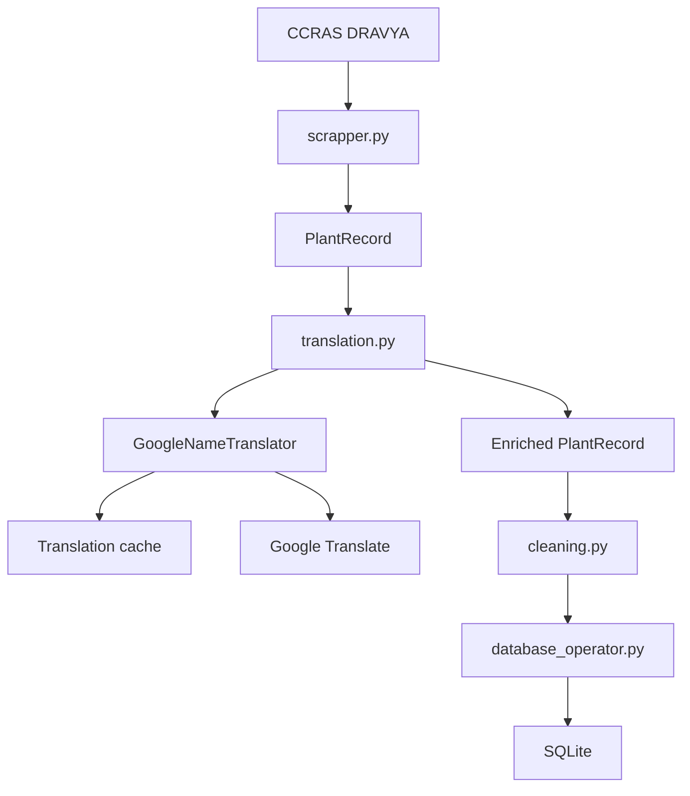

# Machine Translation and Name Enrichment (`translation.py`)

**Source module:** `src/herbal_almanac/translation.py`  
**Package:** `herbal_almanac`  
**Provider:** Google Translate through the optional `deep-translator` package

## 1. Purpose and responsibility

The `translation.py` module enriches scraped plant records with additional language representations of plant names.

The scraper collects names from CCRAS DRAVYA. Those names may be written in Sanskrit or an Indian vernacular language. Translation can make the data easier to search and explore, particularly for users who do not know the original language.

The module is responsible for:

- Translating Ayurvedic plant names into supported Indian languages.
- Translating vernacular names into English.
- Caching translation results.
- Limiting the frequency of external translation requests.
- Recording translation failures.
- Marking machine-generated translations as unverified.
- Preserving the original source values.

**Important:** Translation is an enrichment step. It does not establish botanical identity or verify the correctness of an Ayurvedic interpretation.

## 2. Position in the project architecture

Translation is optional and runs between scraping/parsing and database insertion.



When translation is disabled, the scraper can continue without making translation requests.

### Upstream dependency

- `scrapper.py` conditionally invokes translation when the translation option is enabled.
- `cleaning.py` provides the `PlantRecord` data structure and text-normalization helpers.

### Downstream dependency

- `database_operator.py` stores translated attributes and their metadata.
- `herb_attributes` can retain source-language and machine-generation information.

## 3. Imports

The module uses the following imports.

| Import | Purpose |
|---|---|
| `dataclass` | Defines the immutable translation result structure. |
| `sqlite3` | Stores and retrieves cached translations. |
| `Path` | Handles the optional cache database path. |
| `time` | Implements request throttling. |

Internal imports:

```python
from .cleaning import (
    PlantRecord,
    ascii_text,
    clean_text,
    clean_values,
)
```

These helpers ensure that translated values follow the same text-cleaning conventions as other record attributes.

The module does not import `deep_translator` at the top level. It loads that dependency only when a translation request is actually needed.

## 4. Supported languages

The module defines:

```python
INDIAN_TRANSLATION_LANGUAGES
```

This dictionary maps language names to translation-provider language codes.

| Language | Code |
|---|---|
| English | `en` |
| Assamese | `as` |
| Bengali | `bn` |
| Gujarati | `gu` |
| Hindi | `hi` |
| Kannada | `kn` |
| Malayalam | `ml` |
| Marathi | `mr` |
| Nepali | `ne` |
| Odia | `or` |
| Punjabi | `pa` |
| Sanskrit | `sa` |
| Tamil | `ta` |
| Telugu | `te` |
| Urdu | `ur` |

A reverse mapping is also constructed:

```python
LANGUAGE_CODES = {
    language: code
    for language, code in INDIAN_TRANSLATION_LANGUAGES.items()
}
```

This is used when recording the language associated with an existing vernacular name.

**Note:** `AyurvedicAlmanac.supported_languages` contains a wider set of languages than this translation module. Database support for a language does not automatically mean that the current translation module requests translations into it.

## 5. Classes

### 5.1 `TranslationResult`

```python
@dataclass(frozen=True, slots=True)
class TranslationResult:
    value: str | None
    status: str
    error: str | None
    source_language: str
```

This immutable data structure represents the outcome of a translation request.

| Field | Meaning |
|---|---|
| `value` | The translated text, or `None` if unavailable. |
| `status` | Outcome of the translation request. |
| `error` | Error description, when applicable. |
| `source_language` | Language code associated with the source text. |

The current implementation uses these statuses:

| Status | Meaning |
|---|---|
| `success` | A non-empty translation was returned. |
| `missing` | The provider returned no usable text. |
| `failed` | An exception occurred during translation. |

Keeping these outcomes separate makes it possible to distinguish an empty provider response from a failed request.

### 5.2 `GoogleNameTranslator`

```python
class GoogleNameTranslator:
    ...
```

This class handles translation requests and caching.

#### Constructor

```python
GoogleNameTranslator(
    minimum_interval: float = 0.25,
    cache_path: str | Path | None = None,
)
```

Arguments:

- `minimum_interval`: minimum delay between external translation requests.
- `cache_path`: optional SQLite database path for persistent caching.

Internal state:

| Attribute | Purpose |
|---|---|
| `_cache` | In-memory cache keyed by source text and target language. |
| `_cache_path` | Optional persistent cache database path. |
| `_minimum_interval` | Minimum time between external requests. |
| `_last_request_at` | Monotonic timestamp of the last successful provider request. |

The translator supports both in-memory caching and persistent SQLite caching.

## 6. Functions

### 6.1 `_google_translator()`

```python
_google_translator()
```

Loads the `GoogleTranslator` class from `deep_translator`.

The import is deliberately lazy.

If the optional dependency is missing, the function raises a `RuntimeError` with an installation hint:

```bash
pip install -e ".[translate]"
```

This design prevents the base package from requiring the translation dependency when translation is not being used.

### 6.2 `_load_cached(text, target)`

```python
_load_cached(
    text: str,
    target: str,
) -> TranslationResult | None
```

Looks for an existing translation.

There are two modes.

**In-memory mode**

When no persistent cache path is supplied, the method checks the dictionary using:

```python
(text, target)
```

**SQLite mode**

When a cache path is supplied, the method:

1. Opens the cache database.
2. Creates the `translation_cache` table if necessary.
3. Queries the row matching the source text and target language.
4. Returns a `TranslationResult` if found.
5. Returns `None` if no cached translation exists.

The cache table contains:

| Column | Purpose |
|---|---|
| `source_text` | Original text being translated. |
| `target_language` | Requested target language code. |
| `translated_text` | Translation result. |
| `status` | Translation status. |
| `error` | Error information, if any. |
| `source_language` | Language associated with the original text. |

The primary key is:

```text
(source_text, target_language)
```

This prevents multiple cache rows for the same input and target-language pair.

### 6.3 `translate(text, target)`

```python
translate(
    text: str,
    target: str,
) -> TranslationResult
```

Performs a translation request, using cached results whenever possible.

#### Step-by-step logic

1. Build the cache key `(text, target)`.
2. Look for a cached result.
3. If found, place it in the in-memory cache and return it.
4. Calculate the time elapsed since the last successful provider request.
5. Sleep if the minimum request interval has not elapsed.
6. Create a `GoogleTranslator` with automatic source-language detection.
7. Request the translation.
8. Clean a returned translation using `clean_text`.
9. Create a `TranslationResult`.
10. Cache the result in memory.
11. If persistent caching is enabled, store the result in SQLite.
12. Return the result.

The provider is invoked with:

```python
GoogleTranslator(
    source="auto",
    target=target,
).translate(text)
```

#### Error handling

The translation call is wrapped in exception handling.

If the provider raises an exception, the method returns a result with:

```python
TranslationResult(
    value=None,
    status="failed",
    error=str(error),
    source_language="auto",
)
```

A provider response with no translated text is represented as `missing`, not `failed`.

Both successful and unsuccessful results are cached. This prevents repeated requests for inputs that have already produced an empty response or an error.

**Operational note:** the current cache does not include an expiration policy. A cached failure may therefore remain in the persistent cache until the cache entry is replaced or the cache database is changed.

### 6.4 `_translation_result(value)`

```python
_translation_result(
    value: TranslationResult | str | None,
) -> TranslationResult
```

Normalizes the output of a translator into the `TranslationResult` structure.

- If the input is already a `TranslationResult`, it is returned unchanged.
- A non-empty string becomes a successful result.
- `None` or an empty string becomes a missing result.

This helper also makes the enrichment function easier to test with lightweight mock translators.

### 6.5 `enrich_record(record, translator)`

```python
enrich_record(
    record: PlantRecord,
    translator: GoogleNameTranslator,
) -> PlantRecord
```

This is the main public enrichment function.

It translates plant names and adds the results to the record's attributes.

It does not replace the original Ayurvedic or vernacular names.

#### Part A: Initialize English translated names

The function begins with:

```python
translated = {
    "Translated Names.English": [record.ayurvedic_name]
}
```

This makes the original Ayurvedic name available in the translated-name field as an initial value.

#### Part B: Translate the Ayurvedic name

For each supported language except English:

1. Retrieve the language code.
2. Translate the Ayurvedic name into that language.
3. Normalize the result.
4. If a translation exists, add it to the corresponding translated-name field.
5. Store metadata marking the value as machine-generated and unverified.
6. If the translation failed, append a failure description to `record.translation_failures`.

The generated attribute follows this naming pattern:

```text
Translated Names.<Language>
```

For example:

```text
Translated Names.Hindi
Translated Names.Tamil
Translated Names.Bengali
```

The current code sets the translation result's recorded source language to `sa` for these Ayurvedic-name translations.

#### Part C: Translate vernacular names into English

The function iterates through attributes beginning with:

```text
Vernacular Names.
```

For each vernacular name:

1. Extract its language from the field name.
2. Skip English values.
3. Request an English translation.
4. Record the source language using `LANGUAGE_CODES` where available.
5. Convert the translated English result using `ascii_text()`.
6. Add it to `Translated Names.English`.
7. Record machine-generated and unverified metadata.

This allows a regional-language name to contribute an additional English search representation.

#### Part D: Store translated attributes

For every translated field:

```python
record.attributes[field] = clean_values(values)
record.source_values[field] = " | ".join(record.attributes[field])
```

Finally:

```python
return record.clean()
```

The record is cleaned again so that the new attributes follow the same normalization and deduplication rules as the original attributes.

## 7. Imported functions being used

| Function | Source module | Usage |
|---|---|---|
| `clean_text()` | `cleaning.py` | Cleans provider output. |
| `clean_values()` | `cleaning.py` | Deduplicates and cleans translated values. |
| `ascii_text()` | `cleaning.py` | Converts English translations into the project's ASCII-oriented representation. |
| `PlantRecord` | `cleaning.py` | Defines the record being enriched. |

## 8. Translation metadata and trust model

Machine translations are not treated as verified facts.

A translated attribute receives metadata similar to:

```python
{
    "source_language": "sa",
    "machine_generated": True,
    "verification_status": "unverified",
}
```

The database operator persists this metadata with the attribute.

This distinction is important because a machine translation may:

- Choose an incorrect sense of a Sanskrit word.
- Produce a literal translation instead of a botanical name.
- Lose cultural or Ayurvedic context.
- Produce a plausible but inaccurate English equivalent.

The project therefore retains the original source expression and marks generated translations as unverified.

## 9. Failure handling and limitations

### Translation is optional

The project can scrape and store records without the optional translation dependency.

### Translation failures do not require record replacement

Failures are accumulated in:

```python
record.translation_failures
```

The original record remains available for persistence.

### Request throttling

The translator uses `time.monotonic()` and `time.sleep()` to enforce a minimum interval between requests.

### Cache limitations

- The cache key uses source text and target language.
- There is no cache expiration mechanism in the current implementation.
- Persistent caching uses SQLite.
- A cached failure is returned on later requests for the same key until replaced.

### Provider limitations

The module depends on an external translation service. Network availability, provider behavior, rate limits, and translation quality are outside the application's control.

The module should not be treated as an authoritative linguistic or botanical translation system.

## 10. Example usage

```python
from pathlib import Path

from herbal_almanac.database_operator import default_database_path
from herbal_almanac.translation import (
    GoogleNameTranslator,
    enrich_record,
)

translator = GoogleNameTranslator(
    minimum_interval=0.25,
    cache_path=default_database_path(),
)

# Assuming `record` is a parsed PlantRecord:
enriched_record = enrich_record(record, translator)

print(enriched_record.attributes.get("Translated Names.English"))
print(enriched_record.translation_failures)
```

A minimal mock translator can be used in tests:

```python
class MockTranslator:
    def translate(self, text: str, target: str):
        if target == "en":
            return "Holy Basil"
        return "Tulsi"
```

The mock should match the current `translate(text, target)` interface.

## 11. Related files

- `scrapper.py`
- `cleaning.py`
- `database_operator.py`
- `pyproject.toml`

## 12. Summary

`translation.py` enriches herb records with additional language representations while preserving the original data. It combines optional Google Translate requests, caching, throttling, error reporting, and explicit machine-generated metadata.

Its central design principle is that translated text can improve discoverability, but it must not silently become verified source information.
